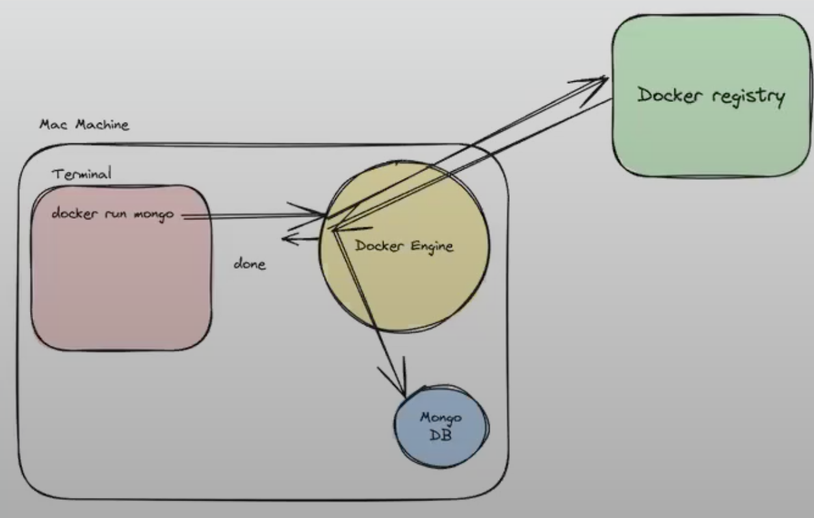
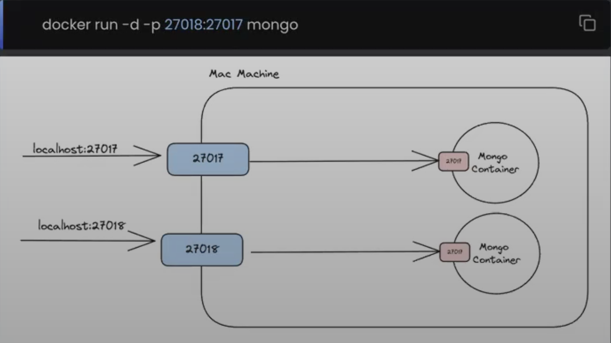

# DevOps + Networking


## 1. Cloud: what you're actually renting

| Model | You manage | Provider manages | Example |
|---|---|---|---|
| IaaS | OS, runtime, app, data | Hardware, virtualization | EC2 / Azure VM / Compute Engine |
| PaaS | App, configuration, data | OS, runtime, infrastructure | App Service / Cloud Run |
| SaaS | Users, access, settings | Application + infrastructure | GitHub / Google Workspace |

```text
VM = virtual machine with its own kernel
Container = isolated process using the host kernel
Docker Desktop = Linux containers inside a Linux VM on macOS/Windows
```

### Public vs private network

```text
Internet → public load balancer:443 → private app:8000 → private DB:5432
                                      ↓
                                 outbound NAT → Internet

Public subnet: route to an Internet gateway; access still needs IP + firewall rules
Private subnet: no direct Internet-gateway route; outbound NAT is optional
NAT: rewrites addresses/ports; it doesn't encrypt traffic
```

| Boundary | Example rule |
|---|---|
| Load balancer ingress | Allow TCP 443 from clients |
| App ingress | Allow TCP 8000 from load balancer only |
| DB ingress | Allow TCP 5432 from app only |
| SSH ingress | Allow TCP 22 from your IP/VPN/bastion |

`10.20.1.0/24` = 256 IPv4 addresses; usable count depends on the platform.

## 2. Domain + DNS

```text
api.example.com
 │      │     └── top-level domain
 │      └──────── registered domain
 └─────────────── subdomain

Domain registration ≠ DNS hosting ≠ application hosting
DNS maps names to records; it doesn't open a firewall or start a server.

Cache miss: client → recursive resolver → root → TLD → authoritative DNS
Cache hit:  resolver returns cached answer until its TTL expires
```

| Record | Purpose | Example |
|---|---|---|
| A | Name → IPv4 | api.example.com → 203.0.113.10 |
| AAAA | Name → IPv6 | api.example.com → 2001:db8::10 |
| CNAME | Name → another name | www.example.com → example.com |
| NS | Authoritative DNS servers | example.com → provider nameservers |
| MX | Mail servers | example.com → mail provider |
| TXT | Verification / email policy | SPF, domain ownership |

Query one record:

```bash
dig api.example.com A +short
```

Compare a specific resolver:

```bash
dig @1.1.1.1 api.example.com A
```

Trace delegation:

```bash
dig +trace example.com
```

Test a target IP while preserving the hostname for HTTP and TLS:

```bash
curl --resolve api.example.com:443:203.0.113.10 https://api.example.com/health
```

`--resolve` bypasses DNS for this request. Certificate validation still applies.

## 3. SSH: remote shell + tunnels

```text
Client checks server host key → server checks client authentication → encrypted session

Server host key: proves server identity; checked against known_hosts
Client private key: stays on your laptop
Client public key: installed in server ~/.ssh/authorized_keys
Server verifies a signature; your private key never leaves the client
Default transport: TCP 22
```

Generate a dedicated key; set a passphrase when prompted:

```bash
ssh-keygen -t ed25519 -f ~/.ssh/devops_lab -C "devops-lab"
```

Install the public key using existing server access; `ssh-copy-id` must be installed:

```bash
ssh-copy-id -i ~/.ssh/devops_lab.pub ubuntu@203.0.113.10
```

Connect:

```bash
ssh -i ~/.ssh/devops_lab ubuntu@203.0.113.10
```

Debug authentication/connection failures:

```bash
ssh -vvv -i ~/.ssh/devops_lab ubuntu@203.0.113.10
```

Local tunnel to a private database:

```bash
ssh -N -L 127.0.0.1:15432:db.internal:5432 -i ~/.ssh/devops_lab ubuntu@203.0.113.10
```

```text
Laptop:15432 → encrypted SSH tunnel → server → db.internal:5432
Connect your DB client to localhost:15432.
db.internal is resolved/reached from the SSH server.
SSH encrypts laptop → server; database TLS protects server → DB.
```

Verify a new server's host-key fingerprint through a trusted channel before accepting it.

## 4. Linux: process → port → logs

A running process doesn't guarantee a reachable port.

| Check | Linux | macOS |
|---|---|---|
| Listening TCP sockets | `sudo ss -lntp` | `lsof -nP -iTCP -sTCP:LISTEN` |
| Routes | `ip route` | `netstat -rn` |
| Interfaces | `ip addr` | `ifconfig` |
| Disk capacity | `df -h` | `df -h` |
| CPU / memory | `top` | `top` |

Inspect one service on a systemd server:

```bash
systemctl status nginx --no-pager
```

Read recent service logs:

```bash
journalctl -u nginx --since "10 minutes ago" --no-pager
```

```text
127.0.0.1:8000 = reachable through that network namespace's loopback only
0.0.0.0:8000   = listen on all IPv4 interfaces; reachability still needs routing/firewall
Container localhost = that container, not your laptop or another container
```

## 5. Reverse proxy: public entry point

```text
Forward proxy: client → proxy → Internet
Reverse proxy: Internet → proxy → your backend(s)

Reverse proxy responsibilities:
routing + TLS termination + optional balancing/caching/rate limits
```


### Nginx configuration

Save as `nginx.conf`. This example runs beside an `app` service in Docker Compose.

```nginx
upstream backend {
    server app:8000;
}

server {
    listen 80;
    server_name _;

    location / {
        proxy_pass http://backend;
        proxy_http_version 1.1;
        proxy_set_header Host $host;
        proxy_set_header X-Real-IP $remote_addr;
        proxy_set_header X-Forwarded-For $proxy_add_x_forwarded_for;
        proxy_set_header X-Forwarded-Proto $scheme;
        proxy_connect_timeout 3s;
        proxy_read_timeout 30s;
    }
}
```

| Choice | Effect |
|---|---|
| Multiple servers inside `upstream` | Round-robin balancing by default |
| `location /api/` + `proxy_pass http://backend;` | Preserve `/api/users` |
| `location /api/` + `proxy_pass http://backend/;` | Replace prefix: `/api/users` → `/users` |
| `proxy_connect_timeout` | Limit time establishing backend connection |
| `proxy_read_timeout` | Limit silence between backend reads; not total request duration |
| `proxy_buffering off;` | Forward streaming chunks promptly; useful for SSE/chat |

Trust forwarded headers only from your configured proxy; clients can spoof them.
WebSockets additionally need Upgrade/Connection headers.

Validate before reloading a host installation:

```bash
sudo nginx -t
```

Reload after validation succeeds:

```bash
sudo systemctl reload nginx
```

[Nginx proxy directives](https://nginx.org/en/docs/http/ngx_http_proxy_module.html).

## 6. HTTPS / TLS termination

```text
Browser ══ HTTPS ══> proxy ── HTTP or HTTPS ──> app
                    ↑
           certificate + private key

Typical full TLS 1.3 handshake:
1. Client/server exchange supported parameters + ephemeral key shares.
2. Server sends certificate and proves possession of its private key.
3. Client validates certificate chain + hostname + validity.
4. Both derive symmetric traffic keys from the shared secret.
5. HTTP requests/responses use those traffic keys on the connection.

Certificate key authenticates the server.
Ephemeral key exchange establishes the shared secret.
A new connection needs a handshake; resumption can reduce handshake cost.
```

Add inside the Nginx `server` block for HTTPS; certificate files must exist:

```nginx
listen 443 ssl;
server_name api.example.com;
ssl_certificate /etc/letsencrypt/live/api.example.com/fullchain.pem;
ssl_certificate_key /etc/letsencrypt/live/api.example.com/privkey.pem;
ssl_protocols TLSv1.2 TLSv1.3;
```

Inspect handshake and verify the certificate:

```bash
openssl s_client -connect api.example.com:443 -servername api.example.com -verify_hostname api.example.com -verify_return_error
```

TLS termination protects client → proxy. Use upstream HTTPS when proxy → app also needs encryption.
The local Compose lab below uses HTTP; it doesn't provision certificates.

[TLS 1.3 handshake specification](https://www.rfc-editor.org/rfc/rfc8446.html#section-2).

## 7. Docker: image → container

```text
docker CLI → Docker daemon → images / containers / networks / volumes
                     ↕
                  registry

Image: immutable layers + metadata
Container: image + writable layer + running process
Tag: mutable image label; digest identifies specific image content

Dockerfile change → rebuild image → recreate container
Restart alone doesn't deploy a newly built image
```



### Minimal Python app

Save as `app.py`:

```python
from http.server import BaseHTTPRequestHandler, HTTPServer

class Handler(BaseHTTPRequestHandler):
    def do_GET(self):
        ok = self.path == "/health"
        body = b"ok\n" if ok else b"not found\n"
        self.send_response(200 if ok else 404)
        self.send_header("Content-Type", "text/plain")
        self.send_header("Content-Length", str(len(body)))
        self.end_headers()
        self.wfile.write(body)

HTTPServer(("0.0.0.0", 8000), Handler).serve_forever()
```

Single-process teaching app; use your production application server for real workloads.

Save as `Dockerfile`:

```dockerfile
FROM python:3.12-slim
WORKDIR /app
COPY app.py .
USER 10001:10001
EXPOSE 8000
CMD ["python", "-u", "app.py"]
```

`EXPOSE` documents a port. It doesn't publish it.
`-u` flushes Python output promptly so container logs appear immediately.

Build:

```bash
docker build -t devops-api:local .
```

Run with a localhost-only published port:

```bash
docker run -d --name devops-api -p 127.0.0.1:8000:8000 devops-api:local
```

Test:

```bash
curl -i http://127.0.0.1:8000/health
```

### Layers + build cache

```dockerfile
# For an app with dependencies, copy the dependency file before application code.
COPY requirements.txt .
RUN pip install --no-cache-dir -r requirements.txt
COPY . .
```

| Change | Cache impact |
|---|---|
| Only app code changes | Dependency installation can stay cached |
| requirements.txt changes | Reinstall dependencies + rebuild following layers |
| Base image changes | Rebuild dependent layers |

Use `.dockerignore` to exclude `.git`, `.venv`, `__pycache__`, and `.env`.
Don't bake credentials into an image. For reproducible releases, pin dependencies and image digests.

### Port publishing



```text
-p 127.0.0.1:8080:80 = host loopback:8080 → container:80
-p 8080:80           = host interfaces:8080 → container:80 by default

Host client → published HOST port
Peer container → service name + CONTAINER port
App must listen on 0.0.0.0 inside the container for this lab
```

[Docker port publishing](https://docs.docker.com/engine/network/port-publishing/).

### Persistence

| Storage | Survives container removal? | Use |
|---|---|---|
| Container writable layer | No | Disposable runtime files |
| Named volume | Yes, until volume deletion | Database data |
| Bind mount | Host files remain | Local code/config files |
| tmpfs | No | Temporary in-memory files |

Create a named volume:

```bash
docker volume create devops-data
```

Example mount: `--mount type=volume,source=devops-data,target=/data`.
A volume persists data; it isn't a backup.

### Networks

```text
User-defined bridge: same host, container-name DNS
Default bridge: same host, no automatic container-name DNS
Overlay: multi-host networking, commonly with Swarm
Host: share host networking; platform-dependent
Compose: creates a user-defined default network for the project
```

Create a network:

```bash
docker network create devops-net
```

Attach the standalone app:

```bash
docker network connect devops-net devops-api
```

Inspect addressing and membership:

```bash
docker network inspect devops-net
```

Same-network containers can use `devops-api:8000` without publishing port 8000.
[Docker bridge networking](https://docs.docker.com/engine/network/drivers/bridge/).

## 8. One local deployment: Nginx → Python

Put `app.py`, `Dockerfile`, `nginx.conf`, and `compose.yaml` in one lab directory.
Save this as `compose.yaml`:

```yaml
services:
  app:
    build: .
    healthcheck:
      test: ["CMD", "python", "-c", "import urllib.request; urllib.request.urlopen('http://127.0.0.1:8000/health', timeout=2)"]
      interval: 5s
      timeout: 3s
      retries: 3

  proxy:
    image: nginx:stable-alpine
    ports:
      - "127.0.0.1:8080:80"
    volumes:
      - ./nginx.conf:/etc/nginx/conf.d/default.conf:ro
    depends_on:
      app:
        condition: service_healthy
```

Validate configuration:

```bash
docker compose config -q
```

Build and start:

```bash
docker compose up -d --build --wait
```

```text
curl localhost:8080/health
 → host port 8080
 → proxy container:80
 → Docker DNS resolves app
 → app container:8000
 → 200 ok

App has no host-published port. Proxy reaches it over the Compose network.
depends_on waits for initial health; it doesn't implement ongoing failure recovery.
```

Check the complete route:

```bash
curl -i http://127.0.0.1:8080/health
```

Check upstream directly from the proxy:

```bash
docker compose exec proxy wget -qO- http://app:8000/health
```

Inspect application logs:

```bash
docker compose logs --tail 50 app proxy
```

Inspect CPU/memory/network usage:

```bash
docker stats --no-stream
```

After editing app code, rebuild and recreate:

```bash
docker compose up -d --build --force-recreate --wait
```

Recreate the proxy too: this simple Nginx config resolves the app's IP at startup.

Stop and remove this project's containers/network; named volumes remain:

```bash
docker compose down
```

`nginx:stable-alpine` and `python:3.12-slim` are convenient lab tags. Pin digests for releases.

## 9. Debug in request order

```text
DNS → route → TCP port → TLS → proxy → application → database
Stop at the first failing boundary.
```

| Symptom | Check | Likely causes |
|---|---|---|
| Name doesn't resolve | `dig api.example.com A` | Missing record, wrong resolver, stale cache |
| Connection refused | `nc -vz 127.0.0.1 8080` | No listener or active rejection |
| Connection times out | `nc -vz -w 3 api.example.com 443` | Packet drop, route/firewall, overload |
| Certificate error | `openssl s_client ...` | Wrong hostname, expired cert, missing chain |
| 502 from proxy | Proxy error log + direct upstream request | App unavailable, wrong port, invalid upstream response |
| 504 from proxy | Upstream duration + timeout settings | Slow app/DB or stalled upstream |
| Works on host, fails in container | Container DNS/network + target hostname | `localhost` points to the container |
| Changes don't appear | Image/build + recreated container | Old image or old running container |
| Container exits | `docker logs devops-api` | Startup exception, missing config, process exit |

Break total request time into cumulative milestones:

```bash
curl -sS -o /dev/null -w 'dns=%{time_namelookup}s connect=%{time_connect}s tls=%{time_appconnect}s first_byte=%{time_starttransfer}s total=%{time_total}s\n' https://api.example.com/health
```

```text
TCP phase ≈ connect - dns
TLS phase ≈ tls - connect
Wait for first byte ≈ first_byte - tls
Use a fresh connection when comparing these timings.
```

Capture only relevant packets on a Linux server; packet capture may contain sensitive data:

```bash
sudo tcpdump -ni any -c 20 'tcp port 443'
```

## 10. Deployment rules worth remembering

```text
Build once → test image → push version/digest → deploy same image
Health check fails → investigate/roll back; don't send traffic blindly
Rollback → redeploy previous known-good image
Database changes → keep schema compatible with old/new app during rollout

Logs:      request_id, service, route, status, duration_ms, error
Metrics:   request rate, error rate, latency p95/p99, CPU, memory, DB pool wait
Secrets:   inject at runtime; don't commit or print them
Timeouts:  coordinate client/proxy/app/DB budgets; leave time to return an error
Retries:   bounded + backoff + jitter; writes need idempotency
```


