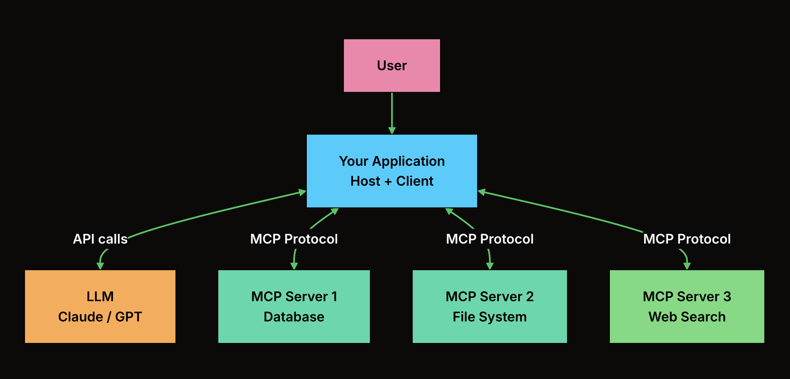

# RAG

- **Retrieval-Augmented Generation:** retrieve relevant evidence, add it to the prompt, and generate a grounded answer with citations.
- Documents provide knowledge; APIs/databases provide live operational values.

## End-to-end flow

```text
Indexing: documents → parse/OCR → clean → chunk → enrich → lexical + vector indexes
Query: question → scope/resolve entities → hybrid search → rerank → assemble context → answer
```

## Chunking: what to use when

| Strategy | Useful for | Trade-off |
| --- | --- | --- |
| Fixed token windows + overlap | Fast baseline for plain text | Cheap; can split a definition from its qualification |
| Recursive splitting | General prose; paragraph → sentence → token boundaries | Simple; doesn't understand document meaning |
| Structure-based | Manuals, policies, SOPs; split by headings/sections | Preserves organization |
| Semantic splitting |split at topic changes | More preprocessing and tuning |
| Parent-child | Retrieve precise passages, then include the containing section | Better surrounding context; larger prompts |
| Table/layout-aware | Specifications, limits, scanned PDFs | Preserve headers, units, captions; parsing is harder |
| Whole item | Short FAQs, definitions, small incident records | Keep question/answer together; unsuitable for long mixed topics |

- Small chunks improve passage precision but can lose context; large chunks preserve context but introduce noise.
- Use overlap where boundaries cut meaning; excessive overlap duplicates results and increases storage.
- Example starting experiment: roughly 500-token chunks, then tune size/overlap against real questions. No universal optimum.

Reference: [Microsoft's chunking guide](https://learn.microsoft.com/en-us/azure/search/vector-search-how-to-chunk-documents).

## Building an organization/industry knowledge base

- **Parse first:** recover headings, reading order, tables, units, and diagram captions; remove repeated headers/footers.
- **Keep provenance:** chunk/document IDs, parent section, page, source link, version, effective date, owner, and permissions.
- **Add domain metadata:** product/model, component, error code, site, document type, language.
- **Resolve terminology:** maintain aliases/acronyms; preserve exact identifiers. Don't equate different models or revisions.
- **Update incrementally:** detect changed documents; replace their affected chunks and remove obsolete/deleted entries. Propagate permission changes too.

Reference: [Microsoft's enrichment guide](https://learn.microsoft.com/en-us/azure/architecture/ai-ml/guide/rag/rag-enrichment-phase).

## Searching: choices and trade-offs

- **Keyword/BM25:** useful for error codes, part numbers, exact terms; weaker on paraphrases.
- **Vector:** useful for similar meaning and vocabulary mismatch; can confuse near-identical identifiers.
- **Hybrid:** retrieve both, fuse ranks (for example, RRF); adds indexing/query work.
- **Reranking:** score question/passage pairs over a shortlist; improves ordering at extra latency/cost.
- **Filters:** enforce authorization and confirmed model/version constraints before evidence reaches the LLM. Guessed filters can hide the answer.
- **Query rewriting:** resolve “that machine” using conversation context; keep original identifiers. Decompose multi-part questions only when needed.
- **Graph retrieval:** useful for explicit equipment/component relationships; requires entity resolution and maintained edges. Add when ordinary retrieval misses relationship questions.

Reference: [Microsoft's retrieval design guide](https://learn.microsoft.com/en-us/azure/architecture/ai-ml/guide/rag/rag-information-retrieval).

## Augmentation: what goes into the prompt

- **At indexing:** attach title/section context to isolated chunks before embedding and keyword indexing. LLM-generated descriptions need checks; retain original text.
- **At query time:** deduplicate passages, add necessary parent/neighbor context, and fit evidence into a token budget.
- Include source IDs, revision/date, and relevant table headers/units. Require citations; expose conflicting evidence or missing support.
- Retrieved text is evidence, not instructions. More retrieved text isn't automatically better.

Reference: [Anthropic's contextual retrieval](https://www.anthropic.com/engineering/contextual-retrieval).

## Practical implementation by data type

- **Documents/PDFs:** Extract embedded text; use OCR for scanned pages/image text and vision transcription for complex tables or diagrams. Clean and split by sections/paragraphs, keeping table headers, units, page numbers, and parent references together.
- **Document storage/search:** Keep originals in object storage and metadata/permissions in a database. Index chunk text + contextual metadata for keyword search and embeddings for semantic search; retrieve with filters and hybrid search, then rerank if useful. Re-index changed chunks and remove deleted ones.
- **Tables/operational records:** Keep typed rows in the source database or a queryable replica; retain schema, keys, relationships, and timestamps. Generate and validate read-only SQL/search queries for row lookup, joins, filters, and aggregates. Search descriptive fields lexically or with vectors where useful; whole short records can be retrieval units.
- **Clicks/events:** Ingest incrementally with event ID, user/session ID, event time, type, and properties; deduplicate and store in an event store or analytics database. Query the full scoped data for counts, funnels, conversion rates, and trends. For narrative retrieval, group related events by session/entity/time window and retain links to the original events.
- **Mixed questions/answers:** Route each part to document search or structured queries. Example: calculate checkout conversion from events, then retrieve release notes for context. Give the LLM relevant passages and computed results within a token budget; cite documents and identify query scope/time range. Top-k passages cannot provide exhaustive counts, and correlation alone doesn't establish a cause.
- **Evaluate:** evidence recall@k, answer correctness, citation support, freshness, permission isolation, latency, and cost. Diagnose parsing/retrieval failures before changing the generator.

# Agent Design

## Creating an agent

- **System prompt:** purpose, boundaries, response rules.
- **Tools:** name, description, argument schema, and application function.
- **Memory:** task context and relevant information from previous interactions.
- **Orchestrator:** builds context, calls the model, executes tools, and repeats.

The model requests actions; application code validates and executes them. Use a fixed workflow when the steps are predictable.

## Tool orchestration

```text
while not done:
    response = call_llm(messages, tools)
    messages.append(response)
    if response has tool_calls:
        results = execute_tools(response.tool_calls)
        messages.extend(results)
    else:
        return response
```

Apply iteration, time, and cost limits; stop when repeated actions make no progress.

Conversation roles: **user, assistant, tool**. System instructions are separate configuration. Chat displays user messages and final assistant answers; internal tool exchanges remain stored.
Each call = system prompt + summary + recent messages

Based on [Oracle's agent-loop overview](https://blogs.oracle.com/developers/what-is-the-ai-agent-loop-the-core-architecture-behind-autonomous-ai-systems).

## Storage

- **Working memory:** active task state, recent messages, tool results, conversation summary.
- **Long-term Procedural memory:** durable facts, preferences, and profile attributes across sessions, scoped to user and agent, reusable lessons, strategies.

These can share a database. Vector search is an optional retrieval mechanism for Long term memory store.

## Managing working memory

Persist full history; assemble a bounded subset for each model call:

```text
Context = system instructions + relevant saved memory
        + older-conversation summary + recent messages + active task state
```

- **Messages:** preserve roles, order, tool-call IDs, and results.
- **Task state:** goal, selected entities, completed steps, pending actions.
- **Summary:** decisions, constraints, unresolved questions, and source references.
- **Compaction:** summarize older completed turns when the token budget is exceeded. Keep the current tool exchange intact.
- **Retrieval:** fetch original records when a summary lacks necessary detail.

## Creating long-term factual memory / procedural memory

**Extract → validate → consolidate → store → retrieve → revise.**

- Extract durable candidates after a turn; prioritize explicit preferences and confirmed facts.
- Keep source, timestamp, scope, and expiry where appropriate.
- Merge duplicates; handle corrections and conflicting evidence explicitly.
- Retrieve relevant, authorized, unexpired facts before a new turn.

This lifecycle follows [Oracle's memory-management overview](https://blogs.oracle.com/developers/agent-memory-is-a-database-problem-oracle-research-makes-the-case).

Practical example:

- “Use bar for pressure readings” → save a preference.
- “Pressure is 1.2 bar right now” → keep as a timestamped observation; refresh before using it as current data.
- “Use psi instead” → replace the active preference, retaining its correction source.
- “For timeout errors, check service health before retrying.”

Deleting a fact must also invalidate summaries or indexes that would retrieve it again.

Treat a proposed lesson as a candidate. Validate against outcomes, specify when it applies, version it, and retire rules that cause failures. Learned procedures don't override application permissions.

Application decides when saving happens.
- Agent-driven: Expose a save_memory tool. Describe in the system prompt what qualifies for saving. The model proposes a memory; the tool validates and stores it.
- Application-driven: After a completed turn/task, run a separate extraction step. Give an LLM the conversation, tool outcomes, and extraction instructions. Application code validates and saves its candidates.

## Logging agent execution

Use **one trace per run**, with child spans for model calls, tools, and memory operations.

| Operation | Record |
| --- | --- |
| Run | Run/session IDs, start/end, outcome, stopping reason |
| Model call | Step, model/prompt version, input/output tokens, duration |
| Tool call | Tool and call ID, sanitized argument/result references, status, retries, duration |
| Memory | Retrieved record IDs, summary version, context size, updates |

Example trace: **run started → memory retrieved → model requested tool → tool succeeded → model answered → run completed**.

Keep payloads in access-controlled storage; logs reference them. Don't log credentials or hidden reasoning. Track task success, failure rate, latency, cost, and repeated calls. Turn failed traces into regression cases to verify improvements.

---


 # MCP (Model Context Protocol)

  

**Purpose**: A **standard protocol** that defines **how an LLM can call external tools/APIs**

Without MCP: Agent → your custom GitHub integration → GitHub API.  
With MCP: Agent → MCP client → GitHub MCP server → GitHub API
- Without MCP, you write each integration’s tool definitions and execution adapter.  
- With MCP, compatible servers expose tools through a shared interface.
- You still need authentication, permissions, and application logic.
2. How it fits with Claude tool calling
    1. Application asks MCP server: tools/list
    2. Server returns tool names, descriptions, and input schemas.
    3. Application supplies those definitions to Claude's tools parameter.
    4. Claude returns a tool_use request.
    5. Application forwards it through MCP: tools/call.
    6. MCP server executes the operation and returns its result.
    7. Application sends the result to Claude as tool_result.
    8. Claude continues or answers.

  


 - A single host usually manages multiple MCP clients. For example, a coding assistant might maintain separate clients for filesystem access, GitHub, package documentation, and a database schema server.

**MCP client**

  - The **MCP client** resides within the host and is responsible for making requests to external tools and data sources. It acts on behalf of the AI model and maintains 1:1 connections with the server while residing inside the host.
    The client is the protocol handler inside the host. In the standard architecture, one client manages one connection to one MCP server. Its job is deliberately narrow:

    - Establishing the connection to a server (via stdio or HTTP)
  Performing capability discovery (asking the server what tools, resources, and prompts it offers).
  Sending requests when the host decides to use a server capability.
  Receiving responses and passing them back to the host
  The 1:1 relationship keeps failures and permissions easier to reason about. If one server crashes or becomes unresponsive, the host can degrade that connection without tearing down every other integration.


   - MCP clients will use the **`*/list`** methods to discover available primitives.

        **Clients exposed primitives**:

        - **Sampling**: Allows servers to request language model completions from the client’s AI application. This is useful when servers’ authors want access to a language model, but want to stay model independent and not include a language model SDK in their MCP server. They can use the **`sampling/complete`** method to request a language model completion from the client’s AI application.
        - **Elicitation**: Allows servers to request additional information from users. This is useful when servers’ authors want to get more information from the user, or ask for confirmation of an action. They can use the **`elicitation/request`** method to request additional information from the user.
        - **Logging**: Enables servers to send log messages to clients for debugging and monitoring purposes.


  **Why build your own MCP client?**
  You build your own MCP client when you need custom behavior such as authorization, logging, tool filtering, workflow orchestration, retries, or integration into your own application.

  **Doesn't Claude Code already have an MCP client?**
  Yes, tools like Claude Code, Claude Desktop, and Cursor already include MCP clients, but they are general-purpose hosts and don't provide the custom business logic and control that a dedicated application may require.

  The Architecture: Where Your Client Fits
  Before writing code, get the boundary right. MCP has three roles: the host (your application), the client (the MCP protocol handler inside the host), and the server (the capability provider). When you build a custom MCP client in an application, you are usually building both the host and the client.

  Here is how everything connects when you wire MCP into an LLM application:
  


 **MCP server**

  - The **MCP server** exposes an external tool or data source (like a database, API, or local file system). It serves information and capabilities to the client in a standardized format that the AI can understand. The server is where the external capability is exposed. It may wrap a local command, a SaaS API, a database, a document store, an internal service, or a workflow. Servers can run locally as subprocesses of the host for sandboxing coding, or remotely behind an HTTP endpoint.

    -  A file system server that reads, writes, and searches local files
    - A GitHub server that lists repos, reads code, and creates pull requests
    - A PostgreSQL server that executes queries and exposes schema information
    - A Slack server that sends messages and reads channels

    
    Servers expose capabilities through MCP primitives, The Three Primitives:


  - **Resources: Exposing Data**Resources represent data a client can read and provide as context. Think of them as documents with stable URIs. A filesystem server might expose files. A database server might expose schemas. An API documentation server might expose endpoint specs.

    Resources are identified by URIs, like file:///home/user/notes.txt or db://products/schema. Clients can list available resources, read their contents, and optionally subscribe to changes (for resources that update over time).


    ```python
    from mcp.server.fastmcp import FastMCP

    mcp = FastMCP("docs-server")

    @mcp.resource("docs://api/endpoints")
    def get_api_docs() -> str:
        """Return the current API endpoint documentation."""
        return load_api_documentation()

    @mcp.resource("docs://changelog/{version}")
    def get_changelog(version: str) -> str:
        """Return the changelog for a specific API version."""
        return load_changelog(version)
    ```
  - **Tools: Performing Actions** Tools are callable operations. They might search files, execute a query, send a message, create a pull request, or run a calculation. Each tool has a name, description, and input schema.

    Tools are model-visible and may have side effects. Writing a file, sending an email, or deleting a record should be modeled as a tool, not a resource. Hosts should show which tools are available and require confirmation for sensitive operations. The protocol recommends human control; the host enforces it.

    ```python
    @mcp.tool()
    def search_codebase(query: str, file_type: str = "") -> str:
        """Search the codebase for files matching a query.

        Args:
            query: Search term to look for in file contents.
            file_type: Optional file extension filter (e.g., '.py', '.js').
        """
        results = perform_search(query, file_type)
        return format_results(results)
    ```
  - **Prompts: Reusable Templates**
    Prompts are reusable prompt templates that a server offers to clients. A code review server might provide a "review this pull request" prompt. A database server might provide an "optimize this query" prompt with the right diagnostic sequence. Prompts are normally user-controlled. They are often exposed as slash commands, menu items, or workflow templates. They shape how the model approaches a task; they do not execute work by themselves.

    ```python
    @mcp.prompt()
    def code_review(language: str, code: str) -> str:
        """Guide the AI through a structured code review.

        Args:
            language: Programming language of the code.
            code: The code to review.
        """
        return f"""
                Review the following {language} code. Analyze it for:
                1. Correctness: Are there any bugs or logic errors?
                2. Performance: Are there any obvious inefficiencies?
                3. Readability: Is the code clear and well-structured?
                4. Security: Are there any security vulnerabilities?

                Code to review:
                {code}
                Provide specific, actionable feedback for each category.
            """
    ```


### MCP layers

**1. Data layer — what is communicated**

Uses **JSON-RPC 2.0** to define requests, responses, errors, and notifications.

- **Discovery:** Learn supported protocol versions and capabilities.
- **Primitives:** Discover and use **tools**, **resources**, and **prompts**.
- **Notifications:** Report changes, such as updated tool lists. The client can refresh its available tools.

**2. Transport layer — how messages travel**

- **stdio:** The host starts a local MCP server process. The client writes requests to its standard input and reads responses from standard output.
- **Streamable HTTP:** Connects to a server over HTTP. Uses POST for requests and can use **SSE** to stream messages. Supports authenticated remote access.

```text
Operation:  tools/call("get_order", arguments)
Format:     JSON-RPC 2.0 request
Transport:  stdio or Streamable HTTP
```

**HTTP carries the messages; MCP defines their meaning.**

  ### MCP vs Function Calling

  **Function Calling** allows an LLM to generate structured requests to invoke specific tools or functions defined by an application. However, the tools must be manually defined and managed by the developer.

  **MCP (Model Context Protocol)** is a standard protocol that enables applications to dynamically discover, describe, and access tools, resources, and prompts from external servers.

  **How they work together:**

  1. MCP discovers available tools.
  2. The tools are converted into the model's function-calling format.
  3. The LLM selects a tool using function calling.
  4. The request is executed through MCP.

  **What MCP adds beyond Function Calling:**

  * Dynamic tool discovery
  * Standardized integrations
  * Reusable tools across applications
  * Built-in versioning and capability negotiation
  * Separation of tool logic from application code

  **In short:** Function calling tells the model *how to use a tool*, while MCP defines *how tools are shared, discovered, and accessed*.

