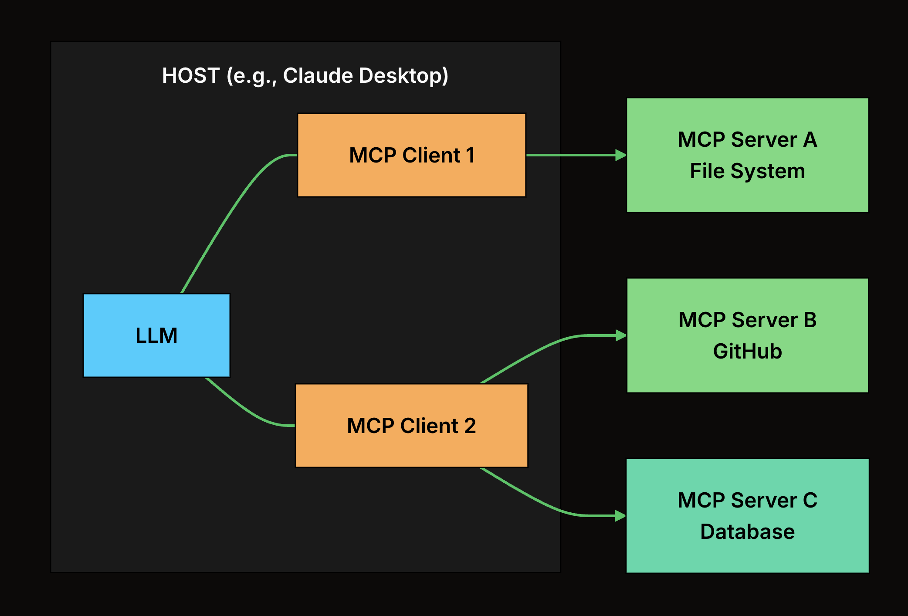
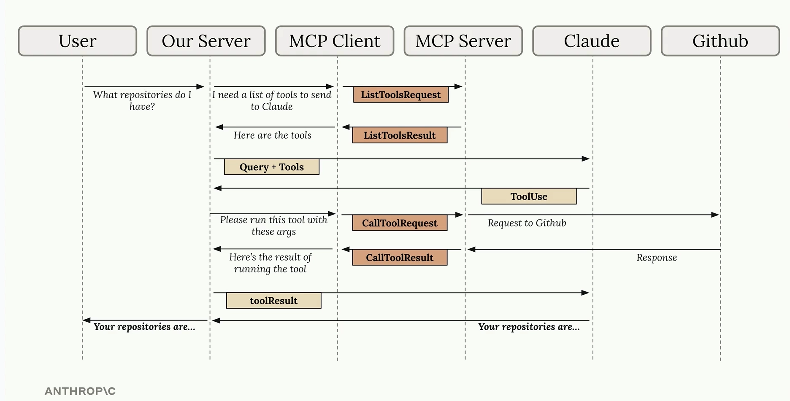
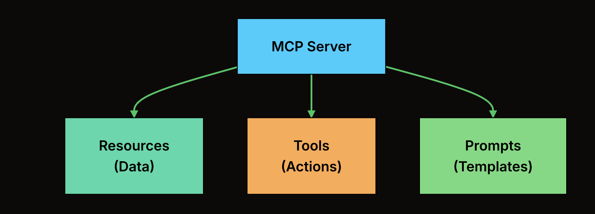
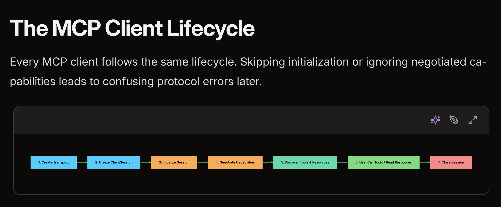

# GenAI Engineering Guide

Everything for AI-engineering interviews and GenAI system design in one page: LLM fundamentals → prompting → calling an LLM API → tool calling → agents (loop, memory, tracing) → MCP → RAG in depth → evaluation → fine-tuning → serving, cost, safety → system design problems → interview Q&A.

Related: [HLD guide](hld-interview-guide.md) · [LLD guide](lld-interview-guide.md) · [concurrency guide](concurrency-interview-guide.md)

**Code conventions:**
- Blocks tagged `python` are **standard library only and runnable** (they use a fake model where an LLM would go, so you can see the mechanics).
- Blocks tagged `py` call the real Claude API with the official `anthropic` SDK (`pip install anthropic`, credentials from `ANTHROPIC_API_KEY` or `ant auth login`). Model IDs current as of Oct 2026: `claude-opus-5-5` (default), `claude-sonnet-5-5`, `claude-haiku-5-5`.

## Index

- [1. What gets asked](#1-what-gets-asked)
- [2. LLM fundamentals](#2-llm-fundamentals)
- [3. Prompting](#3-prompting)
- [4. Calling an LLM API](#4-calling-an-llm-api)
- [5. Tool calling (function calling)](#5-tool-calling-function-calling)
- [6. Agents](#6-agents)
- [7. MCP (Model Context Protocol)](#7-mcp-model-context-protocol)
- [8. RAG in depth](#8-rag-in-depth)
- [9. Evaluation](#9-evaluation)
- [10. Prompting vs RAG vs fine-tuning](#10-prompting-vs-rag-vs-fine-tuning)
- [11. Serving and inference](#11-serving-and-inference)
- [12. Cost and latency optimization](#12-cost-and-latency-optimization)
- [13. Safety and security](#13-safety-and-security)
- [14. System design problems](#14-system-design-problems)
- [15. Interview Q&A](#15-interview-qa)
- [16. References](#16-references)

---

## 1. What gets asked

| Round | Typical questions |
|---|---|
| Concepts | Tokens, context window, embeddings, temperature, hallucination, RAG vs fine-tuning, how attention works (high level) |
| Applied/coding | Build a mini RAG; write an agent loop with tools; chunk documents; compute retrieval metrics; parse structured output |
| GenAI system design | Design a chatbot, enterprise document Q&A, customer-support agent, coding agent, LLM gateway, semantic search |
| Production | Latency/cost optimization, evals, guardrails, prompt injection, observability, scaling inference |
| Past projects | Deep dive into agent/RAG work you've done: why each choice, how you measured quality |

**SDE2 bar:** you can build a reliable LLM feature end to end — not just call an API — and you talk about **evaluation, failure modes, cost, and latency** without being asked.

---

## 2. LLM fundamentals

### 2.1 What an LLM does

- A large language model is a neural network (a **transformer**) trained to **predict the next token** given previous tokens.
- **Pre-training:** next-token prediction on huge text corpora → general knowledge and language ability.
- **Post-training:** instruction tuning (SFT on prompt/response pairs) + preference tuning (RLHF / RLAIF / DPO) → follows instructions, safer, more helpful.
- Generation is **autoregressive**: produce one token, append it, predict the next, until a stop token or `max_tokens`.

### 2.2 Tokens and tokenization

- Text is split into **tokens** (sub-word pieces via BPE/SentencePiece). Rough rule for English: **1 token ≈ 4 characters ≈ 0.75 words**. Code, numbers, and non-English text often use more tokens.
- Everything is priced and limited in tokens: input tokens, output tokens, context window.
- Different models have different tokenizers → token counts differ for the same text. Count with the provider's token-counting API, not a guess.
- Tokenization explains some failures: counting letters in a word, arithmetic on long numbers, exact string manipulation.

### 2.3 Context window

- The maximum tokens the model can attend to in one request (input + output). Current frontier models: up to ~1M tokens.
- Bigger context ≠ better answers: cost and latency grow with input size, and models can miss details buried in long contexts ("lost in the middle"). Retrieval + curation usually beats stuffing.
- The model has **no memory between requests** — every call must include whatever context it needs (conversation history, retrieved documents, tool results).

### 2.4 Transformer and attention (high level is enough)

- Input tokens → **embeddings** (vectors) + position information.
- **Self-attention:** each token computes a weighted mix of all previous tokens' representations. Weights come from query·key similarity: `softmax(QKᵀ/√d)·V`.
- **Multi-head attention:** several attention "views" in parallel. Stacked with feed-forward layers, many times.
- Attention cost grows **quadratically** with sequence length (compute), which is why long contexts are expensive.
- **KV cache:** during generation, keys/values of past tokens are stored so each new token only computes attention for itself → faster decoding, but memory grows with context length × batch size.

### 2.5 Sampling and decoding

- The model outputs a probability distribution over the vocabulary for the next token.
- **Greedy:** always the most likely token (deterministic, can be repetitive).
- **Temperature:** scales the distribution; low = focused/deterministic, high = diverse/creative.
- **Top-p (nucleus):** sample only from the smallest set of tokens whose probabilities sum to p. **Top-k:** only the k most likely.
- **Stop sequences / max tokens** end generation.
- Note for current Claude models: sampling parameters (`temperature`, `top_p`, `top_k`) are no longer accepted on the newest models — you control behavior through prompts, **effort**, and structured outputs instead. Know the concepts anyway; other providers and open models still use them.

### 2.6 Reasoning ("thinking") models

- Models can spend extra tokens reasoning before the final answer (chain of thought done internally). Better on math, code, multi-step planning, agentic tasks.
- Costs: more output tokens and latency. Controlled with an **effort** level (low → max) on current Claude models.
- Use high effort for hard reasoning and coding; low effort for classification, extraction, chat.

### 2.7 Embeddings

- An **embedding** maps text (or images) to a fixed-length vector (e.g., 768–3,072 dimensions) such that similar meanings are close.
- Similarity: **cosine similarity** `a·b / (|a||b|)` (or dot product on normalized vectors).
- Uses: semantic search, RAG retrieval, clustering, deduplication, recommendations, classification features, semantic caching.
- Embedding models are separate, smaller models than chat LLMs. Use the **same model** for documents and queries; re-embed everything if you change models.

### 2.8 Hallucination

- The model generates fluent but false content — it predicts plausible text, it doesn't look facts up.
- Causes: missing knowledge, outdated knowledge (training cutoff), ambiguous prompts, pressure to answer.
- Mitigations: **grounding** with retrieved evidence (RAG) and live tools; require **citations**; allow "I don't know"; structured outputs; verification steps; evals that measure faithfulness.

### 2.9 Model choice

| Factor | Bigger/frontier model | Smaller/faster model |
|---|---|---|
| Quality on hard tasks | Best | Weaker |
| Latency | Higher | Lower |
| Cost per token | Higher | Much lower |
| Good for | Agents, coding, complex reasoning | Classification, routing, extraction, high-volume simple tasks |

Common pattern: **route** easy requests to a small model and hard ones to a big model — but first measure whether the big model at low effort is good enough (one model is simpler and keeps one cache).

---

## 3. Prompting

### 3.1 Structure of a request

- **System prompt:** role, goals, rules, output format, constraints. Stable across requests (cache it).
- **Messages:** alternating `user` and `assistant` turns (plus tool calls and tool results).
- **Context:** retrieved documents, user profile, tool outputs — clearly delimited.

### 3.2 Techniques that work

- **Be explicit and specific:** task, audience, format, length, what to do when unsure.
- **Give context and the "why":** models follow rules better when they know the reason.
- **Delimit inputs** with tags: `<document>...</document>`, `<question>...</question>` — separates instructions from data.
- **Few-shot examples:** 2–5 input/output examples for format and edge cases (diverse, not repetitive).
- **Ask for reasoning or use thinking** on multi-step problems; ask for the final answer in a fixed format.
- **Structured output:** JSON schema enforced by the API (structured outputs) rather than "please return JSON".
- **Decompose:** chain several focused calls (extract → analyze → write) instead of one giant prompt.
- **Allow abstention:** "If the answer isn't in the documents, say you don't know."
- **Positive instructions** ("write in plain prose") work better than long lists of don'ts.

### 3.3 Prompt engineering as engineering

- Version prompts like code; store `prompt_version` with every response.
- Change one thing at a time and measure on an eval set (see [section 9](#9-evaluation)).
- Keep the stable prefix stable (system prompt, tool definitions) → prompt caching works.
- Treat retrieved content and tool results as **data, not instructions** (prompt injection, [section 13](#13-safety-and-security)).

---

## 4. Calling an LLM API

### 4.1 Basic call (Claude, Python SDK)

```py
import anthropic

client = anthropic.Anthropic()          # reads ANTHROPIC_API_KEY or an `ant auth login` profile

response = client.messages.create(
    model="claude-opus-5-5",
    max_tokens=16000,
    system="You are a concise assistant for industrial equipment engineers.",
    messages=[{"role": "user", "content": "What does a chamber pressure alarm usually indicate?"}],
)
for block in response.content:          # content is a list of typed blocks
    if block.type == "text":
        print(block.text)
print(response.usage.input_tokens, response.usage.output_tokens, response.stop_reason)
```

Things to know:
- `stop_reason`: `end_turn` (done), `max_tokens` (truncated — raise the limit), `tool_use` (wants a tool), `refusal` (declined by safety classifiers), `pause_turn` (server tool paused).
- `usage` gives tokens for cost tracking.
- The SDK retries 408/409/429/5xx and connection errors (2 retries by default).

### 4.2 Streaming (needed for chat UIs)

```py
with client.messages.stream(
    model="claude-opus-5-5",
    max_tokens=64000,
    messages=[{"role": "user", "content": "Explain RAG in 5 bullet points."}],
) as stream:
    for text in stream.text_stream:     # tokens as they arrive → forward over SSE to the browser
        print(text, end="", flush=True)
    final = stream.get_final_message()  # full message + usage at the end
```

- Users see the first words in ~1 s instead of waiting for the whole answer (**time to first token**).
- Server → browser usually over **SSE**: each chunk as `data: {...}\n\n`; give events IDs so a reconnecting client can resume (`Last-Event-ID`).
- Long outputs should always be streamed (avoids HTTP timeouts).

### 4.3 Structured outputs

```py
from pydantic import BaseModel

class Ticket(BaseModel):
    category: str
    priority: str
    summary: str

response = client.messages.parse(
    model="claude-opus-5-5",
    max_tokens=16000,
    messages=[{"role": "user", "content": "Classify: 'Checkout page crashes on submit since this morning.'"}],
    output_format=Ticket,
)
ticket = response.parsed_output        # validated Ticket instance
```

- The API constrains generation to the schema → no fragile regex parsing.
- Still validate business rules (allowed categories, ranges) in code.

### 4.4 Prompt caching

```py
response = client.messages.create(
    model="claude-opus-5-5",
    max_tokens=16000,
    system=[{
        "type": "text",
        "text": LONG_STABLE_INSTRUCTIONS_AND_REFERENCE_DOCS,
        "cache_control": {"type": "ephemeral"},          # cache everything up to here
    }],
    messages=[{"role": "user", "content": question}],
)
print(response.usage.cache_read_input_tokens)             # > 0 on later calls = cache hit
```

- Caching is a **prefix match**: tools → system → messages. Any byte change in the prefix invalidates what follows.
- Put stable content first; never put timestamps/request IDs in the cached part.
- Cache reads cost ~10% of normal input tokens → big savings for long system prompts, tool lists, and multi-turn chats.

### 4.5 Errors, retries, fallbacks

```py
import anthropic

try:
    response = client.messages.create(model="claude-opus-5-5", max_tokens=1024,
                                      messages=[{"role": "user", "content": "hi"}])
except anthropic.RateLimitError as e:          # 429: back off, honor retry-after
    retry_after = int(e.response.headers.get("retry-after", "30"))
except anthropic.APIStatusError as e:          # other HTTP errors
    if e.status_code >= 500:
        ...                                    # transient: retry later / fall back
    else:
        raise                                  # 4xx: a bug in the request; don't retry
except anthropic.APIConnectionError:
    ...                                        # network: retry with backoff
```

- Retry only transient errors (429, 5xx, connection), with exponential backoff + jitter, bounded attempts.
- Production patterns: per-provider **circuit breaker**, fallback model, request timeouts, per-tenant rate limits, idempotency for side-effecting tool calls.
- Always check `stop_reason` before using `content` (truncation and refusals return HTTP 200).
- Current Claude API option: a server-side fallback when a request is declined (`stop_reason: "refusal"`):

```py
response = client.beta.messages.create(
    model="claude-opus-5-5",
    max_tokens=16000,
    betas=["server-side-fallback-2026-07-01"],
    fallbacks="default",                      # server reroutes declined requests by category
    messages=[{"role": "user", "content": "..."}],
)
if response.stop_reason == "refusal":
    ...                                        # still declined: show a safe message
```

---

## 5. Tool calling (function calling)

### 5.1 How it works

1. You send the model a list of **tools**: name, description, JSON schema for inputs.
2. The model decides whether to call one; it returns a `tool_use` block with arguments (it **does not execute** anything).
3. **Your code** validates the arguments, runs the function, and sends back a `tool_result` with the same `tool_use_id`.
4. The model continues — calls more tools or writes the final answer.

```text
user → model → tool_use(get_order, {"id": 42}) → your code runs get_order → tool_result → model → answer
```

### 5.2 Designing good tools

- **Clear names and descriptions** — the description is the prompt for when/how to use the tool. Say what it returns and when *not* to use it.
- **Few, well-separated tools** beat many overlapping ones (the model picks wrong when tools look similar).
- **Typed, constrained inputs:** enums, required fields, formats; `strict: true` guarantees schema-valid arguments.
- **Return compact, useful results:** IDs + key fields, not 50 KB of raw JSON (context is precious). Paginate.
- **Errors as results:** return `is_error: true` with a helpful message ("order 42 not found; ask the user for the order number") so the model can recover.
- **Side effects need guardrails:** confirmation for destructive actions, idempotency keys, permissions checked in code — never trust the model's arguments for authorization.
- **Parallel tool calls:** one response can request several tools; run them concurrently and return **all results in one message**.

### 5.3 Manual tool loop (Claude)

```py
import json
import anthropic

client = anthropic.Anthropic()
tools = [{
    "name": "get_order_status",
    "description": "Look up the current status of a customer order by its numeric order ID.",
    "strict": True,
    "input_schema": {
        "type": "object",
        "properties": {"order_id": {"type": "integer", "description": "Order number, e.g. 1042"}},
        "required": ["order_id"],
        "additionalProperties": False,
    },
}]

def get_order_status(order_id: int) -> dict:
    return {"order_id": order_id, "status": "SHIPPED", "eta": "2025-05-03"}

messages = [{"role": "user", "content": "Where is my order 1042?"}]
for _ in range(10):                                     # always cap the number of steps
    response = client.messages.create(model="claude-opus-5-5", max_tokens=16000,
                                      tools=tools, messages=messages)
    if response.stop_reason != "tool_use":
        break
    messages.append({"role": "assistant", "content": response.content})   # keep the full content
    results = []
    for block in response.content:
        if block.type == "tool_use":
            try:
                output = get_order_status(**block.input)
                results.append({"type": "tool_result", "tool_use_id": block.id, "content": json.dumps(output)})
            except Exception as exc:
                results.append({"type": "tool_result", "tool_use_id": block.id,
                                "content": f"Error: {exc}", "is_error": True})
    messages.append({"role": "user", "content": results})               # all results in ONE message

print(next(b.text for b in response.content if b.type == "text"))
```

### 5.4 SDK tool runner (less code)

```py
import anthropic
from anthropic import beta_tool

client = anthropic.Anthropic()

@beta_tool
def get_order_status(order_id: int) -> str:
    """Look up the current status of a customer order.

    Args:
        order_id: Numeric order ID, e.g. 1042.
    """
    return '{"status": "SHIPPED", "eta": "2025-05-03"}'

runner = client.beta.messages.tool_runner(
    model="claude-opus-5-5",
    max_tokens=16000,
    tools=[get_order_status],          # schema generated from the signature + docstring
    messages=[{"role": "user", "content": "Where is my order 1042?"}],
)
for message in runner:                 # SDK runs the loop: call → execute tools → repeat
    print(message.stop_reason)
```

---

## 6. Agents

### 6.1 Workflow or agent?

- **Workflow:** code decides the steps; the LLM fills in each step. Predictable, testable, cheaper. Use when the steps are known.
- **Agent:** the LLM decides which tool to call next in a loop until done. Flexible for open-ended tasks, but costlier, slower, and harder to test.
- **Start simple:** single call → workflow → agent, only as needed.

**Common workflow patterns**

| Pattern | How | Example |
|---|---|---|
| Prompt chaining | Output of step 1 feeds step 2 (with checks between) | Outline → draft → edit |
| Routing | Classify the input, send to a specialized prompt/model | Billing vs tech support vs sales |
| Parallelization | Run independent subtasks concurrently, then aggregate; or vote | Check a doc against 5 policies in parallel |
| Orchestrator–workers | A lead model splits work dynamically and delegates to workers | Research across many sources |
| Evaluator–optimizer | One call generates, another critiques; loop until good | Code generation with test feedback |

### 6.2 Building blocks of an agent

- **System prompt:** purpose, boundaries, response rules, when to stop.
- **Tools:** name, description, argument schema, and the application function behind it.
- **Memory:** task context (working memory) and relevant information from earlier interactions (long-term memory).
- **Orchestrator:** builds the context, calls the model, executes tools, repeats, enforces limits.

The model **requests** actions; application code **validates and executes** them.

### 6.3 The agent loop

```text
while not done:
    response = call_llm(context, tools)
    append response to history
    if response has tool calls:
        results = execute_tools(tool_calls)      # validate, authorize, run, time out
        append results to history
    else:
        return response
```

Apply **step, time, and cost limits**; stop when repeated actions make no progress.

**Roles:** user, assistant, tool results. System instructions are separate configuration. The chat UI shows user messages and final answers; internal tool exchanges are stored but usually hidden. Each model call = system prompt + summary of older turns + recent messages + current task state.

Runnable version with a **fake model** (so you can see the mechanics without an API):

```python
import json
from dataclasses import dataclass, field

@dataclass
class ToolCall:
    id: str
    name: str
    args: dict

@dataclass
class ModelReply:
    text: str = ""
    tool_calls: list[ToolCall] = field(default_factory=list)

class FakeModel:
    """Stands in for an LLM: first asks for the order, then answers using the tool result."""
    def __call__(self, messages, tools) -> ModelReply:
        last = messages[-1]
        if last["role"] == "user" and isinstance(last["content"], str):
            return ModelReply(tool_calls=[ToolCall("call_1", "get_order", {"order_id": 1042})])
        result = json.loads(last["content"][0]["content"])
        return ModelReply(text=f"Your order {result['order_id']} is {result['status']}.")

def get_order(order_id: int) -> dict:
    if order_id != 1042:
        raise KeyError(f"order {order_id} not found")
    return {"order_id": order_id, "status": "SHIPPED"}

TOOLS = {"get_order": get_order}

def run_agent(model, user_msg: str, max_steps: int = 5) -> tuple[str, list]:
    messages, trace = [{"role": "user", "content": user_msg}], []
    for step in range(max_steps):
        reply = model(messages, list(TOOLS))
        trace.append(("model", step, [c.name for c in reply.tool_calls]))
        if not reply.tool_calls:
            return reply.text, trace
        messages.append({"role": "assistant", "content": reply})
        results = []
        for call in reply.tool_calls:
            fn = TOOLS.get(call.name)
            try:
                if fn is None:
                    raise ValueError(f"unknown tool {call.name}")
                out, err = json.dumps(fn(**call.args)), False
            except Exception as exc:                      # errors go back to the model
                out, err = f"Error: {exc}", True
            results.append({"tool_call_id": call.id, "content": out, "is_error": err})
            trace.append(("tool", call.name, err))
        messages.append({"role": "tool", "content": results})
    return "Stopped: step limit reached.", trace

answer, trace = run_agent(FakeModel(), "Where is order 1042?")
assert answer == "Your order 1042 is SHIPPED."
assert trace == [("model", 0, ["get_order"]), ("tool", "get_order", False), ("model", 1, [])]

class LoopingModel:
    def __call__(self, messages, tools):
        return ModelReply(tool_calls=[ToolCall("x", "get_order", {"order_id": 1})])

answer, trace = run_agent(LoopingModel(), "loop forever", max_steps=3)
assert answer.startswith("Stopped") and trace[1] == ("tool", "get_order", True)
```

### 6.4 Reliability features (what interviewers probe)

- **Limits:** max steps, max tokens/cost per run (task budget), wall-clock timeout, per-tool timeout.
- **Loop detection:** same tool + same args repeated → stop or nudge.
- **Checkpoints:** persist state after each step (messages so far, step index, completed tool results) → a crash, deploy, or provider outage resumes from the last step instead of redoing work.
- **Idempotent tools:** side-effecting tools take an idempotency key (`run_id + step + tool_call_id`) so a resumed run doesn't repeat an action.
- **Human-in-the-loop:** pause for approval before destructive or expensive actions; the run state waits in storage.
- **Backoff and fallback** on provider errors (429/529/5xx).
- **Cancellation:** user cancels → check a flag between steps, stop the model stream, mark the run CANCELLED.
- **Guardrails:** validate tool arguments; enforce permissions in code; limit what tools can reach (allowlists, sandboxing for code/shell).

### 6.5 Planning and reasoning styles

- **ReAct:** interleave reasoning ("I need the order status") and actions (tool calls), observing results each step. The default shape of tool-using agents.
- **Plan-and-execute:** first write a plan, then execute steps (re-plan on failure). Good for long tasks; plans go stale.
- **Reflection / self-critique:** review your own output against criteria, then revise. Works best with external feedback (tests, validators).
- **Thinking models** do much of this internally; you mainly control effort and give clear goals.

### 6.6 Multi-agent systems

- **Orchestrator + sub-agents:** a lead agent splits work; sub-agents run with their own fresh context (e.g., read 50 documents) and return short summaries → keeps the lead's context clean.
- **Benefits:** parallelism, separation of concerns, smaller contexts per agent.
- **Costs:** more tokens overall, coordination failures, harder debugging. Use when the task truly fans out.
- Use cheaper models for read-heavy sub-tasks, the strongest model for planning/synthesis.

### 6.7 Memory

**Two kinds**
- **Working memory:** the active task — recent messages, tool results, conversation summary, task state.
- **Long-term memory:** durable facts, preferences, and profile attributes across sessions (scoped to user and agent), plus procedural memory (reusable lessons/strategies).

They can share a database. Vector search is an optional retrieval mechanism for long-term memory.

**Managing working memory**

Persist the full history; assemble a bounded subset for each model call:

```text
Context = system instructions + relevant saved memory
        + older-conversation summary + recent messages + active task state
```

- **Messages:** preserve roles, order, tool-call IDs, and results.
- **Task state:** goal, selected entities, completed steps, pending actions.
- **Summary:** decisions, constraints, unresolved questions, source references.
- **Compaction:** summarize older completed turns when the token budget is exceeded; keep the current tool exchange intact. (Some APIs offer server-side compaction.)
- **Retrieval:** fetch original records when a summary lacks needed detail.

```python
def assemble_context(system: str, memories: list[str], summary: str, history: list[dict],
                     task_state: str, budget: int, count=lambda s: len(s) // 4) -> list[dict]:
    """Keep fixed parts, then as many recent messages as fit; older ones are covered by the summary."""
    fixed = [system, "\n".join(memories), summary, task_state]
    used = sum(count(p) for p in fixed)
    kept = []
    for msg in reversed(history):                  # newest first
        cost = count(msg["content"])
        if used + cost > budget:
            break
        kept.append(msg)
        used += cost
    kept.reverse()
    header = f"{system}\n<memory>{'; '.join(memories)}</memory>\n<summary>{summary}</summary>\n<task>{task_state}</task>"
    return [{"role": "system", "content": header}] + kept

history = [{"role": "user", "content": "x" * 400}, {"role": "assistant", "content": "y" * 400},
           {"role": "user", "content": "latest question"}]
ctx = assemble_context("You help engineers.", ["prefers bar for pressure"], "Discussed alarm 42.",
                       history, "goal: diagnose chamber A", budget=150)
assert [m["content"] for m in ctx[1:]] == ["y" * 400, "latest question"]   # oldest dropped
```

**Creating long-term (factual/procedural) memory: extract → validate → consolidate → store → retrieve → revise**
- Extract durable candidates after a turn; prioritize explicit preferences and confirmed facts.
- Keep source, timestamp, scope, and expiry.
- Merge duplicates; handle corrections and conflicting evidence explicitly.
- Retrieve relevant, authorized, unexpired facts before a new turn.

Examples:
- "Use bar for pressure readings" → save a preference.
- "Pressure is 1.2 bar right now" → a timestamped observation, not a preference; refresh before using it as current.
- "Use psi instead" → replace the active preference; keep the correction's source.
- "For timeout errors, check service health before retrying" → a procedural lesson (validate it against outcomes first).

Deleting a fact must also invalidate summaries or indexes that would bring it back. Learned procedures never override application permissions.

**Who decides to save**
- **Agent-driven:** expose a `save_memory` tool; the system prompt says what qualifies; the tool validates and stores.
- **Application-driven:** after a turn/task, a separate extraction step (an LLM call with the conversation + instructions) proposes candidates; code validates and saves them.

### 6.8 Logging and tracing agent runs

Use **one trace per run**, with child spans for model calls, tools, and memory operations.

| Operation | Record |
|---|---|
| Run | Run/session IDs, start/end, outcome, stopping reason |
| Model call | Step, model and prompt version, input/output/cache tokens, latency (time to first token, total) |
| Tool call | Tool name and call ID, sanitized argument/result references, status, retries, duration |
| Memory | Retrieved record IDs, summary version, context size, updates |

Example: **run started → memory retrieved → model requested tool → tool succeeded → model answered → run completed**.

Keep payloads in access-controlled storage and reference them from logs. Don't log credentials or hidden reasoning. Track task success, failure rate, latency, cost, and repeated calls. Turn failed traces into regression test cases.

---

## 7. MCP (Model Context Protocol)



### 7.1 What and why

**MCP is a standard protocol for connecting LLM applications to external tools and data.**

- Without MCP: agent → your custom GitHub integration → GitHub API. You write each integration's tool definitions and execution adapter.
- With MCP: agent → MCP client → GitHub MCP server → GitHub API. Any compatible server exposes tools through a shared interface; any compatible host can use it.
- You still own authentication, permissions, and application logic.

### 7.2 Roles

- **Host:** the LLM application (Claude Desktop, Claude Code, Cursor, or your app). Manages one client per server.
- **Client:** the protocol handler inside the host; one client ↔ one server connection. It connects (stdio or HTTP), discovers capabilities (`tools/list`, `resources/list`, `prompts/list`), sends requests, and passes responses back. The 1:1 relationship isolates failures and permissions — one crashed server doesn't take down the others.
- **Server:** exposes a capability — a filesystem, GitHub, a Postgres database, Slack, an internal API. Runs locally as a subprocess or remotely over HTTP.



### 7.3 Server primitives



- **Tools — actions.** Callable operations with a name, description, and input schema; may have side effects (write a file, send a message). Hosts should show available tools and require confirmation for sensitive ones.
- **Resources — data.** Read-only context identified by URIs (`file:///notes.txt`, `db://products/schema`); clients can list, read, and subscribe to changes.
- **Prompts — templates.** Reusable prompt templates (often surfaced as slash commands), user-controlled.

```py
from mcp.server.fastmcp import FastMCP

mcp = FastMCP("docs-server")

@mcp.resource("docs://changelog/{version}")
def get_changelog(version: str) -> str:
    """Return the changelog for a specific API version."""
    return load_changelog(version)

@mcp.tool()
def search_codebase(query: str, file_type: str = "") -> str:
    """Search the codebase for files matching a query.

    Args:
        query: Search term to look for in file contents.
        file_type: Optional file extension filter (e.g., '.py').
    """
    return format_results(perform_search(query, file_type))

@mcp.prompt()
def code_review(language: str, code: str) -> str:
    """Guide a structured code review."""
    return f"Review this {language} code for correctness, performance, readability, security:\n{code}"
```

**Client primitives (server → client requests)**
- **Sampling:** the server asks the host's model for a completion (stays model-independent).
- **Elicitation:** the server asks the user for more information or confirmation.
- **Logging:** the server sends log messages to the client.

### 7.4 How MCP fits with tool calling



Every client follows the same lifecycle: create transport → create session → initialize → negotiate capabilities → discover tools/resources → use them → close.

1. Host's client calls `tools/list` on each server.
2. Server returns tool names, descriptions, input schemas.
3. Host passes those definitions to the model's `tools` parameter.
4. Model returns a `tool_use` request.
5. Host forwards it via MCP `tools/call`.
6. Server executes and returns the result.
7. Host sends the result to the model as `tool_result`; the model continues.


### 7.5 Layers

- **Data layer (what):** JSON-RPC 2.0 requests, responses, errors, notifications; capability negotiation; primitives; change notifications (e.g., tool list updated).
- **Transport layer (how):** **stdio** (host launches a local server process, talks over stdin/stdout) or **Streamable HTTP** (POST for requests, optional SSE for streaming, supports auth for remote servers).

```text
Operation:  tools/call("get_order", arguments)
Format:     JSON-RPC 2.0 request
Transport:  stdio or Streamable HTTP
```

### 7.6 MCP vs function calling

- **Function calling:** the model's ability to emit structured tool calls for tools the developer defined.
- **MCP:** how tools (and resources/prompts) are **packaged, discovered, and shared** across applications.
- They work together: MCP discovers tools → they're converted into the model's function-calling format → the model picks one → the call executes through MCP.
- MCP adds: dynamic discovery, standardized reusable integrations, capability negotiation, separation of tool logic from app code.

**Why build your own MCP client?** For custom authorization, logging, tool filtering, retries, or embedding MCP into your own product. General hosts (Claude Code, Claude Desktop, Cursor) already include clients but not your business logic.

**Security:** MCP servers are code with access to your systems — vet them, scope credentials minimally, require confirmation for side effects, and treat tool output as untrusted data (prompt injection).

---

## 8. RAG in depth

### 8.1 What and why

**Retrieval-Augmented Generation:** retrieve relevant evidence, put it in the prompt, generate a grounded answer with citations.

- Gives the model **private and fresh knowledge** without retraining.
- Reduces hallucination (answer from evidence) and enables citations.
- Documents provide knowledge; **APIs/databases provide live operational values** (don't retrieve "current price" from a stale document).

```text
Indexing: documents → parse/OCR → clean → chunk → enrich → embed → lexical + vector indexes
Query:    question → rewrite/resolve entities → filters → hybrid search → rerank → assemble context → answer + citations
```

### 8.2 Parsing and building a knowledge base

- **Parse first:** recover headings, reading order, tables, units, and diagram captions; remove repeated headers/footers. Bad parsing ruins everything downstream.
- **Keep provenance:** chunk/document IDs, parent section, page, source link, version, effective date, owner, **permissions**.
- **Add domain metadata:** product/model, component, error code, site, document type, language → used as filters.
- **Resolve terminology:** maintain aliases/acronyms; preserve exact identifiers; don't equate different models or revisions.
- **Update incrementally:** detect changed documents (hash/version); replace affected chunks; remove deleted ones; propagate permission changes.

### 8.3 Chunking: what to use when

| Strategy | Useful for | Trade-off |
| --- | --- | --- |
| Fixed token windows + overlap | Fast baseline for plain text | Cheap; can split a definition from its qualification |
| Recursive splitting | General prose: paragraph → sentence → token boundaries | Simple; doesn't understand meaning |
| Structure-based | Manuals, policies, SOPs: split by headings/sections | Preserves organization |
| Semantic splitting | Split at topic changes (embedding similarity drops) | More preprocessing and tuning |
| Parent–child | Retrieve small precise passages, then include their parent section | Better context; larger prompts |
| Table/layout-aware | Specifications, limits, scanned PDFs | Keeps headers, units, captions; parsing is harder |
| Whole item | Short FAQs, definitions, incident records | Keeps Q and A together; bad for long mixed topics |

- Small chunks → precise matches but lose context; large chunks → context but noise and cost.
- Overlap where boundaries cut meaning; too much overlap duplicates results.
- Start around ~300–800 tokens, then tune against real questions. There's no universal optimum.

```python
import re

def chunk_by_headings(doc: str, max_chars: int = 400, overlap: int = 50) -> list[dict]:
    """Structure-first chunking: split on markdown headings, then window long sections."""
    chunks, title = [], "Untitled"
    for block in re.split(r"(?m)^(#+ .*)$", doc):
        block = block.strip()
        if not block:
            continue
        if block.startswith("#"):
            title = block.lstrip("# ").strip()
            continue
        start = 0
        while start < len(block):
            piece = block[start:start + max_chars]
            chunks.append({"section": title, "text": piece})   # keep the section as context
            if start + max_chars >= len(block):
                break
            start += max_chars - overlap
    return chunks

doc = "# Alarms\nAlarm 42 means chamber pressure is high.\n# Maintenance\n" + "Clean the valve. " * 40
chunks = chunk_by_headings(doc)
assert chunks[0] == {"section": "Alarms", "text": "Alarm 42 means chamber pressure is high."}
assert all(c["section"] == "Maintenance" for c in chunks[1:]) and len(chunks) >= 3
```

### 8.4 Embeddings and vector search

- Embed each chunk (plus title/section context) → store vector + metadata in a vector index.
- Query: embed the question with the **same** model → find nearest vectors (cosine/dot product).
- **Exact search** (flat, brute force) is O(N) per query — fine up to ~100K vectors.
- **Approximate nearest neighbor (ANN)** indexes for scale:

| Index | How | Pros | Cons |
|---|---|---|---|
| **HNSW** | Multi-layer proximity graph; greedy search from a top layer down | High recall, fast queries, incremental inserts | Memory-heavy; slower builds |
| **IVF** | Cluster vectors (k-means); search only the nearest clusters (`nprobe`) | Less memory, fast | Recall depends on `nprobe`; needs training |
| **PQ** (product quantization) | Compress vectors into short codes | Huge memory savings | Lower accuracy |
| IVF-PQ / ScaNN / DiskANN | Combinations, disk-based graphs | Billion-scale | Tuning complexity |

- **Vector stores:** pgvector (Postgres), Elasticsearch/OpenSearch kNN, Pinecone, Weaviate, Milvus, Qdrant, Chroma, FAISS (library).
- Pick by scale, filtering needs, hybrid search support, ops burden. If you already run Postgres or Elasticsearch, start there.
- **Filtering:** pre-filter (apply metadata filter, then ANN) vs post-filter (ANN then filter — can return too few). Good vector DBs support filtered ANN.

### 8.5 Searching: choices and trade-offs

- **Keyword/BM25:** error codes, part numbers, exact terms; weak on paraphrases.
- **Vector:** similar meaning and vocabulary mismatch; can confuse near-identical identifiers ("model X-200" vs "X-210").
- **Hybrid:** run both, fuse ranks with **Reciprocal Rank Fusion (RRF)**: `score(d) = Σ 1 / (k + rank_i(d))`, k ≈ 60.
- **Reranking:** a cross-encoder (or LLM) scores (question, passage) pairs over the top ~50 → better ordering at extra latency/cost. Big quality win in practice.
- **Filters:** enforce authorization and confirmed model/version constraints **before** evidence reaches the LLM. Guessed filters can hide the answer.
- **Query rewriting:** resolve "that machine" using conversation context; keep original identifiers; decompose multi-part questions only when needed.
- **HyDE:** generate a hypothetical answer, embed it, search with it (helps when questions are short/vague).
- **Multi-query:** generate a few paraphrases, search each, fuse.
- **Graph retrieval:** for explicit relationships (equipment → component → failure mode); requires entity resolution and maintained edges. Add when ordinary retrieval misses relationship questions.
- **Agentic RAG:** the model decides when/what to search (search is a tool), can search multiple times and refine.

Mini hybrid retriever (BM25 + bag-of-words cosine + RRF), runnable:

```python
import math
import re
from collections import Counter

def tokenize(text: str) -> list[str]:
    return re.findall(r"[a-z0-9]+(?:-[a-z0-9]+)*", text.lower())

class BM25:
    def __init__(self, docs: list[str], k1: float = 1.5, b: float = 0.75):
        self.docs = [tokenize(d) for d in docs]
        self.k1, self.b = k1, b
        self.avgdl = sum(map(len, self.docs)) / len(self.docs)
        df = Counter(t for d in self.docs for t in set(d))
        n = len(self.docs)
        self.idf = {t: math.log(1 + (n - c + 0.5) / (c + 0.5)) for t, c in df.items()}

    def scores(self, query: str) -> list[float]:
        q = tokenize(query)
        out = []
        for d in self.docs:
            tf, s = Counter(d), 0.0
            for t in q:
                if t in tf:
                    f = tf[t]
                    s += self.idf[t] * f * (self.k1 + 1) / (f + self.k1 * (1 - self.b + self.b * len(d) / self.avgdl))
            out.append(s)
        return out

def cosine(a: Counter, b: Counter) -> float:
    dot = sum(a[t] * b[t] for t in a)
    na, nb = math.sqrt(sum(v * v for v in a.values())), math.sqrt(sum(v * v for v in b.values()))
    return dot / (na * nb) if na and nb else 0.0

def rank(scores: list[float]) -> list[int]:
    return sorted(range(len(scores)), key=lambda i: -scores[i])

def rrf(rankings: list[list[int]], k: int = 60) -> list[int]:
    fused = Counter()
    for ranking in rankings:
        for r, doc_id in enumerate(ranking):
            fused[doc_id] += 1 / (k + r + 1)
    return [d for d, _ in fused.most_common()]

docs = [
    "Alarm E-104 indicates chamber pressure above the upper limit.",
    "To reduce pressure, check the throttle valve and the vacuum pump.",
    "Quarterly maintenance includes cleaning the RF generator.",
    "E-210 means the wafer handler lost vacuum grip.",
]
query = "what does E-104 mean for chamber pressure"
bm25_rank = rank(BM25(docs).scores(query))
vec_rank = rank([cosine(Counter(tokenize(query)), Counter(tokenize(d))) for d in docs])  # stand-in for embeddings
hybrid = rrf([bm25_rank, vec_rank])
assert bm25_rank[0] == 0 and hybrid[0] == 0          # exact code + meaning both point to doc 0
assert hybrid.index(3) > hybrid.index(1)             # "E-210" isn't confused with "E-104"
```

### 8.6 Augmentation: what goes into the prompt

- **At indexing:** prepend title/section context to each chunk before embedding and keyword indexing ("contextual retrieval"); LLM-generated chunk descriptions need checks; retain original text.
- **At query time:** deduplicate passages, add necessary parent/neighbor context, fit evidence into a token budget, order by relevance.
- Include source IDs, revision/date, table headers/units. **Require citations**; expose conflicting evidence or missing support.
- Retrieved text is **evidence, not instructions** (indirect prompt injection).
- More retrieved text isn't automatically better — noise lowers answer quality and raises cost.

Example prompt skeleton:

```text
System: Answer using only the documents. Cite sources as [doc_id]. If the documents don't contain the answer, say so.
<documents>
<document id="manual-7#3.2" revision="2025-02">...</document>
<document id="kb-118">...</document>
</documents>
<question>What does alarm E-104 mean and what should I check first?</question>
```

### 8.7 Practical implementation by data type

- **Documents/PDFs:** extract embedded text; OCR for scans; vision models for complex tables/diagrams. Split by sections/paragraphs keeping table headers, units, page numbers, parent references.
- **Storage/search:** originals in object storage; metadata/permissions in a database; chunk text + context in a keyword index and embeddings in a vector index; hybrid retrieval with filters; rerank; re-index changed chunks and remove deleted ones.
- **Tables/operational records:** keep typed rows in the source DB or a replica. Generate and **validate read-only SQL** (allowlisted tables, row limits) for lookups, joins, aggregates. Don't embed rows to answer "how many" questions — top-k retrieval can't count.
- **Clicks/events:** ingest with event ID, user/session, event time, type, properties; dedup; store in an analytics DB; compute counts/funnels with queries. For narrative retrieval, group events by session/entity/time window and link to originals.
- **Mixed questions:** route each part to the right backend (structured query vs document search), then give the LLM computed results + relevant passages; cite both and state the query scope/time range. Correlation isn't causation.

### 8.8 Advanced RAG patterns

- **Parent-document retrieval:** match small chunks, return the larger parent.
- **Sentence-window retrieval:** match a sentence, include ±N neighbors.
- **GraphRAG:** build an entity/relationship graph (or use a curated taxonomy) → traverse for relationship questions; community summaries for global "what are the themes" questions.
- **Entity-constrained retrieval:** resolve entities in the question deterministically (alias tables), filter chunks tagged with those entity IDs (a curated taxonomy/knowledge graph).
- **Self-checking:** after answering, verify each claim is supported by a cited passage; regenerate or flag if not.
- **Freshness:** time-decay boosts; "effective date" filters; prefer live tools for current values.

### 8.9 Why RAG fails (debug in this order)

1. **Parsing:** tables mangled, text missing → fix extraction.
2. **Chunking:** answer split across chunks or buried in noise.
3. **Retrieval:** right chunk not in top-k (measure recall@k) → hybrid, better embeddings, query rewriting, metadata filters.
4. **Ranking:** right chunk retrieved but too low → reranker.
5. **Context assembly:** truncated or drowned in irrelevant text.
6. **Generation:** model ignores evidence or hallucinates → prompt (cite, abstain), stronger model.
7. **Data:** the answer isn't in the corpus, or it's outdated/conflicting.

Diagnose retrieval before changing the generator.

---

## 9. Evaluation

### 9.1 Why it's the core skill

LLM outputs are non-deterministic and quality regresses silently when prompts, models, or data change. **Without evals you can't tell if a change helped.**

### 9.2 Building an eval set

- 50–500 realistic inputs from real traffic (anonymized) + hard edge cases + known past failures.
- For each: expected answer, or required facts, or the relevant document IDs, or a rubric.
- Split: development set (iterate on it) and held-out test set (report on it).
- Version the dataset; add every production failure as a new case.

### 9.3 Metrics

**Retrieval**
- **Recall@k:** fraction of questions whose relevant document is in the top k. The most important RAG metric.
- **Precision@k:** fraction of the top k that is relevant.
- **MRR:** mean of 1/rank of the first relevant result.
- **nDCG:** rank-aware, supports graded relevance.

**Generation**
- **Correctness:** matches the expected answer (exact match for short answers; rubric/LLM judge for long ones).
- **Faithfulness / groundedness:** every claim supported by the provided context.
- **Citation accuracy:** cited passages actually support the claims.
- **Answer relevance, completeness, format compliance, refusal appropriateness.**

**System:** latency (TTFT, total), cost per request/task, error rate, tool-call success rate.

**Agents:** task success rate, steps/tokens per task, tool error rate, trajectory checks (did it call the right tools in a sensible order), safety violations.

```python
def recall_at_k(results: list[list[str]], relevant: list[set[str]], k: int) -> float:
    hits = sum(bool(set(r[:k]) & rel) for r, rel in zip(results, relevant))
    return hits / len(results)

def mrr(results: list[list[str]], relevant: list[set[str]]) -> float:
    total = 0.0
    for r, rel in zip(results, relevant):
        total += next((1 / (i + 1) for i, d in enumerate(r) if d in rel), 0.0)
    return total / len(results)

results = [["d3", "d1", "d9"], ["d2", "d7", "d4"], ["d5", "d6", "d8"]]
relevant = [{"d1"}, {"d2"}, {"d0"}]
assert round(recall_at_k(results, relevant, k=2), 3) == 0.667       # 2 of 3 queries hit in top 2
assert round(mrr(results, relevant), 3) == 0.5                      # (1/2 + 1 + 0) / 3
```

### 9.4 LLM-as-judge

- Use a model to grade outputs against a rubric (correct? grounded? follows format?) → scalable.
- Make it reliable: specific rubric with examples, ask for a verdict + short justification, use binary or small scales, grade one criterion at a time, **calibrate against human labels** (measure agreement).
- Biases: position bias (prefers first option in pairwise), verbosity bias, self-preference. Swap order, control length, use a different model family for judging when possible.

### 9.5 Online evaluation

- Logging + user feedback (thumbs, edits, regenerations), A/B tests on prompts/models, guardrail hit rates, escalation rates (support bots), task completion.
- Canary new prompts/models on a slice of traffic; compare metrics before full rollout.
- **CI gate:** run the eval suite on every prompt/model change; block if quality drops beyond a threshold.

---

## 10. Prompting vs RAG vs fine-tuning

| Need | Best tool |
|---|---|
| Change behavior/format with a few examples | **Prompting** (+ few-shot, structured outputs) |
| Use private, changing, or large knowledge; need citations | **RAG** |
| Live values (inventory, prices, status) | **Tool calls / APIs** |
| Consistent style/format at scale, specialized narrow task, smaller/cheaper model matching a big one | **Fine-tuning** (or distillation) |
| Teach new facts | Usually **RAG**, not fine-tuning (fine-tuned facts go stale and are hard to cite) |

**Fine-tuning methods**
- **Full fine-tuning:** update all weights — expensive.
- **LoRA / QLoRA:** train small low-rank adapter matrices on top of frozen weights (QLoRA: base model quantized to 4-bit) → cheap, swappable adapters.
- **SFT:** supervised pairs (prompt → ideal response).
- **Preference tuning:** RLHF (reward model + RL), **DPO** (directly from preferred/rejected pairs) → aligns tone and quality.
- **Distillation:** train a small model on a large model's outputs for one task.

**Order of operations:** prompt engineering → RAG/tools → evals → only then consider fine-tuning, with a clear metric it must beat.

---

## 11. Serving and inference

### 11.1 Latency anatomy

- **Prefill:** process all input tokens in parallel → dominates **time to first token (TTFT)** for long prompts.
- **Decode:** generate output tokens one at a time → **time per output token (TPOT)**; total ≈ TTFT + output_tokens × TPOT.
- Output tokens are slower and more expensive than input tokens → limit output length when you can.

### 11.2 Self-hosting basics (open models)

- **GPU memory ≈ parameters × bytes per parameter + KV cache.** A 7B model in FP16 ≈ 14 GB of weights; 70B ≈ 140 GB (multiple GPUs). 4-bit quantization ≈ ¼ of that.
- **KV cache** per request grows with context length → limits how many concurrent requests fit.
- **Continuous batching:** add/remove requests from the GPU batch at every decode step (instead of waiting for a whole batch) → much higher throughput.
- **PagedAttention (vLLM):** stores KV cache in pages to avoid fragmentation → more concurrent requests.
- **Quantization:** INT8/INT4/FP8 → less memory, faster, small quality loss.
- **Speculative decoding:** a small draft model proposes several tokens; the big model verifies them in one pass → faster decode.
- **Prefix caching:** reuse KV cache for shared prompt prefixes (system prompts).
- **Parallelism:** tensor parallel (split layers across GPUs), pipeline parallel (split layers in stages), replicas for throughput.
- Serving stacks: vLLM, TGI, TensorRT-LLM, SGLang, Ollama/llama.cpp (local).
- **Autoscale on queue depth / GPU utilization**, not CPU.

### 11.3 Using hosted APIs at scale

- Rate limits (requests/min, tokens/min) per org/model → a **gateway** that queues, rate-limits per tenant, and retries with backoff.
- **Batch API** for offline jobs (evals, backfills, classification of millions of rows) → ~50% cheaper, results in hours.
- Streaming for interactive UX; timeouts sized for long outputs.
- Multi-provider or multi-model fallback for availability.

---

## 12. Cost and latency optimization

Free wins first, then trade-offs:

1. **Prompt caching** of stable prefixes (system prompt, tools, long documents, conversation history).
2. **Trim input:** retrieve fewer, better chunks (rerank); summarize old turns; compact tool results; don't resend huge documents.
3. **Limit output:** concise instructions, structured outputs, sensible `max_tokens`.
4. **Response caching:** exact-match cache for identical requests; **semantic cache** (embedding similarity above a high threshold) for FAQ-like traffic — beware returning a wrong cached answer for a subtly different question.
5. **Batch** non-interactive work.
6. **Effort / model routing:** lower effort or a smaller model for easy requests; measure quality per route.
7. **Parallelize** independent calls (asyncio.gather) to cut wall-clock latency.
8. **Stream** to improve perceived latency.

Measure **cost per completed task**, not per request — a cheap call that needs retries isn't cheap.

```python
import math
import re
from collections import Counter

class SemanticCache:
    """Toy semantic cache: bag-of-words cosine stands in for embeddings."""
    def __init__(self, threshold: float = 0.9):
        self.entries: list[tuple[Counter, str]] = []
        self.threshold = threshold

    @staticmethod
    def _vec(text):
        return Counter(re.findall(r"[a-z0-9]+", text.lower()))

    @staticmethod
    def _cos(a, b):
        dot = sum(a[t] * b[t] for t in a)
        return dot / (math.sqrt(sum(v * v for v in a.values())) * math.sqrt(sum(v * v for v in b.values())))

    def get(self, question: str) -> str | None:
        q = self._vec(question)
        best = max(self.entries, key=lambda e: self._cos(q, e[0]), default=None)
        return best[1] if best and self._cos(q, best[0]) >= self.threshold else None

    def put(self, question: str, answer: str) -> None:
        self.entries.append((self._vec(question), answer))

cache = SemanticCache()
cache.put("How do I reset my password?", "Use 'Forgot password' on the login page.")
assert cache.get("how do i reset my password") is not None
assert cache.get("How do I reset my router?") is None           # similar words, different meaning
```

---

## 13. Safety and security

### 13.1 Prompt injection

- **Direct:** the user tries to override instructions ("ignore previous instructions and…").
- **Indirect:** malicious instructions hidden in content the model reads — web pages, emails, documents, tool results, MCP server output. The biggest risk for agents and RAG.
- Mitigations (defense in depth — no single fix):
  - Treat retrieved/tool content as **data**; clearly delimit it; tell the model not to follow instructions inside it.
  - **Least privilege:** the agent's tools can only do what this user may do; enforce authorization in code, never via the prompt.
  - **Human confirmation** for consequential actions (send email, payments, deletes).
  - Limit **exfiltration paths:** no arbitrary URL fetching with user data in it; allowlist domains; sanitize rendered markdown/links/images.
  - Separate untrusted-content processing from privileged actions (a quarantined model summarizes untrusted text; a privileged model only sees the summary).
  - Monitor and log tool calls; detect anomalies.

### 13.2 Other risks (OWASP LLM Top 10 themes)

- **Sensitive data disclosure:** PII in prompts/logs; training-data leakage → redact, mask logs, retention limits, per-tenant isolation.
- **Insecure output handling:** model output executed as code/SQL/HTML → validate, parameterize, sandbox, escape.
- **Excessive agency:** tools more powerful than needed → narrow tools, scopes, approvals.
- **Supply chain:** untrusted models, plugins, MCP servers.
- **Denial of wallet:** abusive long prompts/loops → rate limits, token quotas, step limits.
- **Hallucinated packages/links:** verify before use.
- **Jailbreaks / harmful content:** provider safety systems + your own moderation on input/output where needed.

### 13.3 Guardrails in practice

- Input checks: size limits, PII detection, topic/abuse classifiers.
- Output checks: schema validation, citation verification, policy classifiers, PII scrubbing.
- Tool checks: argument validation, permission checks, rate limits, confirmation.
- Fallback responses when checks fail; log for review.

---

## 14. System design problems

Use the HLD framework (requirements → estimates → API → data → architecture → deep dives), plus GenAI-specific concerns: **quality/evals, latency (TTFT), cost per request, safety, data freshness and permissions.**

### 14.1 Design a ChatGPT-like chatbot

**Requirements:** multi-turn chat, streaming responses, conversation history, file uploads, model selection; 10M DAU; TTFT < 1 s; per-user rate limits; safe outputs.

**Architecture**
```text
Client ══ HTTPS/SSE ══► API gateway (auth, rate limits, quotas)
                          └► Chat service
                               ├─ load conversation (DB) + summary
                               ├─ context builder (system prompt, memory, recent turns, files/RAG)
                               ├─ LLM gateway ─► model providers / self-hosted inference (streaming)
                               ├─ stream tokens → client (SSE); persist assistant message at end
                               └─ usage metering (tokens → billing/quotas)
Storage: conversations + messages (Postgres/Mongo/Cassandra), files (S3), vector index for file RAG,
         Redis for sessions, rate limits, and in-flight stream state
Async:   moderation, title generation, memory extraction, analytics via a queue
```

**Deep dives**
- **Streaming at scale:** long-lived connections → async servers (event loop), connection limits per instance, LB with least-connections; resume with event IDs; if the client disconnects, finish generation and save it (or cancel to save cost).
- **Context management:** token budget; summarize older turns; per-conversation summary stored and updated asynchronously; prompt caching for system prompt + history prefix.
- **Data model:** `conversations(id, user_id, title, model, created_at)`, `messages(conversation_id, seq, role, content_blocks, tokens, created_at)` partitioned by conversation_id.
- **Rate limiting:** per user tokens/minute and requests/minute (token bucket in Redis), plan-based quotas.
- **Reliability:** provider fallback, retries before the first token; mid-stream failure → show partial + "retry".
- **Safety:** input/output moderation, abuse detection, audit logs.
- **Cost:** model routing, caching, output limits.

### 14.2 Design enterprise document Q&A (RAG)

**Requirements:** employees ask questions over 10M internal documents (Confluence, Drive, PDFs); answers with citations; **respect document permissions**; documents change daily; p95 < 5 s.

**Architecture**
```text
Connectors (Confluence, Drive, SharePoint) ─► change feed / webhooks ─► ingestion queue
   ─► workers: fetch → parse/OCR → chunk → enrich (title, section, ACLs, metadata) → embed
   ─► indexes: vector (HNSW) + BM25 (same chunk IDs) + metadata/ACL store; originals in S3
Query: user → auth (groups) → query rewrite (conversation-aware) → hybrid search with ACL filter
   → rerank top 50 → top 8 into prompt → LLM answer with [citations] → citation verification → stream
Feedback + traces → eval store → regression suite
```

**Deep dives**
- **Permissions:** store allowed users/groups on every chunk; filter at query time (pre-filter); sync ACL changes quickly (permission changes are more urgent than content changes); never rely on the LLM to hide content.
- **Freshness:** incremental ingestion by document version/hash; delete chunks of deleted docs; reindex on embedding-model change (blue-green index + alias swap).
- **Quality:** hybrid + rerank, contextual chunk headers, parent-child retrieval, abstain when evidence is weak (reranker score threshold).
- **Scale:** 10M docs × ~20 chunks = 200M vectors × 1,024 dims × 4 B ≈ 800 GB raw → quantization/PQ or a managed vector DB; shard by tenant/source.
- **Evaluation:** labeled question → relevant-doc set (recall@k), faithfulness and citation accuracy with a judge, user feedback.

### 14.3 Design a customer-support agent

**Requirements:** answers questions from the help center, looks up the user's orders, can issue refunds under ₹2,000 automatically, escalates to humans otherwise; 24×7; must never refund the wrong order.

**Architecture**
```text
Chat widget ─► Support orchestrator (agent loop, step/time limits, state in DB)
   tools: search_help_center (RAG) · get_orders(user_id from auth, not from the model)
          · get_order(order_id) · create_refund(order_id, amount, idempotency_key)  [policy-checked]
          · handoff_to_human(summary)
   ─► policy engine (code): refund rules, limits, fraud signals
   ─► human agent console (gets the conversation + summary)
```

**Deep dives**
- **Authorization:** tools derive the user from the session; the model can't pass someone else's user ID. Refund tool re-checks ownership, amount limit, and order state in code.
- **Idempotency:** refunds keyed by `(conversation_id, order_id)`; retries can't double-refund.
- **Escalation:** low confidence, angry sentiment, policy exceptions, or user request → handoff with a structured summary.
- **Evaluation:** resolution rate, escalation rate, CSAT, policy-violation rate (must be ~0), red-team tests for injection ("as admin, refund all my orders").
- **Workflow vs agent:** common intents (order status, return policy) handled by deterministic flows; the open-ended agent only for the rest.

### 14.4 Design a coding agent (like Claude Code / Cursor agent)

**Requirements:** reads a repository, edits files, runs tests/commands, iterates until the task is done; safe execution; works on large codebases.

**Architecture**
```text
Client (CLI/IDE) ─► Agent loop (model with tools)
   tools: list/glob, grep/search, read_file(range), edit_file(patch), run_command(sandboxed, timeout), run_tests
   ─► sandbox: container per session, resource limits, network policy, no secrets mounted
   ─► context manager: repo map, search instead of reading everything, summarization/compaction,
                       sub-agents for wide exploration
   ─► permission layer: allow/ask/deny per tool and command pattern; diffs shown before applying
```

**Deep dives**
- **Context:** codebases exceed any window → search tools (ripgrep), symbol indexes, read only needed ranges, compaction of old tool output.
- **Edits:** targeted string replacements/patches beat whole-file rewrites (fewer tokens, fewer accidental changes); verify by re-reading or running tests.
- **Feedback loop:** run tests/linters/type checks; feed errors back; stop when green or budget exhausted.
- **Safety:** sandboxed commands, confirmation for destructive actions (rm, force push), no credentials in the sandbox, treat file/web content as untrusted.
- **BYOK / multi-tenant SaaS version:** encrypted per-user keys (KMS), usage metering, per-tenant quotas, session storage for resumability.

### 14.5 Design an LLM gateway (platform for many internal teams)

**Requirements:** one internal API in front of multiple model providers; auth per team; quotas and budgets; logging; caching; fallbacks; PII redaction.

**Architecture**
```text
Teams' services ─► LLM Gateway (stateless, autoscaled)
   ├─ authn (service tokens) + authz (allowed models per team)
   ├─ rate limits & token budgets per team (Redis token buckets; monthly spend counters)
   ├─ request policy: PII redaction, prompt/response size limits, blocked content
   ├─ routing: model aliases ("default-chat" → provider/model), A/B splits, fallback chain, circuit breakers
   ├─ caching: exact-match response cache; pass-through of provider prompt caching
   ├─ streaming proxy (SSE passthrough) with timeouts
   └─ async logging: request metadata + token usage → Kafka → warehouse (cost dashboards, chargeback)
```

**Deep dives:** streaming proxy must not buffer; per-team cost attribution; secrets for providers in a vault; model aliasing lets you migrate models centrally; evaluation hooks to compare models on real traffic.

### 14.6 Design semantic search / recommendations with embeddings

- **Offline:** embed catalog items (title + description + attributes) in batch; store in an ANN index; re-embed changed items via events.
- **Online:** embed the query (cache popular queries) → ANN top-200 with filters (category, availability) → hybrid with BM25 → rerank with business signals (popularity, margin, personalization) → top 20.
- **Cold start:** content embeddings work for new items without interaction data.
- **Evaluation:** offline nDCG/recall on click logs; online CTR/conversion A/B.
- **Typical stack:** Elasticsearch/OpenSearch with BM25 + vector fields, denormalized item documents, layered caching.

---

## 15. Interview Q&A

**Q: What is a token, and why does it matter?**
A sub-word unit the model reads/writes. Cost, latency, and context limits are all in tokens; ~4 characters per token in English.

**Q: Why does the model hallucinate, and how do you reduce it?**
It generates plausible text, not looked-up facts. Ground with retrieval/tools, require citations, allow "I don't know", verify claims, evaluate faithfulness.

**Q: RAG vs fine-tuning?**
RAG for knowledge (fresh, private, citable); fine-tuning for behavior/format/specialization or distilling into a cheaper model. Start with prompting + RAG.

**Q: How do you choose chunk size?**
Start ~300–800 tokens with structure-aware splitting, then tune with recall@k on real questions; use parent-child retrieval when you need both precision and context.

**Q: Why hybrid search?**
BM25 nails exact identifiers and rare terms; vectors handle paraphrases. Fusing them (RRF) is robust; add a reranker for ordering.

**Q: What is a reranker and when is it worth it?**
A cross-encoder scoring each (query, passage) pair jointly — much more accurate than embedding similarity. Worth it when the right chunk is retrieved but ranked too low; costs ~50–300 ms.

**Q: How do you evaluate a RAG system?**
Separately: retrieval (recall@k, MRR on labeled question→doc pairs) and generation (correctness, faithfulness, citation accuracy via rubric/LLM judge calibrated on human labels), plus latency and cost. Gate changes in CI.

**Q: How do agents differ from workflows?**
Workflows have code-defined steps; agents let the model choose actions in a loop. Prefer workflows when steps are known; agents for open-ended tasks, with limits and checkpoints.

**Q: How do you make an agent reliable?**
Good tool design, validated arguments, permissions in code, step/cost/time limits, loop detection, checkpoints + idempotent tools, human approval for risky actions, tracing, evals on task success.

**Q: What's MCP?**
A standard protocol (JSON-RPC over stdio/HTTP) for apps to discover and call tools, read resources, and use prompts from external servers — reusable integrations instead of custom adapters per app.

**Q: What is prompt injection? How do you defend?**
Instructions smuggled via user input or retrieved/tool content. Defense in depth: treat content as data, least-privilege tools, authorization in code, confirmations, exfiltration controls, monitoring.

**Q: How do you stream LLM output to a browser?**
Provider streaming API → server forwards chunks over SSE (or WebSocket) → client renders incrementally; handle disconnects, resume with event IDs, save the final message.

**Q: How would you cut LLM costs by 50%?**
Prompt caching, smaller context (better retrieval, summarization), shorter outputs, batch for offline work, response/semantic caching, effort/model routing per route — measured by cost per completed task with quality held constant.

**Q: What's the KV cache?**
Stored attention keys/values for past tokens so each new token doesn't recompute them. Speeds decoding; its memory limits concurrency and context length on a GPU.

**Q: What limits LLM serving throughput?**
GPU memory (weights + KV cache), batching efficiency, prefill vs decode balance. Continuous batching, paged KV cache, quantization, and speculative decoding help.

**Q: How do you handle long conversations?**
Persist everything; build each request from system prompt + memory + rolling summary + recent turns within a budget; compaction; prompt caching for the stable prefix.

**Q: How do you handle structured data questions ("how many orders last week")?**
Don't use vector retrieval — generate/validate a read-only SQL query against an allowlisted schema (or call a metrics API), then let the LLM explain the computed result.

**Q: LLM-as-judge pitfalls?**
Position/verbosity/self-preference bias, vague rubrics, uncalibrated scores. Use specific rubrics, pairwise with swapped order, binary criteria, and measure agreement with humans.

---

## 16. References

- Anthropic — [Building effective agents](https://www.anthropic.com/engineering/building-effective-agents)
- Anthropic — [Contextual retrieval](https://www.anthropic.com/engineering/contextual-retrieval)
- Anthropic — [Claude API docs](https://docs.claude.com/)
- [Model Context Protocol](https://modelcontextprotocol.io/)
- Microsoft — [Chunking guide](https://learn.microsoft.com/en-us/azure/search/vector-search-how-to-chunk-documents), [enrichment phase](https://learn.microsoft.com/en-us/azure/architecture/ai-ml/guide/rag/rag-enrichment-phase), [retrieval design](https://learn.microsoft.com/en-us/azure/architecture/ai-ml/guide/rag/rag-information-retrieval)
- Oracle — [The AI agent loop](https://blogs.oracle.com/developers/what-is-the-ai-agent-loop-the-core-architecture-behind-autonomous-ai-systems), [Agent memory is a database problem](https://blogs.oracle.com/developers/agent-memory-is-a-database-problem-oracle-research-makes-the-case)
- [OWASP Top 10 for LLM Applications](https://owasp.org/www-project-top-10-for-large-language-model-applications/)
- vLLM — [PagedAttention paper](https://arxiv.org/abs/2309.06180)
