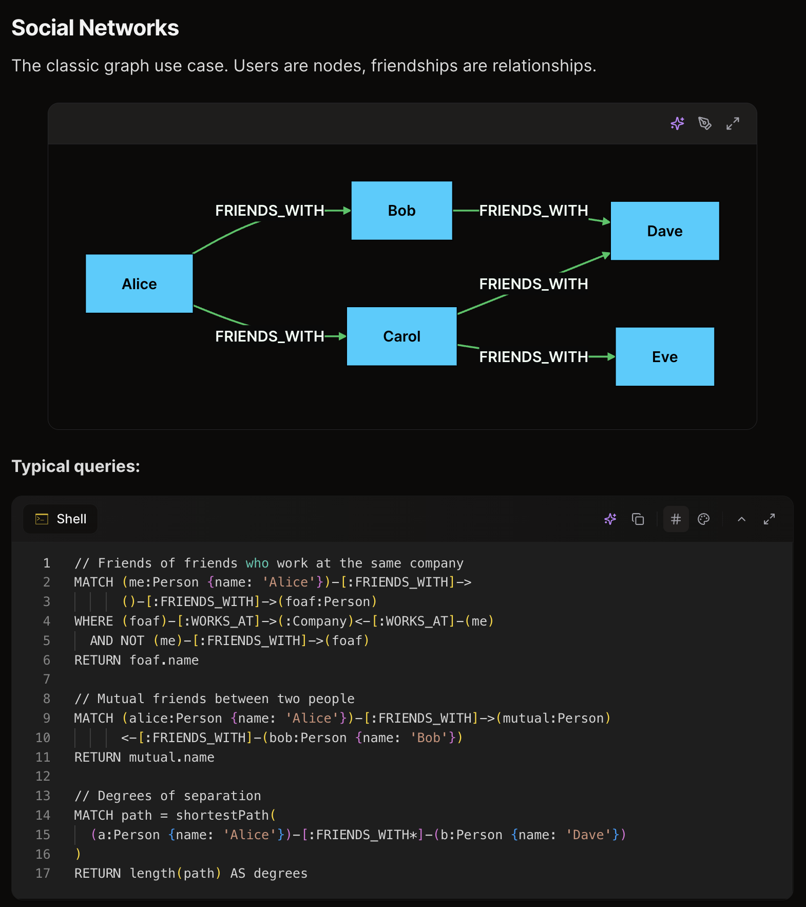
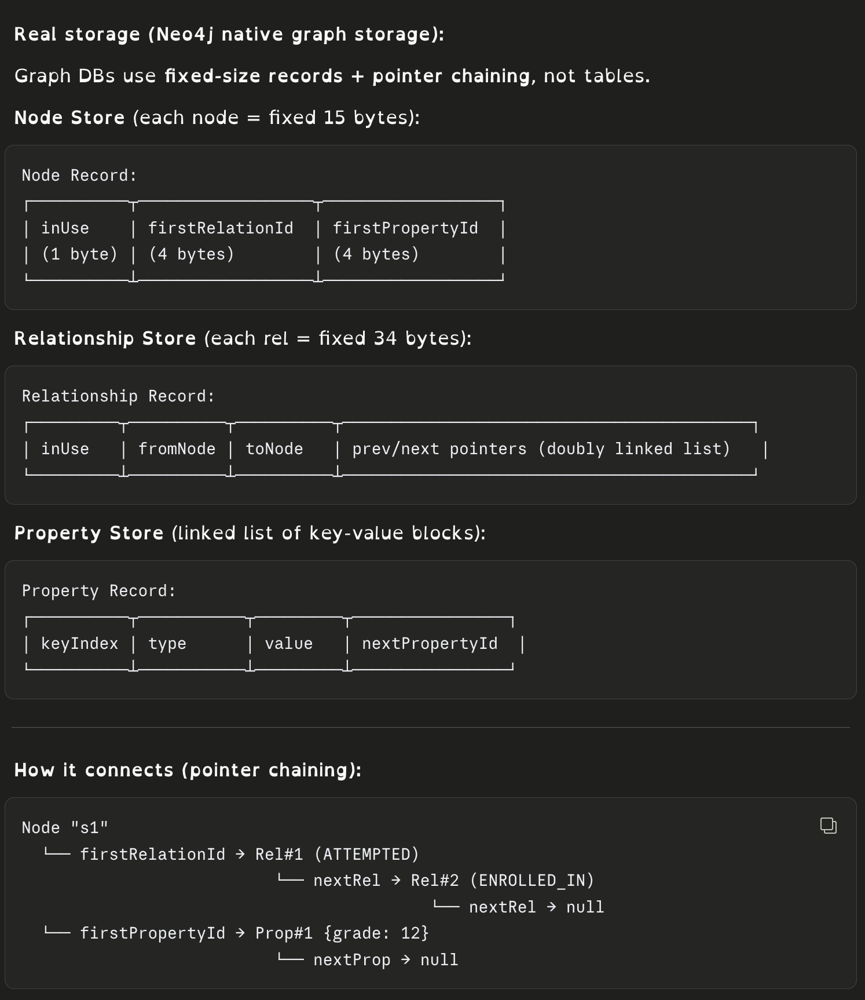
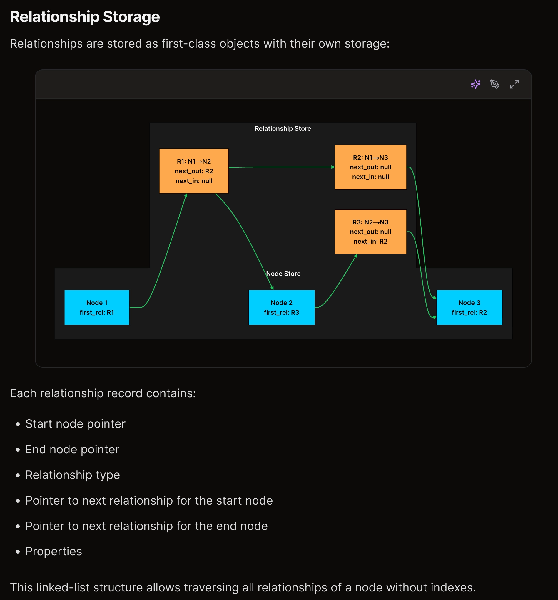
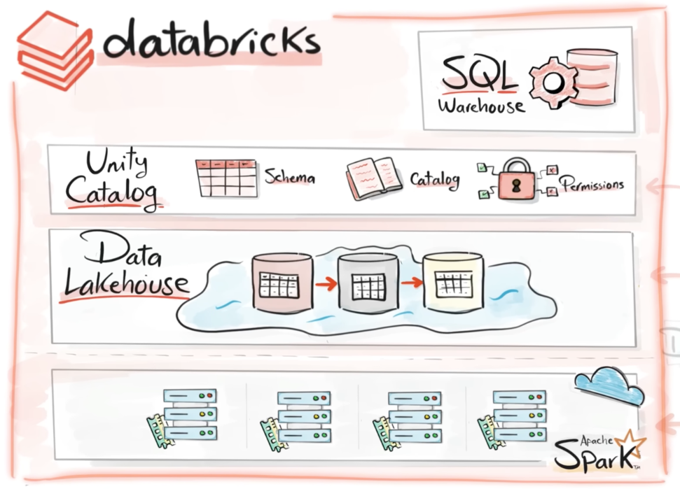

# HLD Interview Guide (SDE2)

Everything needed for the system design round, in one page: how the round works → estimation → every core concept in depth → 26 problems with full solutions → how to present a system you built.

Related: [syllabus](../test/INTERVIEW_SYLLABUS.md) · [LLD guide](lld-interview-guide.md) · [concurrency guide](concurrency-interview-guide.md) · [GenAI guide](genai.md) (LLM apps, RAG, agents, LLM serving)

## Index

**Part A — How to run the round**
- [1. What the SDE2 bar looks like](#1-what-the-sde2-bar-looks-like)
- [2. The 45-minute framework](#2-the-45-minute-framework)
- [3. Back-of-the-envelope estimation](#3-back-of-the-envelope-estimation)

**Part B — Concepts**
- [4. Networking fundamentals](#4-networking-fundamentals)
- [5. API design](#5-api-design)
- [6. Load balancing, proxies, gateways, service discovery](#6-load-balancing-proxies-gateways-service-discovery)
- [7. CDN and edge](#7-cdn-and-edge)
- [8. Caching](#8-caching)
- [9. Databases: relational internals](#9-databases-relational-internals)
- [10. Databases: NoSQL and data modeling](#10-databases-nosql-and-data-modeling)
- [11. Replication](#11-replication)
- [12. Partitioning and sharding](#12-partitioning-and-sharding)
- [13. Distributed systems core](#13-distributed-systems-core)
- [14. Messaging and stream processing](#14-messaging-and-stream-processing)
- [15. Storage: block, file, object, data lake, warehouse](#15-storage-block-file-object-data-lake-warehouse)
- [16. Search](#16-search)
- [17. Special data structures](#17-special-data-structures)
- [18. Reliability and resilience](#18-reliability-and-resilience)
- [19. Security](#19-security)
- [20. Observability](#20-observability)
- [21. Architecture styles and deployment](#21-architecture-styles-and-deployment)

**Part C — Problems**
- [22. Tier 1 problems](#22-tier-1-problems)
- [23. Tier 2 problems](#23-tier-2-problems)
- [24. Tier 3 problems](#24-tier-3-problems)

**Part D**
- [25. Presenting a system you built](#25-presenting-a-system-you-built)
- [26. Common mistakes and phrases that help](#26-common-mistakes-and-phrases-that-help)

---

# Part A — How to run the round

## 1. What the SDE2 bar looks like

| Signal | SDE1 | **SDE2 (target)** | Senior |
|---|---|---|---|
| Requirements | Needs prompting | **Drives it, picks a scope, states non-functional needs** | Finds hidden requirements |
| Estimation | Skips | **Rough numbers that change design choices** | Uses numbers to compare options |
| Design | Boxes connected | **Working end-to-end design; every box has a reason** | Several options compared deeply |
| Data model | Vague | **Tables/keys/partition keys + DB choice with reasons** | Access-pattern driven, migrations |
| Deep dive | Shallow | **Goes deep on 1–2 components (cache, queue, sharding, consistency)** | Goes deep anywhere |
| Tradeoffs | Rare | **States the tradeoff of each major choice** | Quantifies them |
| Failure | Ignored | **Retries, idempotency, replication, single points of failure** | Multi-region, ops, cost |

**Why SDE2 candidates fail:** no numbers, no data model, picking technologies by name ("use Kafka") without saying why, never discussing failure, and monologuing without checking what the interviewer wants to dig into.

## 2. The 45-minute framework

| Step | Time | Output |
|---|---|---|
| 1. Functional requirements | 3–5 min | 3–5 core features. Say what's **out of scope**. |
| 2. Non-functional requirements | 2–3 min | Scale (DAU, data size), latency target (p99), availability vs consistency, durability, read/write ratio. |
| 3. Estimates | 3–5 min | QPS (avg + peak), storage/year, bandwidth. Only numbers that affect the design. |
| 4. API | 3–5 min | 3–6 endpoints: method, path, params, response. |
| 5. Data model | 5 min | Entities, keys, partition key, indexes. DB choice + why. |
| 6. High-level design | 10 min | Diagram. Walk one write path and one read path end to end. |
| 7. Deep dives | 10–15 min | The hard part of *this* problem. Ask the interviewer which part to go deep on. |
| 8. Wrap up | 2–3 min | Bottlenecks, failure modes, monitoring, next steps. |

**Requirements checklist (ask these out loud):**
- Who are the users and how many (DAU, peak concurrent)?
- Read-heavy or write-heavy? Ratio?
- Latency target? Real-time or eventual?
- Can data be stale? For how long? Can we lose data?
- Global or one region? Mobile, web, or both?
- Any hard rule (no double booking, no double charge)?

**Walk-through example (first 2 minutes of "design Instagram"):**
> "Core features: upload photo, follow users, home feed, like/comment. Out of scope: stories, DMs, ads, search. Non-functional: 500M DAU, feed p99 under 300 ms, very read-heavy, feed can be a few seconds stale, uploads must never be lost. I'll estimate next."

## 3. Back-of-the-envelope estimation

### Numbers to memorize

**Time conversions**
- 1 day = 86,400 s ≈ **10^5 s** (use 100K for quick math)
- 1 month ≈ 2.5 × 10^6 s · 1 year ≈ 3 × 10^7 s
- **1M/day ≈ 12/s** · 10M/day ≈ 120/s · 100M/day ≈ 1.2K/s · 1B/day ≈ 12K/s
- Peak ≈ 2–3× average (5–10× for events like sales, New Year)

**Powers of two**
- 2^10 ≈ 1 thousand (KB) · 2^20 ≈ 1 million (MB) · 2^30 ≈ 1 billion (GB) · 2^40 ≈ 1 trillion (TB) · 2^50 = PB

**Sizes**
- char (ASCII) 1 B · int32 4 B · int64/timestamp 8 B · UUID 16 B
- Short text row (tweet + metadata) ≈ 0.5–1 KB · user profile ≈ 1 KB
- Compressed photo ≈ 200 KB–2 MB · 1 min 1080p video ≈ 50–100 MB · 1 min audio ≈ 1 MB

**Latency (order of magnitude)**

| Operation | Time |
|---|---|
| L1 cache reference | ~1 ns |
| Main memory reference | ~100 ns |
| Compress 1 KB (fast codec) | ~2 µs |
| Read 1 MB sequentially from memory | ~10 µs |
| SSD random read | ~100 µs |
| Read 1 MB sequentially from SSD | ~1 ms |
| Round trip within a data center | ~0.5 ms |
| HDD seek | ~10 ms |
| Round trip US ↔ Europe | ~80–150 ms |

Takeaways: memory ≫ SSD ≫ network ≫ disk seek. Avoid cross-region calls in the request path. Batch small network calls.

**Single-machine capacity (ballpark — for deciding whether to scale out)**

| Component | Rough capacity |
|---|---|
| Stateless app server | 1K–10K req/s (depends on work per request) |
| Postgres/MySQL (good hardware) | ~10K simple reads/s, ~1–5K writes/s; a few TB comfortably |
| Redis | ~100K ops/s per node (single-threaded command execution) |
| Cassandra node | ~10K+ writes/s per node, scales linearly |
| Kafka broker | hundreds of MB/s |
| Elasticsearch node | hundreds to a few thousand queries/s (query-dependent) |
| WebSocket server | 50K–100K+ concurrent connections |
| Network card | 10 Gbps ≈ 1.25 GB/s |

### Method

1. **Traffic:** DAU × actions per user per day ÷ 10^5 = average QPS. × 2–3 = peak.
2. **Read/write split:** separate the two; they scale differently.
3. **Storage:** writes per day × size × retention. Add replication factor (×3) if asked.
4. **Bandwidth:** QPS × response size.
5. **Memory for cache:** 80/20 rule — cache 20% of daily read data.
6. **Servers:** peak QPS ÷ per-server capacity (with headroom).

### Worked example 1: social feed

- 200M DAU, each opens feed 10×/day → 2B reads/day ≈ **23K QPS**, peak ~70K.
- Each user posts 0.5×/day → 100M posts/day ≈ **1.2K writes/s**.
- Post = 1 KB text/metadata → 100 GB/day → **~36 TB/year** (before replication) → needs sharding.
- Images: 20% of posts have a 500 KB image → 20M × 0.5 MB = 10 TB/day → object storage + CDN.
- Feed cache: 200M users × 800 post IDs × 8 B ≈ 1.3 TB → Redis cluster (≈ 20–30 nodes with headroom).

### Worked example 2: chat

- 100M DAU × 50 messages/day = 5B/day ≈ **58K msg/s**, peak ~150K.
- 5B × 200 B = 1 TB/day → wide-column store.
- 20M concurrent connections ÷ 50K per gateway = **400 gateway servers** (+ headroom).

### Worked example 3: URL shortener

- 100M new URLs/day ≈ 1.2K writes/s; 100:1 reads ≈ 120K reads/s peak.
- 5 years ≈ 180B URLs × 500 B ≈ **90 TB**.
- 62^7 ≈ 3.5 × 10^12 > 180 × 10^9 → **7-char base62 codes**.

**Tip:** round aggressively, say the numbers out loud, and state the *consequence* ("70K reads/s → one DB can't do it → cache + replicas").

---

# Part B — Concepts

Each topic: **what it is → how it works → when to use it → tradeoffs → what to say.**

## 4. Networking fundamentals

### 4.1 The layers you actually need

| Layer | Examples | Why it matters in design |
|---|---|---|
| Application (L7) | HTTP, gRPC, WebSocket, DNS | Routing by URL/header, caching, auth |
| Transport (L4) | TCP, UDP, QUIC | Reliability, ordering, connection cost |
| Network (L3) | IP | Addressing, routing |

### 4.2 TCP vs UDP

| | TCP | UDP |
|---|---|---|
| Connection | 3-way handshake (SYN → SYN-ACK → ACK) | None |
| Delivery | Reliable, ordered, retransmits lost packets | Best effort, may drop/reorder |
| Flow/congestion control | Yes (slows down when network is congested) | No |
| Overhead | Higher (handshake, headers, ACKs) | Lower |
| Use for | Web, APIs, DBs, file transfer | Video calls, gaming, DNS, live streaming, QUIC |

- **Head-of-line blocking:** in TCP one lost packet delays everything behind it in that connection.
- Connection setup costs a round trip (plus TLS). That's why we reuse connections (keep-alive, pooling).

### 4.3 HTTP versions

- **HTTP/1.1:** one request at a time per connection (pipelining unused in practice) → browsers open ~6 connections per host. Text headers.
- **HTTP/2:** many streams **multiplexed** over one TCP connection, binary framing, header compression (HPACK), server push (deprecated). Still TCP head-of-line blocking.
- **HTTP/3:** runs over **QUIC (UDP)**. Streams are independent (no TCP HOL blocking), faster handshakes (0-RTT/1-RTT), connection migration (phone switches Wi-Fi → 4G without reconnecting).

**Status codes to use correctly:** 200 OK, 201 Created, 202 Accepted (async), 204 No Content, 301/302 redirects, 304 Not Modified, 400 Bad Request, 401 Unauthenticated, 403 Forbidden, 404, 409 Conflict, 422 Validation error, 429 Too Many Requests, 500, 502 Bad Gateway, 503 Unavailable, 504 Gateway Timeout.

### 4.4 TLS (HTTPS)

- Gives **encryption, integrity, and server authentication** (certificate signed by a trusted CA).
- TLS 1.3 handshake: client hello (supported ciphers + key share) → server hello (key share + certificate) → both derive session keys → encrypted traffic. **1 round trip** (0-RTT on resumption).
- Asymmetric crypto (key exchange) only at setup; data is encrypted with fast symmetric keys.
- **TLS termination** usually happens at the load balancer/edge; traffic inside the data center may be re-encrypted (mTLS in a service mesh).

### 4.5 DNS

- Turns `api.example.com` into an IP.
- Resolution: browser cache → OS cache → **recursive resolver** (ISP/8.8.8.8) → root server → TLD server (`.com`) → **authoritative** server for `example.com` → answer cached per **TTL**.
- Records: A (IPv4), AAAA (IPv6), CNAME (alias), MX (mail), TXT, NS.
- **DNS-based load balancing / GeoDNS:** return different IPs per region or by health (Route 53 latency routing).
- Low TTL = faster failover but more DNS queries. Clients and resolvers sometimes ignore TTLs → DNS failover is slow (minutes).

### 4.6 "What happens when you type a URL?"

1. DNS lookup → IP.
2. TCP handshake (or QUIC) + TLS handshake.
3. HTTP request → CDN edge (cache hit → return) → load balancer → app server.
4. App server → cache/DB/other services → builds response.
5. Response → browser parses HTML → fetches CSS/JS/images (mostly from CDN) → renders.

### 4.7 IP, ports, NAT, proxies

- **Private IPs** (10.x, 172.16–31.x, 192.168.x) inside networks; **NAT** maps many private IPs to one public IP.
- A **port** identifies a process on a host (443 HTTPS, 5432 Postgres, 6379 Redis).
- **Forward proxy:** sits in front of *clients* (corporate proxy, hides client identity).
- **Reverse proxy:** sits in front of *servers* (Nginx/Envoy): TLS termination, routing, caching, compression, hides backend topology.

## 5. API design

### 5.1 REST

- Resources are nouns: `/users/{id}/orders`. HTTP verbs are actions: GET (read, safe, idempotent), POST (create, not idempotent), PUT (replace, idempotent), PATCH (partial update), DELETE (idempotent).
- Use plural nouns, nested resources only one level deep, filtering via query params (`?status=active&sort=-created_at`).
- **Versioning:** `/v1/...` in the path (simplest) or a header.
- **Errors:** consistent body `{ "error": { "code": "SEAT_TAKEN", "message": "...", "details": {...} } }`.
- **Caching:** `ETag` + `If-None-Match` → 304; `Cache-Control: max-age=60, public`.

### 5.2 gRPC

- Contract in `.proto` files → generated clients/servers in many languages.
- Protobuf binary encoding (smaller, faster than JSON) over HTTP/2.
- Supports **streaming**: server-streaming, client-streaming, bidirectional.
- Best for internal service-to-service calls. Downsides: not natively callable from browsers (needs gRPC-Web/proxy), harder to inspect.

### 5.3 GraphQL

- One endpoint; the client asks for exactly the fields it needs → no over/under-fetching, fewer round trips (good for mobile and many screens).
- Costs: HTTP caching is harder (POST to one URL), **N+1 queries** (use DataLoader batching), expensive queries need depth/complexity limits, field-level authorization.

### 5.4 Real-time communication

| Option | How | Pros | Cons | Use |
|---|---|---|---|---|
| Short polling | Client asks every N s | Trivial | Wasteful, delayed | Rare updates |
| Long polling | Server holds the request until data or timeout | Works everywhere | Reconnect per message, held connections | Fallback |
| **SSE** | One HTTP response stays open, server writes events | Simple, auto-reconnect (`Last-Event-ID`), HTTP/2 friendly | Server → client only, text only | LLM token streaming, notifications, live scores |
| **WebSocket** | Upgrade HTTP to a full-duplex TCP channel | Bidirectional, low overhead per message | Stateful connections, harder LB/scaling | Chat, games, collaborative editing |
| Webhooks | Server calls *your* URL on events | No polling between servers | Must handle retries, verify signatures | Payments, GitHub events |

**Scaling WebSockets:** connections are stateful → a **connection registry** (user → gateway server) in Redis; route messages to the right gateway (pub/sub); LBs must support long-lived connections (least-connections algorithm); handle reconnect storms with jittered backoff.

### 5.5 Pagination

- **Offset:** `LIMIT 20 OFFSET 10000` → DB still reads and discards 10,000 rows; results shift if new items arrive. OK for small admin tables.
- **Cursor / keyset:** `WHERE created_at < :last_seen ORDER BY created_at DESC LIMIT 20` → index seek, stable, fast. Encode the cursor as an opaque token. **Default choice for feeds and large lists.**

### 5.6 Idempotency

- An operation is idempotent if doing it twice = doing it once.
- Networks fail *after* the server did the work → clients retry → duplicates (double charge).
- **Idempotency key:** client generates a UUID per logical operation, sends `Idempotency-Key` header.
  - Server: `INSERT INTO idempotency(key, status='IN_PROGRESS')` (unique) → do work → store the response.
  - Retry with the same key: return the stored response (or 409 if still in progress).
  - Keys expire after 24 h.
- Make consumers idempotent too: upserts, unique constraints, version checks.

### 5.7 Other API concerns

- **Rate limiting** per API key (see [18.6](#186-rate-limiting)).
- **Request validation** at the edge (schema), size limits.
- **Backward compatibility:** add optional fields; never change a field's meaning; deprecate with notice.
- **BFF (Backend for Frontend):** a thin API per client type (web vs mobile) that aggregates microservice calls.

## 6. Load balancing, proxies, gateways, service discovery

### 6.1 Why

Spread traffic across servers, remove unhealthy servers, allow scaling and zero-downtime deploys.

### 6.2 L4 vs L7

| | L4 (transport) | L7 (application) |
|---|---|---|
| Sees | IP + port | URL, headers, cookies, body |
| Can do | Fast forwarding, TCP/UDP | Path routing (`/api` vs `/static`), TLS termination, retries, header-based routing, rate limits |
| Speed | Faster, less CPU | More work per request |
| Examples | AWS NLB, LVS | AWS ALB, Nginx, Envoy, HAProxy (both) |

### 6.3 Algorithms

- **Round robin:** equal servers, short requests.
- **Weighted round robin:** different server sizes, canary (5% weight).
- **Least connections:** long or uneven requests, WebSockets.
- **Least response time / power of two choices:** pick 2 random servers, send to the less loaded — simple and very effective.
- **IP hash / consistent hashing:** same client/key → same server (cache locality, sticky behavior).

### 6.4 Health checks and high availability

- Active checks: LB calls `/health` every few seconds; N failures → remove; N successes → add back.
- **Liveness** (process alive) vs **readiness** (can serve: DB connected, warmed up).
- The LB itself must not be a single point of failure: managed LBs are redundant; self-hosted run in active-passive pairs sharing a virtual IP (keepalived), or multiple LBs behind DNS.

### 6.5 Stateless servers and sessions

- Keep app servers **stateless** → any server can serve any request → easy autoscaling and failover.
- Session data → Redis, or a signed token (JWT) on the client.
- **Sticky sessions** (LB pins a user to a server): avoid; uneven load, and sessions are lost when the server dies.

### 6.6 API gateway

A reverse proxy specialized for APIs: authentication, rate limiting, request validation, routing to services, response aggregation, API keys, metrics. Examples: Kong, AWS API Gateway, Envoy-based gateways.

### 6.7 Service discovery

- Services scale up/down and change IPs → callers need a registry.
- **Client-side:** client queries the registry (Consul, Eureka) and load-balances itself.
- **Server-side:** client calls a stable name; a load balancer/DNS resolves it (Kubernetes Service + DNS).
- **Service mesh** (Istio/Linkerd): a sidecar proxy next to each service handles discovery, retries, timeouts, mTLS, metrics — no code changes.

### 6.8 Autoscaling

- Scale on CPU, request rate, queue depth, or custom metrics.
- Horizontal (more instances) preferred over vertical (bigger instance: simple, but has a ceiling and causes downtime).
- Cooldowns prevent flapping; pre-scale for known events.

## 7. CDN and edge

- A **CDN** is a network of edge servers that cache content close to users → lower latency, less origin load, absorbs traffic spikes and DDoS.
- **Pull CDN:** edge fetches from origin on the first miss, caches per `Cache-Control`. Most common.
- **Push CDN:** you upload content to the CDN in advance. For large, predictable files.
- **What to cache:** images, video segments, JS/CSS, fonts, downloadable files, and even API responses that are public and cacheable (product pages for anonymous users).
- **Invalidation:** prefer **versioned URLs** (`app.3f9a2c.js`, `img/v2/...`) — new content = new URL, no purge needed. Purge APIs exist but take time to propagate.
- **Signed URLs/cookies:** protect paid content with expiring tokens.
- **Origin shield:** a middle cache layer so edges don't all hit the origin on a miss.
- **Edge compute** (Cloudflare Workers, Lambda@Edge): auth checks, redirects, A/B routing, header rewriting near the user.

## 8. Caching

### 8.1 Where caches live

Browser → CDN → API gateway/reverse proxy → **in-process cache** (LRU in app memory, fastest, per-instance) → **distributed cache** (Redis/Memcached, shared) → DB's own buffer pool.

### 8.2 Read and write patterns

| Pattern | How | Pros | Cons | Use |
|---|---|---|---|---|
| **Cache-aside** | App: read cache → miss → read DB → fill cache. On write: update DB → **delete** cache key | Simple, cache only has requested data, survives cache failure | First read is slow (miss); possible stale window | **Default** |
| Read-through | Cache library loads from DB on miss | Cleaner app code | Needs cache provider support | Same as cache-aside |
| Write-through | Write to cache and DB synchronously | Cache always fresh | Slower writes; caches data that may never be read | Read-after-write heavy data |
| Write-back (write-behind) | Write to cache; flush to DB asynchronously in batches | Very fast writes, absorbs bursts | **Data loss** if the cache dies before flush | Counters, analytics, likes |
| Write-around | Write to DB only; cache fills on read | Avoids caching write-once data | First read misses | Logs, rarely re-read data |
| Refresh-ahead | Refresh hot keys before they expire | No miss latency for hot keys | Wasted refreshes | Predictable hot data |

**Why delete instead of update the cache on write?** Two concurrent writers: A writes DB=1, B writes DB=2, B sets cache=2, A sets cache=1 → cache is stale forever. Deleting avoids ordering bugs; the next read loads the latest. A small race still exists (a reader loads the old value just before the delete and writes it after) → TTLs bound it; **delayed double delete** or versioned values shrink it.

### 8.3 Eviction policies

- **LRU** (least recently used): default; good for recency-driven access.
- **LFU** (least frequently used): keeps long-term popular items; needs aging so old popular items don't stick.
- **FIFO / random:** cheap; random is surprisingly decent.
- **TTL:** time-based expiry; always set one as a safety net.
- Redis offers `allkeys-lru`, `allkeys-lfu`, `volatile-ttl`, etc. (approximate, sampling-based).

### 8.4 Cache problems you must know

| Problem | What happens | Fixes |
|---|---|---|
| **Stampede / thundering herd** | Hot key expires; thousands of requests miss at once and hit the DB | **Single-flight lock** (one rebuilds, others wait/serve stale), **jittered TTLs**, early probabilistic refresh, never-expire + background refresh for the hottest keys |
| **Penetration** | Requests for keys that don't exist always miss → DB hammered (often malicious) | Cache "not found" with a short TTL; **Bloom filter** of existing keys; input validation |
| **Avalanche** | Many keys expire at the same time, or the cache cluster goes down | Jittered TTLs; replicated cache; circuit breaker + rate limit to the DB; warm-up |
| **Hot key** | One key (celebrity, flash-sale item) overloads one cache shard | Replicate the key (`key#1..N`, read a random one); in-process local cache for it; split the value |
| **Big key** | Huge values (10 MB lists) block Redis and the network | Split into smaller keys, paginate, compress |
| **Stale data** | Cache differs from DB | Short TTLs for volatile data; event-driven invalidation (CDC); read DB for critical paths (balance, checkout) |

### 8.5 Redis in depth

- **Single-threaded command execution** (I/O threads exist in newer versions) → every command is atomic; no locks needed for single commands. A slow command (`KEYS *`, huge `SMEMBERS`) blocks everyone → use `SCAN`.
- **Data structures:** String (values, counters with `INCR`, locks with `SET NX PX`), Hash (objects), List (queues, recent items), Set (unique members), **Sorted Set** (leaderboards, timelines, delay queues, sliding-window rate limits), Bitmap (daily active flags), HyperLogLog (unique counts), Geo (nearby search), Streams (log with consumer groups), Pub/Sub (fire-and-forget fan-out).
- **Atomic multi-step logic:** Lua scripts or `MULTI/EXEC` transactions.
- **Persistence:** **RDB** snapshots (compact, fast restart, lose minutes of data) and/or **AOF** append-only log (fsync every second → lose ≤ 1 s). Many deployments use both, or none for pure caches.
- **Replication:** async primary → replicas. **Sentinel** monitors and fails over. Async → a failover can lose the last writes.
- **Redis Cluster:** 16,384 **hash slots**; each primary owns a range; `CRC16(key) % 16384`. Clients cache the slot map and follow `MOVED` redirects. Multi-key ops need keys in the same slot → **hash tags** `{user:42}:cart`.
- **Memcached vs Redis:** Memcached is a simple multi-threaded string cache (great for plain caching); Redis has data structures, persistence, replication, scripting.

### 8.6 Cache consistency strategies (pick per data type)

- Product description → TTL 1 h, invalidate on update.
- Price/stock → short TTL (seconds) or event-driven invalidation; **checkout reads the DB**.
- User's own profile after an edit → read-your-writes: bypass cache or update it in the same request.
- Feed → stale by seconds is fine.

## 9. Databases: relational internals

### 9.1 ACID

- **Atomicity:** all statements in a transaction commit, or none (via the WAL/undo).
- **Consistency:** constraints (FK, unique, check) hold before and after.
- **Isolation:** concurrent transactions don't see each other's partial work (degree depends on the isolation level).
- **Durability:** once committed, it survives a crash (WAL flushed to disk).

### 9.2 How a write is made durable: WAL

- Every change is first appended to the **write-ahead log** (sequential write, fast) and fsynced at commit.
- Data pages are updated in memory (buffer pool) and flushed to disk later (checkpoints).
- After a crash, the DB replays the WAL to recover.
- The same WAL stream feeds **replication** and **CDC** (Debezium reads Postgres logical decoding).

### 9.3 MVCC (multi-version concurrency control)

- Instead of locking rows for reads, the DB keeps **multiple versions** of a row. Each transaction reads a consistent **snapshot**.
- **Readers don't block writers, and writers don't block readers.** Writers still block writers on the same row.
- Postgres: old versions stay in the table until **VACUUM** cleans them (table bloat if vacuum lags). MySQL InnoDB: old versions in the undo log.

### 9.4 Isolation levels and anomalies

| Anomaly | Example |
|---|---|
| Dirty read | T1 reads T2's uncommitted change, T2 rolls back |
| Non-repeatable read | T1 reads a row twice and gets different values (T2 committed in between) |
| Phantom read | T1 runs the same range query twice and gets new rows |
| **Lost update** | T1 and T2 both read balance=100, both write 100−10 → one update lost |
| **Write skew** | Two doctors both check "≥1 other doctor on call" then both go off call → zero on call |

| Level | Prevents | Notes |
|---|---|---|
| Read uncommitted | nothing | Rarely used |
| **Read committed** | dirty reads | Postgres/Oracle default |
| Repeatable read (snapshot) | + non-repeatable reads (+ phantoms in Postgres) | MySQL InnoDB default |
| Serializable | everything | Postgres SSI aborts conflicting transactions → **app must retry** |

**Fixing lost updates (very common interview follow-up):**
1. **Atomic update:** `UPDATE accounts SET balance = balance - 10 WHERE id = 1 AND balance >= 10` (best when possible).
2. **Pessimistic lock:** `SELECT ... FOR UPDATE`, then update, in one transaction.
3. **Optimistic lock:** `UPDATE ... SET ..., version = version + 1 WHERE id = 1 AND version = 7` → 0 rows means conflict → retry.
4. **Serializable** isolation + retry.

**Job-queue pattern in SQL:** `SELECT ... FOR UPDATE SKIP LOCKED LIMIT 10` lets many workers grab different rows without blocking each other.

### 9.5 Indexes

- **B+ tree** (default in Postgres/MySQL): sorted, balanced, ~3–4 levels for millions of rows → O(log n) lookups and **range scans**. Leaves are linked for ordered scans.
- **Hash index:** equality only, no ranges.
- **Composite index** `(a, b, c)`: usable for `a`, `a,b`, `a,b,c` — **leftmost prefix rule**. Put equality columns first, then the range/sort column: `(user_id, created_at)` serves `WHERE user_id = ? ORDER BY created_at DESC LIMIT 20`.
- **Covering index:** includes all columns the query needs → no table lookup (index-only scan).
- **Partial index:** `WHERE status = 'PENDING'` → small and fast for hot subsets.
- **Full-text / GIN / GiST:** text search, JSONB, arrays, geospatial (PostGIS).
- **Costs:** every index slows writes (must be updated) and uses space. Low-selectivity columns (boolean) rarely benefit.
- **Clustered vs secondary:** InnoDB stores rows inside the primary-key B+ tree (clustered), so secondary indexes point to the PK → random UUID PKs cause page splits; prefer sequential keys (auto-increment, UUIDv7, Snowflake).
- Use `EXPLAIN ANALYZE` to verify.

### 9.6 B-tree vs LSM-tree storage engines

| | B-tree (Postgres, MySQL) | LSM-tree (Cassandra, RocksDB, ScyllaDB, HBase) |
|---|---|---|
| Write | Update pages in place (random I/O) + WAL | Append to WAL + in-memory **memtable**; flush sorted **SSTables**; background **compaction** |
| Read | One tree lookup | Check memtable + several SSTables (**Bloom filters** skip most) |
| Best at | Reads, range queries, transactions | **High write throughput** |
| Amplification | Write amplification from page writes | Write amplification from compaction; read amplification |
| Deletes | In place | **Tombstones** until compaction |

### 9.7 Normalization vs denormalization

- **Normalize** (3NF): each fact stored once → no update anomalies, smaller writes, joins at read time.
- **Denormalize**: copy data where it's read (author name inside each post document) → fast reads, no joins, but updates must fan out and may be temporarily inconsistent.
- Typical design: normalized source of truth (SQL) + denormalized read models (cache, search index, materialized views) updated by events/CDC. This is **CQRS** (separate write and read models).

### 9.8 Connection pooling

- Opening a DB connection costs a TCP + TLS + auth handshake and server memory (Postgres = one process per connection).
- App-side pools (HikariCP, SQLAlchemy pool) reuse connections. Proxy poolers (**PgBouncer**) multiplex many app connections onto few DB connections.
- Budget: `app instances × pool size ≤ DB max connections` (minus admin headroom). Too large a pool makes the DB slower (contention), not faster.

## 10. Databases: NoSQL and data modeling

### 10.1 Choosing a database

| Need | Pick | Why |
|---|---|---|
| Transactions, joins, constraints, money, inventory | **PostgreSQL/MySQL** | ACID, mature, flexible queries |
| Document-shaped data read as a whole, evolving schema | **MongoDB / DynamoDB (document)** | Flexible schema, one read per entity |
| Very high write volume, time-ordered data, known query patterns | **Cassandra / ScyllaDB / DynamoDB** | LSM writes, linear horizontal scale |
| Ultra-fast lookups, ephemeral data, counters, queues | **Redis** | In-memory |
| Full-text search, relevance, facets | **Elasticsearch / OpenSearch** | Inverted index |
| Relationship traversal (friends of friends, fraud rings) | **Neo4j / graph DB** | Index-free adjacency |
| Metrics over time | **Prometheus, InfluxDB, TimescaleDB** | Compression, downsampling, time functions |
| Analytics over billions of rows | **ClickHouse, BigQuery, Snowflake, Redshift** | Columnar storage, vectorized scans |
| Vector similarity | **pgvector, Elasticsearch kNN, Pinecone, Milvus** | ANN indexes (see the [GenAI guide](genai.md)) |
| Large files | **S3/GCS/R2** | Cheap, durable blobs |

**Interview line:** "Postgres by default. I move a specific dataset elsewhere only when its access pattern or scale needs it — e.g., messages to Cassandra for write volume."

### 10.2 Wide-column (Cassandra) modeling

- Table has a **partition key** (decides the node; all rows with the same partition key live together) and **clustering columns** (sort order inside the partition).
- **Model by query, not by entity.** One table per query pattern; duplicate data across tables.
- Example — messages of a conversation, newest first:
  ```sql
  CREATE TABLE messages (
    conversation_id uuid, bucket int, message_id timeuuid, sender_id uuid, body text,
    PRIMARY KEY ((conversation_id, bucket), message_id)
  ) WITH CLUSTERING ORDER BY (message_id DESC);
  ```
  `bucket` (e.g., month) keeps partitions bounded (aim < ~100 MB per partition).
- No joins, limited secondary indexes, no ad-hoc queries. Tunable consistency per query (`ONE`, `QUORUM`, `ALL`).
- Writes are cheap; reads that need many partitions are expensive.

### 10.3 DynamoDB modeling

- **Partition key** (+ optional **sort key**). Items with the same PK form an item collection sorted by SK.
- **Single-table design:** different entity types in one table with overloaded keys: `PK=USER#42, SK=ORDER#2024-05-01#9` → "user 42's orders by date" is one query.
- **GSI** (global secondary index): a different PK/SK for another access pattern; eventually consistent.
- Capacity: on-demand or provisioned; hot partitions are throttled → choose high-cardinality keys.

### 10.4 Document (MongoDB) modeling

- **Embed** data read together and bounded in size (order + its line items).
- **Reference** data that's large, unbounded, or shared (user ↔ millions of comments).
- Atomic updates per document; multi-document transactions exist but are slower → design so one write touches one document.
- Index the fields you query; compound index order follows the leftmost-prefix rule like SQL.

### 10.5 Graph databases

- Nodes + edges with properties; traversals follow pointers instead of joins.
- Great for multi-hop queries ("friends of friends who like X", fraud rings, knowledge graphs).
- Watch out for **supernodes** (a node with millions of edges) → cap fan-out, partition the edges.
- **Native graph storage (Neo4j):** fixed-size node and relationship records linked by pointers, so traversing a node's edges needs no index lookup ("index-free adjacency").







### 10.6 Time-series and columnar

- **Time-series:** data = (series key + tags, timestamp, value). Append-only, compressed (delta-of-delta, XOR encoding), **downsampled** with age, retention policies. Watch **cardinality** (unique tag combinations).
- **Columnar (OLAP):** stores each column separately → scanning 3 columns of a 100-column table reads only those 3; great compression; vectorized execution. Bad at single-row updates. Used for dashboards, analytics, logs.

### 10.7 OLTP vs OLAP

| | OLTP | OLAP |
|---|---|---|
| Queries | Short reads/writes of few rows | Large scans/aggregations |
| Storage | Row-oriented | Column-oriented |
| Examples | Postgres, MySQL, DynamoDB | ClickHouse, BigQuery, Snowflake |
| Data flow | Source of truth | Fed by ETL/CDC from OLTP |

## 11. Replication

### 11.1 Why

Availability (survive node failure), read scaling, lower latency (replicas near users), backups/analytics without hurting the primary.

### 11.2 Leader-follower (primary-replica)

- All writes go to the leader; it ships its log (WAL/binlog) to followers; reads can go to followers.
- **Synchronous:** leader waits for follower ack → no data loss on failover, but higher write latency; a slow follower stalls writes.
- **Asynchronous:** leader doesn't wait → fast, but a failover can lose the last few writes.
- **Semi-sync:** wait for at least one follower (common compromise).

### 11.3 Replication lag problems

| Problem | Example | Fix |
|---|---|---|
| **Read-your-writes** | User edits profile, refreshes, sees the old one (read from a lagging replica) | Read own data from the leader for N seconds after a write; or track the write's log position and read from a replica that has caught up |
| **Monotonic reads** | User sees a comment, refreshes, it disappears (second read hit a more-lagged replica) | Pin a user's reads to one replica |
| **Consistent prefix** | A reply appears before the question | Write causally related data to the same partition; ordered logs |

### 11.4 Failover

- Detect leader failure (heartbeats/timeouts) → elect the most up-to-date follower → reconfigure clients.
- Risks: **split brain** (two leaders accept writes) → use fencing/STONITH and a consensus system (etcd/ZooKeeper) to decide the leader; lost async writes; timeouts too short → needless failovers.

### 11.5 Multi-leader

- Each region has a leader accepting writes; leaders replicate to each other.
- Needed for multi-region writes or offline clients (calendar apps).
- **Conflicts** must be resolved: last-write-wins (loses data), merge functions, CRDTs, or app-level resolution.

### 11.6 Leaderless (Dynamo-style)

- Client (or coordinator) writes to N replicas and waits for W acks; reads from R replicas and takes the newest version.
- **R + W > N** → read and write sets overlap → reads see the latest acknowledged write (with caveats under concurrent writes and failures).
- Repair mechanisms: **read repair**, **hinted handoff**, **anti-entropy with Merkle trees**.
- Used by Cassandra, DynamoDB (internally), Riak.

## 12. Partitioning and sharding

### 12.1 Terms

- **Partitioning:** splitting data into pieces. **Sharding:** placing those pieces on different machines (horizontal partitioning across nodes).
- **Vertical partitioning:** splitting columns/tables (put blobs or rarely-used columns elsewhere) or splitting by feature (users DB vs orders DB).
- Postgres declarative partitioning (by month) inside one server helps pruning/archiving but isn't sharding.

### 12.2 When to shard

- Data doesn't fit one machine, or write throughput exceeds one primary.
- Exhaust simpler options first: indexes, caching, read replicas, vertical scaling, archiving old data.

### 12.3 Strategies

| Strategy | How | Pros | Cons |
|---|---|---|---|
| **Range** | Key ranges per shard (A–F, G–M; or by date) | Efficient range scans | **Hotspots** (all new writes go to the latest range) |
| **Hash** | `hash(key) % N` | Even spread | Range queries hit all shards; changing N moves almost everything |
| **Consistent hashing** | Keys and nodes on a ring | Adding/removing a node moves ~1/N of keys | Slightly more complex |
| **Directory / lookup** | A service maps key → shard | Flexible (move individual tenants) | Lookup service is critical; extra hop (cache it) |
| **Geo** | By region/country | Data locality, compliance | Uneven region sizes |

### 12.4 Choosing the shard key (most important sharding decision)

- **High cardinality** and **even load**.
- **Most queries include it** → they hit one shard.
- Doesn't change over time (moving rows between shards is painful).
- Examples: chat → `conversation_id`; e-commerce orders → `user_id` (user's orders on one shard); multi-tenant SaaS → `tenant_id` (big tenants get dedicated shards).

### 12.5 Consistent hashing in detail

- Hash space is a ring (0 … 2^32−1). Each node is hashed to positions on the ring.
- A key goes to the **first node clockwise** from its hash.
- Add a node → it takes keys only from its clockwise neighbor; remove → its keys go to the next node. Only ~K/N keys move.
- **Virtual nodes:** each physical node owns 100–200 positions → smooth distribution; bigger machines get more vnodes; a failed node's load spreads across many nodes.
- Replication: store a key on the next R distinct physical nodes clockwise.
- Used by Cassandra, DynamoDB, Riak, many cache clients (ketama). Redis Cluster uses fixed hash slots instead (same goal, easier slot migration).

### 12.6 Problems after sharding

- **Cross-shard queries:** scatter-gather to all shards and merge (slow; avoid in hot paths). Maintain secondary read models (search index, denormalized tables) for other access patterns.
- **Cross-shard transactions:** avoid by design; otherwise sagas or 2PC.
- **Global unique IDs:** no auto-increment across shards → Snowflake/UUIDv7.
- **Hot partitions:** a celebrity or giant tenant → split that key (salting: `key#0..9`, then merge on read), dedicated shard, or cache.
- **Resharding:** double-write + backfill + switch reads, or pre-split into many logical shards (e.g., 4,096) mapped onto fewer physical nodes, so rebalancing moves whole logical shards.

## 13. Distributed systems core

### 13.1 Why distributed is hard

Networks drop/delay/reorder messages, nodes crash and pause (GC), clocks drift, and you can't tell a slow node from a dead one. Design for partial failure.

### 13.2 CAP and PACELC

- **CAP:** during a network **P**artition, a system must choose **C**onsistency (refuse some requests to avoid stale/conflicting data) or **A**vailability (answer everything, possibly stale). With no partition you can have both.
- **CP examples:** bank balance, inventory decrement, seat booking, leader election (etcd, ZooKeeper, Spanner).
- **AP examples:** social feed, likes, product catalog, shopping cart, DNS.
- **PACELC:** if **P**artition → **A** or **C**; **E**lse → **L**atency or **C**onsistency. Even without failures, strong consistency costs latency (synchronous replication, quorum reads).

### 13.3 Consistency models (strong → weak)

| Model | Guarantee | Example |
|---|---|---|
| **Linearizable** | Every read sees the latest completed write, as if one copy | Leader reads in etcd; Spanner |
| Sequential | All see the same order of operations | — |
| **Causal** | Causally related ops seen in order (reply after its question) | Comment threads |
| **Read-your-writes** | You always see your own updates | Profile edits |
| Monotonic reads | Never see older data after newer | Pin reads to a replica |
| **Eventual** | Replicas converge when writes stop | DNS, feeds, counters |

### 13.4 Quorums

- N replicas, write waits for W, read queries R.
- **R + W > N** → overlap → read sees the latest write. N=3, W=2, R=2 is common.
- W=1/R=1 → fast, eventual. W=N → slow, unavailable if any replica is down.
- **Sloppy quorum + hinted handoff:** accept writes on other nodes when replicas are down (more available, weaker guarantee).

### 13.5 Consensus and leader election

- **Consensus:** nodes agree on a value/log even if some fail. **Raft** (etcd, Consul, Kafka KRaft) and **Paxos** (Chubby, Spanner).
- Raft basics: one leader per **term**; leader appends entries and replicates to followers; an entry is **committed** once a **majority** has it; if the leader dies, followers time out and elect a new one (a candidate needs a majority of votes, and must have an up-to-date log).
- Majority quorum: 3 nodes tolerate 1 failure, 5 tolerate 2. Use odd numbers.
- In interviews: "use etcd/ZooKeeper for leader election, config, and distributed locks" — don't implement Raft.
- **Leases:** the leader holds a time-limited lease and must renew it; if it can't, it steps down.

### 13.6 Time and ordering

- Wall clocks drift and jump (NTP) → never order events across machines by wall-clock timestamps for correctness.
- **Lamport clock:** counter incremented per event and on message receive (`max(local, received) + 1`) → total order consistent with causality.
- **Vector clock:** one counter per node → can detect *concurrent* (conflicting) updates (Dynamo-style).
- **Hybrid logical clocks** (CockroachDB) combine physical time and logical counters.
- **Google Spanner TrueTime:** bounded clock uncertainty + commit wait → external consistency.
- Practical: get order from a **single sequencer per entity** (a DB sequence, a Kafka partition, a per-conversation counter).

### 13.7 Unique ID generation

| Option | Pros | Cons |
|---|---|---|
| DB auto-increment | Simple, ordered | Single point; leaks volume; hard across shards |
| Auto-increment with step (shard i: i, i+N, …) | No coordination | Hard to add shards |
| **UUIDv4** | No coordination | 128 bits, random → poor index locality, not sortable |
| **UUIDv7 / ULID** | Time-ordered + random | 128 bits |
| **Snowflake** (64-bit) | Time-sortable, compact, no coordination | Needs unique machine IDs; clock rollback handling |
| Ticket server / range allocation | Compact, ordered within a range | Extra service |

**Snowflake layout:** 1 sign bit · 41 bits ms timestamp (~69 years from a custom epoch) · 10 bits machine ID (1,024 machines) · 12 bits sequence (4,096 IDs/ms/machine). If the clock moves backwards → wait or refuse.

### 13.8 Distributed transactions

**Two-phase commit (2PC)**
1. Coordinator → all participants: "prepare" (each writes to its log, locks rows, votes yes/no).
2. All yes → "commit"; any no → "abort".
- Problems: **blocking** — if the coordinator dies after prepare, participants hold locks until it recovers; latency; every participant must support it. Used inside databases (Spanner, CockroachDB), rarely across microservices.

**Saga**
- A long transaction split into local transactions, each with a **compensating action**: `reserve inventory → charge payment → create shipment`; if shipment fails → refund payment → release inventory.
- **Orchestration:** a central orchestrator (state machine, e.g., Temporal/Step Functions) calls each step and compensations. Easier to reason about and monitor. **Prefer in interviews.**
- **Choreography:** each service listens to events and emits the next. Loosely coupled, but the flow is hard to see.
- Sagas give no isolation: others may see intermediate states → use semantic locks (status = PENDING) and design for it.

**Transactional outbox (solves dual writes)**
- Problem: "update DB, then publish to Kafka" — a crash between the two loses the event (or publishing first and then failing the DB write creates a ghost event).
- Fix: in **one DB transaction**, write the business row **and** an `outbox` row. A relay publishes outbox rows to Kafka (polling, or **CDC** reading the WAL), marks them sent. Consumers are idempotent because the relay is at-least-once.

**Change data capture (CDC)**
- Read the DB's replication log (Postgres logical decoding, MySQL binlog) and publish row changes as events (Debezium → Kafka).
- Use it to update caches, search indexes, and analytics without dual writes.

### 13.9 Distributed locks

- Use when only one worker may do something at a time across machines (one scheduler runs a job, one process rebuilds a cache key).
- **Redis:** `SET lock:job42 <random_token> NX PX 30000`; release with a Lua script that deletes only if the value equals your token (don't release someone else's lock).
- **Problem:** your process pauses (GC, VM freeze) longer than the TTL → lock expires → another worker takes it → both act.
- **Fencing tokens:** the lock service hands out an increasing number with each lock; the storage rejects writes with a token lower than the last one seen. ZooKeeper/etcd provide this naturally (zxid / revision).
- Redlock (majority of independent Redis nodes) is debated; for correctness-critical locking prefer etcd/ZooKeeper or, better, **avoid locks** using DB constraints, conditional updates, or a single owner per partition.

### 13.10 Failure detection and membership

- **Heartbeats** with timeouts (too short → false positives; too long → slow failover). Phi-accrual detectors adapt to network conditions.
- **Gossip protocols:** each node periodically exchanges state with a few random peers → cluster membership spreads in O(log N) rounds (Cassandra, Consul).

### 13.11 Exactly-once — the honest answer

- Over a network you get **at-most-once** or **at-least-once** delivery.
- "Exactly-once" in practice = **at-least-once delivery + idempotent processing** (dedup by message ID, upserts, version checks), or transactions spanning the read offset and the write (Kafka transactions, within Kafka).

### 13.12 Backpressure

- When a consumer is slower than a producer, something must give: buffer (bounded), slow the producer (block/reject), or drop (load shedding).
- Unbounded queues just move the failure to memory exhaustion.

## 14. Messaging and stream processing

### 14.1 Why asynchronous messaging

- Decouple services (producer doesn't wait for or know consumers).
- Absorb spikes (queue buffers bursts).
- Retry failed work without losing it.
- Fan out one event to many consumers.
- Move slow work off the request path (emails, transcoding, indexing).

### 14.2 Queue vs log

| | Message queue (RabbitMQ, SQS) | Log (Kafka, Kinesis, Pulsar) |
|---|---|---|
| Model | Message delivered to one consumer, deleted after ack | Append-only log; messages kept for a retention period; consumers track an **offset** |
| Replay | No | Yes — rewind offsets |
| Ordering | Best-effort (FIFO variants exist) | Strict **per partition** |
| Fan-out | Exchanges/topics copy messages | Many consumer groups read the same log independently |
| Throughput | Good | Very high (sequential disk I/O) |
| Per-message features | Routing, priorities, delays, per-message ack/visibility timeout | Simple; delays/priorities need patterns |
| Use | Task queues, work distribution, RPC-ish jobs | Event streaming, CDC, analytics, event sourcing, audit logs |

### 14.3 Kafka internals

- **Topic** → **partitions**. Each partition is an ordered, append-only log stored as segment files.
- Producer chooses the partition: `hash(key) % partitions` (same key → same partition → **ordered per key**) or round-robin without a key.
- **Replication:** each partition has a **leader** and followers on other brokers. **ISR** (in-sync replicas) = followers caught up.
- **Producer `acks`:** `0` (fire and forget), `1` (leader wrote it), `all` (all ISR wrote it). Durable config: `acks=all`, `replication.factor=3`, `min.insync.replicas=2`, idempotent producer enabled (dedups producer retries).
- **Consumer group:** partitions are divided among the group's consumers; one partition → one consumer in the group. Max useful consumers = number of partitions. Different groups each get all messages.
- **Rebalancing:** consumers joining/leaving trigger partition reassignment (cooperative rebalancing reduces pauses).
- **Offsets:** committed to an internal topic. Commit after processing → at-least-once.
- **Retention:** by time/size; **log compaction** keeps the latest value per key (changelog/state topics).
- **Why fast:** sequential writes, OS page cache, batching + compression, zero-copy sends to consumers.
- **Partition count:** sets max parallelism; too many increases overhead and rebalance time. Increasing later changes key → partition mapping (breaks per-key ordering for a while).

### 14.4 RabbitMQ and SQS

- **RabbitMQ:** exchanges (direct, topic, fanout) route to queues; per-message acks; prefetch limits; priorities; dead-letter exchanges.
- **SQS:** managed queue; **visibility timeout** (message hidden while being processed, reappears if not deleted); standard (at-least-once, best-effort order) vs FIFO (ordered per message group, dedup window); DLQ via redrive policy.

### 14.5 Delivery semantics and ordering

- **At-most-once:** commit/ack before processing → may lose messages.
- **At-least-once:** process, then commit/ack → may duplicate → **idempotent consumers** (default choice).
- **Exactly-once:** see [13.11](#1311-exactly-once--the-honest-answer).
- **Ordering:** guaranteed only within a partition/message group → key by the entity whose order matters (order_id, account_id). Parallelism across keys, order within a key.

### 14.6 Failure handling patterns

- **Retry with backoff:** transient failures retry a few times with exponential backoff + jitter.
- **Retry topics/queues:** `orders.retry.1m`, `orders.retry.10m` → don't block the main partition while waiting.
- **Dead-letter queue (DLQ):** after N attempts or on non-retryable errors (bad payload); store error + metadata; alert; fix; replay.
- **Poison pill:** one malformed message that crashes the consumer repeatedly → catch, DLQ it, move on.
- **Consumer lag** is the key metric; alert when it grows.

### 14.7 Event-driven patterns

- **Event notification:** "OrderPlaced {order_id}" → consumers fetch details if needed.
- **Event-carried state transfer:** the event contains the data consumers need → no callback to the producer.
- **Event sourcing:** store the sequence of events as the source of truth; current state = replay (snapshots speed this up). Great audit trail; harder querying (pair with CQRS read models).
- **CQRS:** separate write model (normalized, validated) from read models (denormalized, query-optimized) updated by events.

### 14.8 Stream processing

- Continuous computation over unbounded event streams (Flink, Kafka Streams, Spark Structured Streaming).
- **Windows:** tumbling (fixed, non-overlapping: per minute), sliding/hopping (overlapping: last 5 min every 1 min), session (gaps of inactivity).
- **Event time vs processing time:** events arrive late/out of order → **watermarks** say "we've probably seen everything up to time T"; allowed lateness; late events go to a side output.
- **State + checkpoints:** operators keep state (counts per key) in local stores, checkpointed to durable storage for recovery → exactly-once state updates within the engine.
- **Batch vs stream:** batch = high latency, simple, reprocess everything; stream = low latency, more complex.
- **Lambda architecture:** batch layer (accurate) + speed layer (fast, approximate), merged at query time. **Kappa:** stream only; reprocess by replaying the log.

## 15. Storage: block, file, object, data lake, warehouse

| Type | What | Examples | Use |
|---|---|---|---|
| **Block** | Raw disk volumes attached to one machine | EBS, local SSD | Databases, OS disks |
| **File** | Shared hierarchical file system (NFS) | EFS, NFS | Shared files among servers, legacy apps |
| **Object** | Flat namespace of objects (key → bytes + metadata) via HTTP | S3, GCS, R2 | Images, video, backups, data lakes, static sites |

**Object storage details**
- Extremely durable (S3: 11 nines) by replicating/erasure-coding across facilities.
- Immutable objects (replace whole objects); no partial in-place updates.
- **Pre-signed URLs:** the server signs a time-limited URL; the client uploads/downloads directly → app servers never carry the bytes.
- **Multipart upload:** big files in parallel parts, retry only failed parts, resumable.
- **Storage classes + lifecycle rules:** hot → infrequent access → archive (Glacier) after N days.
- Strongly consistent reads after writes on S3 today; listing large buckets is slow → keep your own metadata index in a DB.

**Distributed file systems:** HDFS splits files into large blocks (128 MB) replicated ×3 across data nodes; a name node holds metadata. Built for big sequential batch reads.

**Data lake vs warehouse vs lakehouse**
- **Data lake:** raw files (Parquet/JSON) in object storage; cheap, schema-on-read.
- **Warehouse:** structured, schema-on-write, fast SQL (Snowflake, BigQuery, Redshift).
- **Lakehouse:** table formats (Delta Lake, Iceberg, Hudi) add ACID transactions, schema evolution, and time travel on top of lake files.



- **ETL vs ELT:** transform before loading vs load raw then transform in the warehouse (dbt).
- **Batch processing:** Spark splits data into partitions processed in parallel across executors; MapReduce = map (emit key/value) → shuffle (group by key) → reduce.

## 16. Search

### 16.1 Inverted index

- Maps **term → posting list** (document IDs, positions, frequencies).
- Indexing pipeline (**analyzer**): character filters → **tokenizer** (split words) → token filters (lowercase, stop words, **stemming** "running" → "run", synonyms).
- Query: analyze the query the same way → look up each term's posting list → intersect/union → score → top-K.

### 16.2 Relevance scoring

- **TF-IDF:** term frequency in the doc × inverse document frequency (rare terms matter more).
- **BM25** (default in Lucene/ES): TF-IDF with **saturation** (the 10th occurrence adds little) and **document length normalization** (matches in short fields count more).
- Business signals: boost by popularity, recency, availability (`function_score`).
- **Semantic/vector search** finds meaning, not just words; **hybrid search** combines both (details in the [GenAI guide](genai.md)).

### 16.3 Elasticsearch architecture

- **Index** → fixed number of **primary shards** (each a Lucene index) + **replica shards** (copies on other nodes for failover and read throughput).
- Document routed to a shard by `hash(_id or routing) % primaries` → **primary count can't change** without reindexing (or split/shrink APIs).
- **Query flow:** coordinating node → scatter to one copy of every shard → each returns top-K → gather/merge → fetch documents. Too many small shards = slow fan-out.
- **Near real-time:** new docs go to an in-memory buffer + translog; a **refresh** (default ~1 s) creates a searchable **segment**. Segments are immutable; background **merging** combines them and drops deleted docs.
- Updates = delete + reindex internally.
- **Mappings:** `text` (analyzed, full-text) vs `keyword` (exact: filters, sorting, aggregations).
- **Filter context** (no scoring, cacheable) vs **query context** (scored).
- **Aggregations** compute facets (counts per brand, price ranges).
- ES is a **secondary index**, not the source of truth: write to the DB → sync via CDC/Kafka → rebuild by reindexing into a new index and switching an **alias**.

### 16.4 Autocomplete approaches

- **Trie** with top-K completions stored at each node (fast prefix lookup).
- **Edge n-grams** at index time ("iph" → "i", "ip", "iph").
- **Completion suggester** (in-memory FST in ES).
- See [problem 22.10](#2210-typeahead--search-autocomplete).

## 17. Special data structures

| Structure | What it does | Error/space | Used for |
|---|---|---|---|
| **Bloom filter** | "Definitely not in set" or "maybe in set" | False positives, no false negatives; ~10 bits/item for 1% FP | Skip disk reads (LSM SSTables), cache penetration guard, "URL already crawled?" |
| Counting Bloom filter | Bloom filter with deletes | More memory | Sets with removals |
| **HyperLogLog** | Approximate count of distinct items | ~0.8% error in 12 KB | Unique visitors, distinct searches |
| **Count-Min Sketch** | Approximate frequency of each item in a stream | Overestimates only | Heavy hitters, trending topics (with a top-K heap) |
| **Skip list** | Sorted structure with O(log n) search/insert, simple to make concurrent | — | Redis sorted sets, LSM memtables |
| **Trie** | Prefix tree | — | Autocomplete, IP routing tables |
| **Merkle tree** | Tree of hashes; compare roots to find differing ranges | — | Replica anti-entropy (Cassandra/Dynamo), Git, blockchains |
| **Geohash** | Encodes lat/long into a base-32 string; shared prefix ≈ nearby | Edge effects at cell borders → also check neighbors | Proximity search |
| **Quadtree** | Recursively split 2D space into 4 until each cell has ≤ K points | Adapts to density | Nearby search, maps |
| **H3 / S2** | Hierarchical hexagon (H3) / square (S2) cells on the sphere | — | Uber dispatch, geo aggregation |
| **Consistent hash ring** | Key → node with minimal movement | — | Sharding, caches |
| **Ring buffer** | Fixed-size circular array | — | Sliding-window counters, logs |

**Bloom filter math (good to know):** with m bits, n items, and k hash functions, false positive rate ≈ (1 − e^(−kn/m))^k; optimal k ≈ (m/n)·ln 2.

**Geohash in practice:** precision 6 ≈ 1.2 km × 0.6 km cells. Query = user's cell + 8 neighbors → filter by exact distance.

## 18. Reliability and resilience

### 18.1 Availability math

| Availability | Downtime/year | Downtime/month |
|---|---|---|
| 99% | 3.65 days | 7.2 h |
| 99.9% | 8.8 h | 43 min |
| 99.99% | 53 min | 4.3 min |
| 99.999% | 5.3 min | 26 s |

- **Series** (A calls B, both needed): A × B → 99.9% × 99.9% = 99.8%. Every dependency lowers availability.
- **Parallel** (redundant copies, any one works): 1 − (1 − A)^n → two 99% replicas = 99.99%.

### 18.2 Timeouts

- Every network call needs a timeout; without one, threads/connections pile up and the caller dies too.
- Set from the dependency's p99 latency plus margin; use a **deadline** propagated across calls (remaining budget shrinks as the request travels).

### 18.3 Retries

- Retry only **transient** errors (timeouts, 503, connection reset) and only **idempotent** operations (or with idempotency keys).
- **Exponential backoff + jitter:** `sleep = random(0, base × 2^attempt)` capped → avoids synchronized retry storms.
- Cap attempts; use a **retry budget** (e.g., retries ≤ 10% of requests).
- **Retry amplification:** 3 layers × 3 retries = 27× load on the bottom service during an outage → retry at one layer only.

### 18.4 Circuit breaker

- **Closed:** calls pass; count failures.
- **Open:** failure rate over a threshold → fail fast for a cool-down period (don't waste resources on a dead dependency).
- **Half-open:** let a few trial calls through; success → close; failure → open again.
- Combine with a **fallback** (cached data, default value, degraded feature).

### 18.5 Bulkheads, load shedding, graceful degradation

- **Bulkhead:** separate thread/connection pools per dependency → one slow dependency can't exhaust everything.
- **Load shedding:** when overloaded, reject low-priority requests early (429/503) to keep the important ones fast. Prioritize (checkout > recommendations).
- **Graceful degradation:** serve partial results (page loads without recommendations; stale cached feed).
- **Queue-based load leveling:** put a queue in front of a slow backend so spikes are absorbed.

### 18.6 Rate limiting

| Algorithm | How | Pros | Cons |
|---|---|---|---|
| **Token bucket** | Bucket of capacity C refills at R tokens/s; a request takes 1 token | Allows bursts up to C, smooth average | Two parameters to tune |
| Leaky bucket | Requests queue and drain at a fixed rate | Smooth output rate | Bursts are delayed/dropped |
| Fixed window counter | Count per calendar window (per minute) | 1 counter, simple | Up to 2× burst at window edges |
| Sliding window log | Store each request timestamp; count those in the last window | Exact | Memory per request |
| **Sliding window counter** | `current_count + previous_count × overlap_fraction` | Close to exact, 2 counters | Approximate |

- Where: API gateway (global), per service (protect yourself), per client SDK (be polite).
- Keys: user ID, API key, IP, endpoint, tenant.
- Response: **429** with `Retry-After`, `X-RateLimit-Limit/Remaining/Reset`.
- Distributed: shared counters in Redis with atomic Lua (see [problem 22.2](#222-rate-limiter-distributed)).

### 18.7 Redundancy, failover, disaster recovery

- Remove **single points of failure**: run ≥ 2 of everything stateless across availability zones; replicate stateful stores; multiple brokers.
- **RPO** (recovery point objective): how much data you can lose (async replication → seconds). **RTO** (recovery time objective): how long to recover.
- **Backups:** regular snapshots + point-in-time recovery (WAL archiving); **test restores**.
- **Multi-AZ** (same region, separate data centers): standard for production.
- **Multi-region:**
  - Active-passive: one region serves; the other is a warm standby (simpler; RTO minutes).
  - Active-active: both serve (low latency globally) but need conflict handling or data partitioned by region.

### 18.8 Idempotency everywhere

Retries happen at every layer (client, LB, queue redelivery, cron rerun). Every write path should be safe to repeat: idempotency keys, unique constraints, upserts, conditional updates.

## 19. Security

- **Authentication (who are you):** passwords (bcrypt/argon2 hashing, never plain), MFA, SSO.
- **Sessions vs tokens:**
  - Server sessions: random session ID in an HttpOnly cookie, session data in Redis; easy revocation.
  - **JWT:** signed claims (`sub`, `exp`, `aud`, `iss`); stateless verification; hard to revoke → short-lived access tokens + refresh tokens (rotated), denylist for emergencies.
  - RS256 (asymmetric): only the auth server signs; services verify with the public key from a **JWKS** endpoint; rotate keys via `kid`. Pin the algorithm (reject `none`, prevent HS/RS confusion).
- **OAuth 2.0 (delegated authorization):** Authorization Code flow **with PKCE** for web/mobile apps; Client Credentials for service-to-service. **OIDC** adds an ID token for login ("Sign in with Google").
- **Authorization (what you can do):** RBAC (roles → permissions), ABAC (attributes/policies), resource ownership checks. Enforce on the server, every request.
- **Transport and data:** TLS everywhere; mTLS between services; encryption at rest (KMS-managed keys, envelope encryption); secrets in a secret manager (never in code/logs).
- **Common attacks:** SQL injection (parameterized queries), XSS (escape output, CSP, HttpOnly cookies), CSRF (SameSite cookies, CSRF tokens), SSRF (allowlist outbound URLs), broken access control (check ownership), credential stuffing (rate limits, MFA, breached-password checks).
- **DDoS:** CDN/WAF at the edge, rate limiting, autoscaling, anycast.
- **Multi-tenancy:** tenant ID in every query; row-level security; per-tenant keys for sensitive data.
- **Audit logs:** who did what, when — append-only.
- **PII:** minimize, mask in logs, retention policies, right to deletion (GDPR).

## 20. Observability

- **Metrics:** numeric time series. For services use **RED** (Rate, Errors, Duration p50/p95/p99); for resources **USE** (Utilization, Saturation, Errors). Prometheus + Grafana.
- **Logs:** structured JSON with `trace_id`, `request_id`, `user_id`; levels; sampling for noisy logs; centralized (ELK/Loki/ClickHouse).
- **Traces:** a request's path through services with timing per span (OpenTelemetry → Jaeger/Tempo). Find the slow hop.
- **SLI / SLO / SLA:** SLI = what you measure (p99 latency, success rate); SLO = target (99.9% of requests < 300 ms over 30 days); SLA = contractual promise with penalties. **Error budget** = 1 − SLO; spend it on releases, freeze when exhausted.
- **Alerting:** alert on symptoms users feel (SLO burn rate), not every CPU spike; route to on-call; runbooks.
- **Health and synthetic checks:** probes from outside that mimic user flows.
- **Percentiles, not averages:** averages hide tail latency; at scale, p99 affects many users and fan-out requests hit the tail often.

## 21. Architecture styles and deployment

### 21.1 Monolith vs microservices

| | Monolith | Microservices |
|---|---|---|
| Deploy | One unit | Independent per service |
| Scale | Whole app | Per service |
| Data | One DB, easy transactions | DB per service, eventual consistency, sagas |
| Complexity | Low ops, simpler debugging | Network calls, tracing, versioning, more infra |
| Teams | Fine for small teams | Lets many teams move independently |

- Start with a **modular monolith**; split out services when a team boundary, scaling need, or reliability isolation justifies it.
- Each service owns its data; others access it through its API or events — no shared tables.

### 21.2 Other styles

- **Event-driven:** services communicate via events (Kafka). Loose coupling, async, harder to trace.
- **Serverless (FaaS):** functions run per event (Lambda); pay per use, auto-scale; cold starts, time limits, vendor lock-in.
- **Cell-based architecture:** independent copies ("cells") of the whole stack, each serving a subset of users → limits blast radius.

### 21.3 Containers and Kubernetes (enough for HLD)

- Container = app + dependencies in an isolated process (Docker image layers).
- Kubernetes: **Pods** (containers scheduled together), **Deployments** (replica count, rolling updates), **Services** (stable virtual IP + DNS + load balancing), **Ingress** (HTTP routing from outside), **HPA** (autoscale on metrics), ConfigMaps/Secrets, liveness/readiness probes, StatefulSets for stateful workloads.

### 21.4 Deployment strategies

- **Rolling:** replace instances a few at a time. Default.
- **Blue-green:** run the new version alongside the old, switch traffic at once, instant rollback.
- **Canary:** send 1–5% of traffic to the new version, watch metrics, then ramp up.
- **Feature flags:** deploy code dark, enable per user/percentage, kill switch.
- **Database migrations:** expand → migrate → contract (add the new column, write both, backfill, switch reads, drop the old) so old and new code both work during rollout.

---

# Part C — Problems

Every problem follows the framework: **requirements → estimates → API → data model → architecture → flows → deep dives → failures → follow-up Q&A.** Practice saying each one out loud in 35–40 minutes.

## 22. Tier 1 problems

### 22.1 URL shortener (TinyURL / bit.ly)

**Requirements**
- Functional: create a short URL for a long URL; redirect short → long; optional custom alias; optional expiry.
- Out of scope: accounts/billing, detailed analytics dashboard (mention as an extension).
- Non-functional: redirect p99 < 50 ms; 99.99% available for redirects; short codes unique; codes shouldn't be trivially enumerable.

**Estimates**
- Writes: 100M/day ≈ 1.2K/s (peak 3K/s). Reads 100:1 → 12K/s avg, ~100K/s peak.
- Storage: 180B URLs over 5 years × 500 B ≈ 90 TB.
- Code length: base62^7 ≈ 3.5 trillion → 7 chars.
- Cache: 20% of daily-read URLs × 500 B — a few tens of GB → fits a Redis cluster.

**API**
```
POST /v1/urls
  body: { long_url, custom_alias?, expires_at? }
  201:  { code, short_url, expires_at }
  409:  alias taken
GET /{code}
  302 Location: <long_url>      (404 if unknown, 410 if expired)
```
- **301 vs 302:** 301 is cached by browsers → fewer hits on your servers, but you can't count clicks or change the target. 302 → every click comes to you. Use 302 if analytics or editing matter.

**Data model**
```
urls: code (PK, varchar 7–16) | long_url | owner_id | created_at | expires_at
```
- Pure key-value access by `code` → DynamoDB/Cassandra (easy horizontal scale) or sharded Postgres (shard by `code`).
- Optional index `long_url_hash → code` if the same long URL must return the same code.

**Architecture**
```
              ┌──────────────► Write service ──► ID range allocator (ZooKeeper/DB)
Client ─► LB ─┤                     │
              │                     └──► URL store (sharded by code)
              └──────────────► Redirect service ──► Redis (code → long_url)
                                     │                 │ miss
                                     │                 └──► URL store
                                     └──► Kafka "clicks" ──► analytics (optional)
```

**Write flow:** validate URL (scheme, length, blocklist) → get a unique ID → base62-encode → store row → return.

**Read flow:** Redis lookup → hit: 302 → miss: DB lookup → fill cache → 302. Unknown codes are negative-cached for a minute.

**Deep dive 1: generating unique codes**

| Approach | How | Pros | Cons |
|---|---|---|---|
| Hash + truncate | `base62(sha256(long_url))[:7]` | Same URL → same code; stateless | Collisions → check DB, append salt, retry |
| Global counter + base62 | DB sequence → encode | No collisions | Single bottleneck; sequential (guessable) |
| **Range allocation** | Each write server leases a block (e.g., 1M IDs) from ZooKeeper/a DB row; hands them out locally | No per-request coordination, no collisions | IDs in an unused block are lost on crash (fine) |
| Pre-generated key service | Offline job fills a table with random unused codes; servers fetch batches | Random codes, no collisions | Extra service and storage |

- **Choose:** range allocation + base62. To make codes non-sequential, apply a reversible bit permutation (e.g., multiply by a large odd number mod 2^42, or a Feistel cipher) before encoding — still unique, not guessable.
- Custom alias: insert with a unique constraint on `code`; 409 on conflict. Reserve words (`api`, `admin`).

**Deep dive 2: the redirect path at 100K QPS**
- Stateless redirect servers behind an L7 LB, scaled horizontally.
- Redis cluster with LRU eviction; hit ratio > 90% because traffic is skewed (Zipf).
- In-process LRU on each redirect server for the hottest few thousand codes (saves a network hop).
- DB is rarely touched.

**Deep dive 3: expiry and cleanup**
- Check `expires_at` on read → 410.
- Background job deletes expired rows in batches; or DB-native TTL (DynamoDB/Cassandra TTL).

**Failures**
- Redis down → fall back to DB with a rate limit (protect DB), circuit breaker.
- Allocator down → servers still have leased ranges for a while; lease the next range early (at 80% used).

**Follow-ups**
- *Analytics?* Redirect service emits click events (code, time, referrer, country from IP, user agent) to Kafka asynchronously → stream aggregation per code per minute → OLAP store (ClickHouse). Never block the redirect on analytics.
- *Abuse (phishing links)?* Check against a safe-browsing list on create and periodically; rate-limit creation per IP/API key; allow takedown.
- *Same URL by different users?* Usually different codes (per-user analytics). Global dedup only if required.
- *Multi-region?* Replicate the URL store globally (reads local); writes go to a home region or use region-prefixed ID ranges so no coordination is needed.

---

### 22.2 Rate limiter (distributed)

**Requirements**
- Limit requests per key (user ID, API key, IP) per rule, e.g., 100/min per user, 10/s per IP on login.
- Rules configurable per endpoint and plan; multiple rules per request.
- Return 429 with headers. Add < 2 ms latency. Works across hundreds of API servers.
- Decide failure mode: **fail open** (allow on limiter failure — protects availability) for normal APIs; **fail closed** for security-critical ones (login, OTP).

**Where it runs:** API gateway / shared middleware. Also local limits inside critical services to protect themselves.

**Algorithm choice:** token bucket (allows short bursts, smooth average; 2 numbers per key) or sliding window counter (no burst at window edges). See [18.6](#186-rate-limiting).

**Data model (Redis)**
```
token bucket:   rl:{rule}:{key} → hash { tokens, last_refill_ms }      TTL ≈ 2 × refill time
sliding window: rl:{rule}:{key}:{window_start} → counter               TTL = 2 windows
rules:          rule_id → { match: endpoint/plan, limit, window, algorithm }   (config DB, cached in gateway)
```

**Architecture**
```
Client ─► API Gateway
             ├─ rules cache (refreshed every 30 s from config service)
             ├─ rate-limit check ──► Redis Cluster (sharded by key)
             │      allowed → forward to service
             │      denied  → 429 + Retry-After
             └─ metrics: allowed/denied per rule
```

**Deep dive 1: atomicity across servers**
- Problem: two gateways read `tokens = 1` simultaneously and both allow.
- Fix: run read-modify-write **inside Redis atomically** with a Lua script (Redis runs scripts without interleaving):

```lua
-- KEYS[1] = bucket key; ARGV = capacity, refill_per_sec, now_ms
local data = redis.call('HMGET', KEYS[1], 'tokens', 'ts')
local capacity, rate, now = tonumber(ARGV[1]), tonumber(ARGV[2]), tonumber(ARGV[3])
local tokens = tonumber(data[1]) or capacity
local ts = tonumber(data[2]) or now
tokens = math.min(capacity, tokens + (now - ts) / 1000 * rate)
local allowed = 0
if tokens >= 1 then
  tokens = tokens - 1
  allowed = 1
end
redis.call('HSET', KEYS[1], 'tokens', tokens, 'ts', now)
redis.call('PEXPIRE', KEYS[1], math.ceil(capacity / rate * 1000) * 2)
return {allowed, tokens}
```

- Sliding window counter alternative: `INCR` current window key + `GET` previous window key; `allowed = curr + prev × (1 − elapsed/window) < limit`.
- Sliding window log alternative: sorted set per key; `ZREMRANGEBYSCORE` older than window, `ZCARD`, `ZADD now` — exact but memory per request.

**Deep dive 2: performance at very high QPS**
- One Redis round trip per request (~0.5 ms) is fine for most systems.
- For extreme rates: each gateway keeps a **local bucket** with a slice of the global limit and syncs with Redis every 100 ms (approximate, far fewer Redis calls).
- Hot key (one API key sending 50K req/s) → local limiting handles it before Redis.

**Deep dive 3: clocks**
- Gateways' clocks differ → use Redis server time (`redis.call('TIME')`) inside the script, or accept small skew.

**Failures**
- Redis shard down → fail open with local in-memory limits as a fallback; alert.
- Config service down → keep using cached rules.

**Follow-ups**
- *Different limits per plan?* Rule lookup by `(endpoint, plan)`; plan comes from the auth token.
- *Global limit across regions?* Per-region limits (sum = global) or async sync between regions; exact global limits cost cross-region latency.
- *Queue instead of reject?* Leaky bucket / queue for background APIs; reject for interactive APIs.
- *DDoS?* Rate limiting per user doesn't stop a botnet → CDN/WAF, IP reputation, CAPTCHAs at the edge.

---

### 22.3 Chat / messaging (WhatsApp, Slack)

**Requirements**
- 1:1 and group chats (≤ 500 members), text + media, delivery and read receipts, online/last-seen presence, push notifications when offline, history synced across devices.
- Non-functional: delivery < 200 ms for online users; **no message loss**; **in-order within a conversation**; highly available; E2E encryption (mention).

**Estimates**
- 500M DAU × 40 msgs = 20B/day ≈ 230K msgs/s, peak ~600K/s.
- 20B × 200 B ≈ 4 TB/day (≈ 1.5 PB/year) → horizontally scalable write-heavy store.
- 150M concurrent connections ÷ 50K/gateway ≈ 3,000 gateways.

**API**
```
WebSocket (persistent):
  → send      { client_msg_id, conversation_id, body, media_ref? }
  ← ack       { client_msg_id, message_id, seq, server_ts }
  ← message   { conversation_id, message_id, seq, sender_id, body, ts }
  → receipt   { conversation_id, up_to_seq, type: DELIVERED|READ }
  ← presence  { user_id, status, last_seen }
REST:
  GET  /v1/conversations?cursor=            (chat list with unread counts)
  GET  /v1/conversations/{id}/messages?before_seq=&limit=50
  POST /v1/conversations                    (create group)
  POST /v1/media/upload-url                 (pre-signed URL)
```

**Data model**
```
messages (Cassandra):    PK (conversation_id, bucket) | CK seq DESC | message_id, sender_id, body, media_ref, ts
conversations (SQL/KV):  conversation_id | type | created_by | created_at
members:                 conversation_id | user_id | role | joined_at
user_inbox (KV):         PK user_id | CK conversation_id | last_seq_seen, last_read_seq, muted, last_preview
sessions (Redis):        user_id → set of {device_id, gateway_id}
presence (Redis):        presence:{user_id} → online, TTL 60 s ; last_seen:{user_id} → ts
```
- Partition messages by conversation → a chat's history lives together, ordered by `seq`.
- `bucket` (e.g., month) caps partition size for long-lived chats.

**Architecture**
```
Device ══ WebSocket ══► Chat Gateway (stateful, holds connections)
                             │
                             ├──► Chat Service ──► Sequencer (per-conversation seq: Redis INCR / DB)
                             │          ├──► Message store (Cassandra)
                             │          ├──► Fan-out: look up members' sessions ──► target gateways
                             │          │                        (internal pub/sub or direct RPC)
                             │          └──► Push service (APNs/FCM) for offline members
                             ├──► Presence service (Redis)
                             └──► Session registry (Redis)
Media: client ─► pre-signed URL ─► S3 ─► CDN
```

**Send flow**
1. Client sends with `client_msg_id` (UUID) — used for dedup if the client retries.
2. Gateway → chat service: dedup check (`client_msg_id` seen recently? return the original ack).
3. Assign `seq` from the conversation's sequencer → write to the message store.
4. Ack the sender (single tick). **Persist before ack** = no loss.
5. Fan-out: for each member, look up sessions → push to their gateways → gateways push over WebSocket.
6. Recipient device acks → delivery receipt to the sender (double tick). Read → `last_read_seq` → read receipt.
7. Members with no live session → push notification.

**Deep dive 1: ordering**
- Per-conversation monotonic `seq` from one sequencer (Redis `INCR conv:{id}` or a conditional DB update) → total order per chat.
- Clients render by `seq`, never by device clock. Gaps in `seq` → client fetches the missing range.

**Deep dive 2: offline sync and multi-device**
- Each device stores `last_seq` per conversation. On reconnect: "give me messages with seq > X" for conversations with new activity (`user_inbox` tells which ones).
- Every device of a user is a separate session; all receive the message; read state syncs via `last_read_seq`.

**Deep dive 3: groups**
- Store the message **once** (conversation partition); fan out only *notifications/deliveries*.
- Large groups/channels (Slack, 100K members): don't push to everyone instantly — push to online members, others pull on open; batch fan-out with workers.

**Deep dive 4: presence**
- Heartbeat every 30 s → `SET presence:{u} 1 EX 60`. Missing heartbeats → offline after the TTL.
- Don't broadcast every status change to all contacts (O(contacts) per change). Send presence only to users currently viewing that chat/profile (subscription-based), or have clients poll presence lazily.

**Deep dive 5: gateway failures and scaling**
- Gateway dies → its clients reconnect (jittered backoff) to another gateway → registry updated → client syncs by `seq`. No message lost because messages were persisted before ack.
- Session registry entries carry a TTL refreshed by heartbeats so dead gateways' entries expire.
- Deploys: drain gateways gradually (tell clients to reconnect) to avoid reconnect storms.

**Follow-ups**
- *Why WebSocket?* Frequent traffic both ways (messages, typing, receipts).
- *E2E encryption?* Signal protocol: keys on devices; server stores only ciphertext → server-side search impossible; multi-device needs per-device keys.
- *Message search?* Client-side for E2E apps; otherwise async index into Elasticsearch per user/workspace.
- *Edit/delete?* New event types referencing `message_id`; clients apply them; tombstones in storage.
- *Exactly-once display?* At-least-once delivery + client dedup by `message_id`.

---

### 22.4 News feed (Twitter / Instagram home timeline)

**Requirements**
- Post (text/media), follow/unfollow, home timeline of followed users' posts (reverse-chronological; ranked as an extension), infinite scroll.
- Non-functional: timeline p99 < 200 ms; eventual consistency OK (seconds); very read-heavy; highly available.

**Estimates**
- 300M DAU × 10 feed loads = 3B/day ≈ 35K QPS (peak ~100K).
- 150M posts/day ≈ 1.7K/s.
- Avg 200 followers → fan-out writes ≈ 1.7K × 200 = 340K feed inserts/s (heavy but parallel).
- Some accounts have 100M+ followers.

**API**
```
POST /v1/posts                 { text, media_ids[] }        → { post_id }
POST /v1/users/{id}/follow
DELETE /v1/users/{id}/follow
GET  /v1/feed?cursor=&limit=20 → { posts[], next_cursor }
```

**Data model**
```
posts (sharded by post_id):        post_id (Snowflake) | author_id | text | media_refs | created_at | deleted
user_posts (by author):            PK author_id | CK post_id DESC          (author's own timeline)
follows:                           followers(followee_id → follower_id), following(follower_id → followee_id)
feed cache (Redis):                feed:{user_id} → sorted set/list of post_ids (latest ~800)
post cache (Redis):                post:{post_id} → serialized post
```

**The core decision: fan-out on write vs on read**

| | Fan-out on write (push) | Fan-out on read (pull) |
|---|---|---|
| On post | Insert post_id into every follower's feed | Nothing |
| On feed read | Read one precomputed list | Fetch recent posts of everyone you follow and merge |
| Read latency | Very low | High (hundreds of lookups) |
| Write cost | O(followers) — celebrities = millions of writes | O(1) |
| Wasted work | Feeds of users who never log in | None |

**Hybrid (expected answer)**
- Regular authors (< ~10K followers): **push** via async fan-out workers.
- Celebrities: **pull** at read time — their recent posts are cached per celebrity and merged into the follower's feed.
- Inactive users (> 30 days): don't push; rebuild their feed with pull on next login.

**Architecture**
```
POST ─► Post service ─► posts DB + user_posts ─► Kafka "post_created"
                                                     │
                                       Fan-out workers (partitioned by author)
                                         ├─ author is celebrity? → skip push
                                         └─ for follower in active followers (paged):
                                              ZADD feed:{follower} post_id ; trim to 800

GET /feed ─► Feed service
               1. ZREVRANGE feed:{me} by cursor          (push part)
               2. + recent posts of celebrities I follow  (pull part, cached)
               3. merge by post_id (time-sortable), drop deleted/blocked
               4. hydrate: MGET post:{id} … + author profiles (cache)
               5. (optional) rank top N candidates
```

**Deep dives**
- **Store IDs, not posts, in feeds:** small fan-out writes; edits/deletes show up immediately at hydration time.
- **Pagination:** cursor = last post_id (Snowflake is time-sortable) → `ZREVRANGEBYSCORE` below the cursor.
- **Fan-out at scale:** Kafka partitioned by author; workers page through follower lists; idempotent `ZADD` (re-running is safe).
- **Ranking:** candidate generation (feed IDs) → feature fetch → ML model scores → top 20 → diversity rules. Mention only if asked.
- **Media:** uploaded to S3 via pre-signed URLs, served via CDN; posts store media IDs.

**Failures**
- Feed cache lost → rebuild from pull path (followees' `user_posts`). The pull path must exist anyway.
- Fan-out lag → posts appear late; monitor consumer lag.

**Follow-ups**
- *New follow?* Backfill the followee's recent posts into the follower's feed asynchronously. Unfollow → filter at read time + lazy cleanup.
- *Likes/comments counts?* Separate counter service (Redis + periodic flush); don't update the post row on every like.
- *Celebrity threshold?* Dynamic (by follower count and posting rate).

---

### 22.5 Notification system

**Requirements**
- Channels: mobile push (APNs/FCM), SMS, email, in-app.
- Triggered by services (transactional: OTP, order shipped) and campaigns (marketing to segments).
- User preferences and opt-outs; templates with localization; scheduling; per-user rate limits; delivery tracking.
- Non-functional: at-least-once, **no duplicate sends to users**, OTPs fast (seconds), campaigns to 50M users without hurting transactional traffic.

**API**
```
POST /v1/notifications
  { idempotency_key, recipient: { user_id } | { segment_id },
    type, template_id, params, channels?, priority: HIGH|NORMAL|LOW, send_at? }
  → 202 { notification_id }
GET  /v1/notifications/{id}          → status per channel
PUT  /v1/users/{id}/preferences
```

**Data model**
```
notifications:   id | idempotency_key UNIQUE | user_id | type | template_id | params | priority | send_at | status
deliveries:      notification_id | channel | status (QUEUED/SENT/DELIVERED/FAILED/BOUNCED) | attempts | provider_msg_id | updated_at
preferences:     user_id | type | channel | enabled | quiet_hours
devices:         user_id | device_token | platform | last_seen
templates:       template_id | channel | locale | version | body
```

**Architecture**
```
Producers ─► Notification API ─► validate, dedup by idempotency_key, persist
                     │
                     ├─ send_at in future → Scheduler (DB index on send_at / Redis ZSET) ─┐
                     ▼                                                                      │
               Router: load prefs + quiet hours + per-user caps → pick channels ◄──────────┘
                     │
         Kafka topics by channel × priority (push.high, push.low, sms.high, email.low, ...)
                     │
      Channel workers ─► render template ─► provider adapter (FCM/APNs/Twilio/SES)
             │                 └─ per-provider rate limit + circuit breaker + fallback provider
             ├─ transient failure → retry topic (backoff) → DLQ after N
             └─ update deliveries
Provider webhooks (delivered/bounced/invalid token) ─► update deliveries, prune bad device tokens
Campaign service ─► segment expansion in batches ─► throttled enqueue (LOW priority)
```

**Deep dives**
- **Dedup:** unique `idempotency_key` at the API. Workers also check `deliveries` status before calling the provider (Kafka may redeliver). Some providers accept their own idempotency key.
- **Priority isolation:** separate topics and worker pools → a 50M campaign never delays an OTP.
- **Campaigns:** expand segments page by page; enqueue gradually (e.g., 50K/s) to protect providers and downstream; respect per-user caps ("max 3 marketing pushes/day").
- **Provider failures:** circuit breaker per provider; fail over SMS to a secondary vendor; honor provider rate limits.
- **User experience:** quiet hours (delay non-urgent), collapse similar notifications ("5 people liked your post"), unsubscribe links (legal requirement for email).

**Follow-ups**
- *Exactly once?* Not possible with external providers; at-least-once + dedup makes duplicates rare.
- *In-app notifications?* Stored per user (`inbox` table), delivered over WebSocket/SSE if online, fetched on open; unread count in Redis.
- *Tracking opens/clicks?* Tracking pixel / redirect links → events → analytics.

---

### 22.6 Distributed cache / key-value store

Two flavors are asked: **"design Redis/Memcached cluster"** (in-memory cache) and **"design DynamoDB/Cassandra"** (durable KV). Cover the shared core, then the differences.

**Requirements**
- `put(key, value, ttl?)`, `get(key)`, `delete(key)`; values up to ~1 MB.
- Horizontally scalable to TBs and millions of ops/s; p99 < 5 ms; highly available; tunable consistency (durable flavor).

**Partitioning**
- Consistent hashing with virtual nodes (or fixed hash slots like Redis Cluster's 16,384).
- **Client-side routing:** smart clients hold the ring/slot map and talk to the owner directly (no proxy hop); refresh on `MOVED`/errors. Alternative: a proxy layer (Twemproxy, Envoy) — simpler clients, extra hop.

**Replication**
- Cache flavor: per shard one primary + replicas (async); failover by a coordinator (Sentinel-like) or consensus.
- Durable flavor: each key on N=3 nodes (next distinct nodes on the ring); **leaderless quorum** W=2, R=2.

**Durable flavor: write path**
1. Client → coordinator (any node, or the owner).
2. Coordinator sends to the N replicas; returns after W acks.
3. Each replica: append to **commit log (WAL)** → insert into **memtable** → ack. Memtable full → flush as an immutable sorted **SSTable**.
4. Background **compaction** merges SSTables, discards overwritten values and expired **tombstones**.

**Durable flavor: read path**
1. Coordinator queries R replicas.
2. Each replica checks memtable → SSTables newest-first, using **Bloom filters** to skip files and a sparse index to find the block.
3. Coordinator returns the newest version; stale replicas get **read repair**.

**Handling failures (durable)**
- **Gossip** for membership and failure detection.
- **Hinted handoff:** if a replica is down, another node stores the write plus a hint, forwards it on recovery.
- **Anti-entropy:** replicas compare **Merkle trees** per key range and sync only differing ranges.
- **Conflict resolution:** last-write-wins by timestamp (simple, may drop concurrent writes) or **vector clocks** returning siblings for the client to merge (e.g., union of shopping carts).

**Cache flavor specifics**
- Eviction per node: approximate LRU/LFU (sample a few keys, evict the best candidate) — exact LRU across millions of keys costs too much memory.
- TTL: lazy expiry on access + periodic random sampling of keys with TTLs.
- Memory management: slab allocator (Memcached) to limit fragmentation.
- Persistence optional (snapshots/AOF) for faster warm restarts.

**Hot keys and large values**
- Hot key → replicate across several nodes (`key#n`) or client-side local caching with a short TTL.
- Large values → chunk or compress; reject > limit.

**Follow-ups**
- *Adding a node?* It takes over vnode ranges; data streams from previous owners; reads fall back to old owners until the transfer completes.
- *Why not one big hash map?* Memory ceiling and a single point of failure.
- *Strong consistency option?* Leader per partition with Raft (like etcd/TiKV) instead of leaderless quorums — linearizable but lower write availability during partitions.

---

### 22.7 Video streaming (YouTube / Netflix)

**Requirements**
- Upload videos (up to several GB), process into multiple resolutions/codecs, stream with adaptive bitrate on any device, metadata/search, view counts, resume playback.
- Non-functional: smooth playback worldwide (low startup time, minimal rebuffering), uploads processed in minutes, durable storage, cost-efficient.

**Estimates**
- 500K uploads/day × 500 MB = 250 TB/day raw; transcoded renditions add ~1–2× → storage is the main cost.
- 1B views/day × avg 10 min × ~3 Mbps → egress of **petabytes per day** → CDN must serve > 95%.

**API**
```
POST /v1/videos                      { title, description, size, content_type } → { video_id, upload: multipart pre-signed URLs }
POST /v1/videos/{id}/complete        (client finished uploading parts)
GET  /v1/videos/{id}                 → metadata + manifest URL + status
GET  /v1/videos/{id}/manifest.m3u8   (via CDN)
POST /v1/videos/{id}/progress        { position_sec }
```

**Data model**
```
videos (SQL, sharded by video_id): video_id | owner_id | title | description | status (UPLOADING/PROCESSING/READY/FAILED) | duration | created_at
renditions:   video_id | resolution | codec | bitrate | manifest_path
watch_progress (KV): (user_id, video_id) → position, updated_at
view_counts (counter service): video_id → count
Object storage: raw/{video_id}/source ; processed/{video_id}/{rendition}/segment_00042.m4s
```

**Upload + processing pipeline**
```
Client ─► Upload API: create row (UPLOADING), return multipart pre-signed URLs
Client ─► S3 raw bucket (parallel parts, resumable)
Complete ─► Kafka "video_uploaded"
          ─► Orchestrator (workflow engine, DAG per video):
               1. validate + probe (ffprobe)
               2. split into chunks (GOP-aligned, e.g., 10 s)
               3. fan-out: transcode each chunk × each rendition (240p … 4K; H.264/VP9/AV1)  ← worker fleet
               4. package into HLS/DASH segments + manifests
               5. thumbnails, captions (speech-to-text), content moderation
               6. update status READY → notify uploader
Processed ─► S3 processed bucket ─► CDN (origin shield in front)
```
- Chunk-level parallelism: a 1-hour video transcodes in minutes across many workers; a failed chunk retries alone.
- Tasks idempotent by `(video_id, chunk, rendition)` output path.
- Priority queues: popular creators / short videos first.

**Playback**
- **Adaptive bitrate (ABR):** the master manifest lists renditions; each rendition is a sequence of 2–6 s segments. The player measures throughput and buffer level and picks the next segment's quality → no stalls on a slow network.
- Player → CDN edge (cache hit for popular videos) → regional cache → origin (S3) on miss.
- **Netflix-style Open Connect:** CDN boxes inside ISPs, pre-filled overnight with predicted popular content.
- Startup time: small first segments, low initial bitrate, prefetch the manifest.

**View counts**
- Don't `UPDATE videos SET views = views + 1` per view (hot rows).
- Player sends view events → Kafka → stream aggregation (per video per minute) → batch increments to the counter store; Redis for near-real-time display. Dedup/bot filtering in the stream job.

**Follow-ups**
- *Resumable upload?* Multipart: re-upload only missing parts; client keeps the upload ID.
- *Cost?* Encode long-tail videos in fewer renditions/on demand; newer codecs (AV1) for popular content (more CPU once, less bandwidth forever); cold storage for originals.
- *Live streaming?* Ingest (RTMP/SRT) → real-time transcoder → short segments (1–2 s, low-latency HLS) → CDN; 2–10 s latency; DVR window stored for replay.
- *Copyright?* Fingerprint audio/video during processing and match against a reference DB.

---

### 22.8 Ride hailing (Uber / Lyft)

**Requirements**
- Riders request a ride (pickup/drop); see nearby drivers and ETA; get matched to a driver; live tracking; trip lifecycle; fare and payment; ratings.
- Non-functional: match within seconds; location freshness ~5 s; a driver is never assigned two rides; highly available per city.

**Estimates**
- 1M active drivers × 1 location update / 4 s = **250K writes/s** → in-memory geo index, not a disk DB per update.
- 20M rides/day ≈ 230 ride requests/s (peaks much higher in rush hour).
- Riders polling nearby drivers: ~100K/s → served from the in-memory index.

**API**
```
Driver: POST /v1/drivers/location { lat, lng, heading, ts }   (or over a WebSocket)
        POST /v1/drivers/status   { AVAILABLE | OFFLINE }
        POST /v1/offers/{id}/accept | /decline
Rider:  GET  /v1/drivers/nearby?lat=&lng=
        POST /v1/rides            { pickup, dropoff, product } → { ride_id, fare_estimate }
        GET  /v1/rides/{id}        (+ WebSocket for live updates)
        POST /v1/rides/{id}/cancel
```

**Data model**
```
Geo index (in-memory / Redis, sharded by city/region):  cell_id → set of available driver_ids ; driver_id → (lat, lng, ts)
drivers (SQL):  driver_id | vehicle | rating | status
rides (SQL):    ride_id | rider_id | driver_id | status | pickup | dropoff | fare | created_at | version
ride_events:    ride_id | from_status | to_status | ts      (audit)
location history: Kafka → cold storage (analytics, ETA training, disputes)
```

**Architecture**
```
Driver app ─(every 4 s)─► Location service ─► Geo index (cells, e.g., H3 res 8–9)
                                       └─► Kafka "locations" (history, ETA, surge)
Rider app ─► Ride service ─► Matching service
                                ├─ query cells around pickup (expand rings if too few drivers)
                                ├─ rank candidates by ETA (routing service), rating, acceptance
                                ├─ reserve driver atomically (OFFERED, TTL 15 s)
                                └─ send offer (push/WebSocket) → accept → ASSIGNED / timeout → next candidate
Trip service (state machine) ─► rides DB ; Notification over WebSocket to rider & driver
Pricing service (fare estimate + surge per cell) ; Payment service on completion
```

**Deep dive 1: geo index**
- Map lat/lng → cell (geohash, S2, or H3). Each cell holds available drivers.
- Nearby query = pickup cell + neighboring rings; expand radius until K candidates.
- Kept in memory (Redis GEO or a custom service) because of the update rate; stale entries expire if a driver stops reporting.
- Shard by city/region — matching is local.

**Deep dive 2: no double assignment**
- Atomically flip driver state `AVAILABLE → OFFERED`:
  - Redis: `SET driver:{id}:offer {ride_id} NX EX 15`, or
  - SQL: `UPDATE drivers SET status='OFFERED', ride_id=:r WHERE id=:d AND status='AVAILABLE'` (1 row = success).
- Offer expires → driver returns to AVAILABLE automatically.
- Ride state transitions use optimistic locking (`version`).

**Deep dive 3: trip state machine**
`REQUESTED → MATCHING → DRIVER_ASSIGNED → DRIVER_ARRIVED → IN_PROGRESS → COMPLETED`, plus `CANCELLED` from early states. Server validates every transition; each change is an event (audit, notifications, billing).

**Deep dive 4: ETA and surge**
- ETA from a routing engine on the road graph with live traffic (precomputed contraction hierarchies for speed), not straight-line distance.
- Surge per cell = f(open requests / available drivers) over a sliding window, smoothed to avoid oscillation.

**Failures**
- Location service node dies → drivers reconnect; index rebuilds within one update interval (4 s).
- Region outage → city served from a standby region; in-flight trips continue from the rides DB.

**Follow-ups**
- *Pooling (shared rides)?* Matching considers detour cost for existing riders; harder optimization (batch matching every few seconds).
- *Batch matching?* Instead of greedy first-come, match all requests in a 2-second window to minimize total ETA (bipartite matching).

---

### 22.9 Ticket booking (BookMyShow / Ticketmaster)

**Requirements**
- Browse events/shows by city; view seat map with availability; select seats → **hold for 10 min** → pay → confirm → e-ticket; cancellation/refund.
- Non-functional: **never double-book**; handle flash sales (1M users for 50K seats); browsing can be slightly stale; holds must expire reliably.

**Estimates**
- Normal: a few thousand bookings/min. Flash sale: 1M concurrent users, hundreds of thousands of hold attempts in the first minutes, mostly on the same few rows → contention is the problem, not total volume.

**API**
```
GET  /v1/events?city=&date=
GET  /v1/shows/{id}/seats                 → seat map with status (cached 1–2 s)
POST /v1/shows/{id}/holds  { seat_ids }   → 201 { hold_id, expires_at } | 409 { unavailable_seats }
POST /v1/holds/{id}/payment-intent        → { client_secret }      (idempotency key header)
POST /v1/payments/webhook                 (PSP → us)
GET  /v1/bookings/{id}
POST /v1/bookings/{id}/cancel
```

**Data model (PostgreSQL — transactions needed)**
```
venues, screens, seats(seat_id, screen_id, row, number, type)
shows(show_id, event_id, screen_id, starts_at)
show_seats(show_id, seat_id, status, hold_id, hold_expires_at, booking_id, version)   PK (show_id, seat_id)
holds(hold_id, user_id, show_id, seat_ids, expires_at, status)
bookings(booking_id, hold_id UNIQUE, user_id, show_id, amount, status, payment_id, created_at)
```

**Hold (the core)**
```sql
BEGIN;
UPDATE show_seats
SET status = 'HELD', hold_id = :hold, hold_expires_at = now() + interval '10 minutes'
WHERE show_id = :show
  AND seat_id = ANY(:seats)
  AND (status = 'AVAILABLE' OR (status = 'HELD' AND hold_expires_at < now()));
-- application checks: rows_updated == len(:seats) ? COMMIT : ROLLBACK (409)
COMMIT;
```
- The conditional `UPDATE` locks the rows; concurrent requests on the same seats serialize on those row locks; the loser updates fewer rows → rollback → 409. **All-or-nothing.**
- Expired holds count as available in the `WHERE` → expiry works even if the sweeper is late. A sweeper job also resets expired holds for clean seat maps.

**Confirm**
1. Client pays (PSP) using an idempotency key = `hold_id`.
2. Webhook → in one transaction: `UPDATE show_seats SET status='BOOKED', booking_id=:b WHERE hold_id=:hold AND status='HELD' AND hold_expires_at > now()` must update all seats → insert booking.
3. If the hold already expired (payment too slow) → refund automatically (compensation) and notify.
4. Webhooks retry → handler is idempotent (`bookings.hold_id` is unique).

**Flash sale design**
- **Virtual waiting room:** users get a queue token; a gatekeeper admits N users/minute to the seat-selection page (Redis sorted set by arrival time). Protects the DB and is fairer.
- Seat map served from cache (1–2 s TTL) — display only; the hold is the source of truth.
- Option for extreme contention: holds in **Redis** (`SET seat:{show}:{seat} {hold} NX EX 600` via Lua for multiple seats) then persist bookings to the DB. Faster, but two systems must agree → reconciliation job.
- Per-user limits (max 6 tickets), bot protection (CAPTCHA at the edge), idempotent APIs.

**Follow-ups**
- *Why not lock when the seat map opens?* Browsers would hold seats they never buy; lock only on explicit selection with a short TTL.
- *Payment succeeded but our service crashed?* PSP webhook retries; reconciliation compares PSP records with bookings and fixes or refunds.
- *General admission (no seat numbers)?* Inventory counter: `UPDATE ticket_types SET sold = sold + :n WHERE id = ? AND sold + :n <= capacity`.

---

### 22.10 Typeahead / search autocomplete

**Requirements**
- As the user types, return the top 5–10 completions for the prefix, ranked by popularity (optionally personalized, localized, trending).
- Non-functional: end-to-end < 100 ms (server < 20 ms); very high QPS; suggestions can be minutes/hours stale; filter offensive terms.

**Estimates**
- 100M DAU × 10 searches × ~8 keystrokes (after debounce) = 8B requests/day ≈ 90K QPS avg, 250K peak.
- Popular queries: ~10M distinct after filtering × 30 B ≈ 300 MB + trie overhead → a few GB per serving node — fits in memory.

**API**
```
GET /v1/suggest?q=iph&locale=en-IN&limit=8  → ["iphone 15", "iphone 15 pro", ...]
```

**Approach A: trie with precomputed top-K**
- Each node stores the **top-K completions** for its prefix → lookup is O(length of prefix), no subtree traversal.
- Built offline: query logs → aggregate counts with time decay (recent weighs more) → filter (blocklist, min count) → build the trie → serialize → ship snapshot to serving nodes (blue-green swap).
- Sharding: by prefix range (balanced by traffic, not alphabet) or replicate the whole trie if it fits (simplest).

**Approach B: search engine**
- Elasticsearch completion suggester (in-memory FST) or edge n-gram index on a `suggestions` index with a popularity field.
- Better when you need filters (category, locale), fuzzy matching (typos), or frequent updates.

**Architecture**
```
Client: debounce 100–150 ms, cache prefix results locally, cancel stale requests
   ─► CDN/edge cache (short prefixes are extremely hot; cache 1–5 min)
   ─► Suggest service (in-memory trie snapshot) + Redis cache (prefix → results)
Offline:  search logs ─► Kafka ─► aggregator (hourly/daily counts, decay) ─► trie builder ─► snapshot store (S3) ─► serving nodes
Real-time: Kafka ─► stream job (Count-Min Sketch per window) ─► trending boosts merged at query time
```

**Deep dives**
- **Trending:** batch trie updates hourly/daily; a real-time trending service detects spikes (count in the last 10 min vs baseline) and injects them.
- **Personalization:** merge global top-K with the user's recent searches (client-side or a small per-user store), re-rank.
- **Typos:** fuzzy matching (edit distance ≤ 1–2), or a spell-correction step before lookup.
- **Short prefixes** (1–2 chars) → precompute and serve from CDN/browser cache.

**Follow-ups**
- *How do you update the trie without downtime?* Build a new snapshot; load it in the background; atomically swap the pointer.
- *Multi-language?* Separate tries per locale; Unicode normalization.

---

## 23. Tier 2 problems

### 23.1 File storage & sync (Dropbox / Google Drive)

**Requirements:** upload/download files, sync across devices, share with others, version history, offline edits. Non-functional: never lose data, efficient bandwidth for small edits to big files, strong consistency for metadata.

**Estimates:** 50M DAU; average 2 GB per user stored → 100 PB → object storage. Metadata: billions of file rows → sharded SQL.

**Key design: chunking + content addressing**
- Split files into ~4 MB chunks; hash each (SHA-256). A file version = ordered list of chunk hashes.
- Upload only chunks the server doesn't already have (**dedup**) → editing a 1 GB file uploads only changed chunks (**delta sync**). Content-defined chunking (rolling hash) keeps chunk boundaries stable when bytes are inserted.

**Data model**
```
files:          file_id | owner_id | parent_id | name | is_folder | latest_version | deleted   (sharded by owner/namespace)
file_versions:  file_id | version | chunk_hashes[] | size | modified_by | created_at
chunks:         chunk_hash (PK) | s3_key | size | ref_count
shares:         file_id | user_id | permission
journal:        namespace_id | seq | change (for sync cursors)
```

**Architecture**
```
Client (watcher + local DB of chunk hashes)
   ├─► Metadata service (SQL) ─► journal (per-namespace seq)
   ├─► Block service: "which of these hashes are missing?" → pre-signed URLs ─► S3
   └─► Notification service (long poll / WebSocket): "namespace changed, cursor X"
```

**Sync flow:** client edits → computes chunk hashes → asks which are missing → uploads them → commits a new version with `expected_parent_version` (optimistic concurrency) → journal entry → other devices notified → they fetch the journal since their cursor → download missing chunks.

**Conflicts:** two devices commit on the same parent version → second commit fails → client saves a "conflicted copy". (Google Docs-style real-time merging is a different problem — [23.10](#2310-collaborative-editor-google-docs).)

**Follow-ups:** sharing permissions inherited from folders · version retention (keep 30 days) · garbage-collect unreferenced chunks (ref counts + delayed delete) · large-folder listing pagination.

---

### 23.2 Web crawler

**Requirements:** crawl billions of pages, keep them fresh, be polite to websites, avoid duplicates and traps; store pages for indexing.

**Estimates:** 1B pages/month ≈ 400 pages/s; 500 KB avg → 500 TB/month raw (compressed less).

**Architecture**
```
Seed URLs ─► URL Frontier ─► Fetchers ─► DNS resolver (cached) ─► HTTP fetch (robots.txt checked)
                ▲                              │
                │                              ▼
          URL filter/dedup ◄── Link extractor ◄── Parser ─► Content dedup (hash / SimHash) ─► Page store (S3) ─► Indexer
```

**URL frontier (the heart)**
- **Prioritization:** front queues by priority (PageRank-ish importance, change frequency).
- **Politeness:** back queues **one per host**; each host has a "next allowed fetch time" (crawl delay, robots.txt). A heap picks the host whose time has come.
- Persist the frontier (disk-backed queues) — it's huge.

**Dedup**
- URL seen? normalize (lowercase host, remove fragments, sort params) → check a Bloom filter + a persistent store.
- Content seen? exact hash; near-duplicates via SimHash (Hamming distance).

**Distribution:** partition by **hostname hash** → each crawler node owns a set of hosts → politeness stays local, no cross-node coordination.

**Traps & safety:** max URL length/depth, detect infinite calendars, per-host page caps, content-type checks, timeouts, limit response size.

**Freshness:** re-crawl schedule based on observed change rate (news sites hourly, static pages monthly); conditional GETs (`If-Modified-Since`, ETag).

---

### 23.3 Payment system / digital wallet

**Requirements:** accept payments (cards via a PSP like Stripe/Razorpay), wallet balances and transfers, refunds, payouts to merchants, reconciliation. Non-functional: **never double-charge or lose money**, strong consistency, full audit trail, compliance (PCI — never store raw card numbers; the PSP tokenizes them).

**Data model**
```
payments:         payment_id | idempotency_key UNIQUE | merchant_id | user_id | amount | currency | status | psp_ref | created_at
ledger_entries:   entry_id | txn_id | account_id | direction (DEBIT/CREDIT) | amount | created_at      (append-only)
accounts:         account_id | owner | type (USER_WALLET, MERCHANT, PLATFORM_FEES, PSP_CLEARING) | balance (cached) | version
outbox:           id | event | payload | published
```

**Double-entry ledger**
- Every money movement writes ≥ 2 entries that **sum to zero** (debit one account, credit another). Example: user pays merchant ₹100 with 2% fee → debit user wallet 100, credit merchant 98, credit platform fees 2.
- Ledger is append-only; corrections are new reversing entries. Balances are derived from (and reconciled against) the ledger.

**Payment flow (card)**
1. Client → `POST /payments` with an idempotency key → create payment `PENDING`.
2. Call PSP with **our** idempotency key (PSP dedups too).
3. PSP result (sync response and/or webhook) → in one DB transaction: status `SUCCEEDED` + ledger entries + outbox event.
4. Unknown result (timeout) → status `UNKNOWN` → query PSP later; never blindly retry with a new key.

**Wallet transfer (internal)**
```sql
BEGIN;
SELECT * FROM accounts WHERE account_id IN (:a, :b) ORDER BY account_id FOR UPDATE;  -- fixed order avoids deadlocks
-- check balance(a) >= amount
INSERT INTO ledger_entries ... (debit a, credit b);
UPDATE accounts SET balance = balance - :amt, version = version + 1 WHERE account_id = :a;
UPDATE accounts SET balance = balance + :amt, version = version + 1 WHERE account_id = :b;
COMMIT;
```

**Reconciliation:** daily, compare our ledger with PSP settlement reports and bank statements; mismatches go to an exceptions queue for investigation. Every serious payment system has this.

**Other points:** state machine for payments (`CREATED → PENDING → SUCCEEDED/FAILED → REFUNDED`); sync replication for the ledger DB (RPO = 0); events via outbox; fraud/risk checks before charging; payouts batched to merchants.

---

### 23.4 Distributed job scheduler (cron at scale)

**Requirements:** schedule one-off and recurring jobs (cron expressions), millions of jobs; run each **at least once** near its time (seconds of delay OK); retries; job history; no job lost if a node dies.

**Data model**
```
jobs:      job_id | owner | cron_expr | payload | next_run_at | status | retry_policy | timeout   INDEX(next_run_at) WHERE status='ACTIVE'
job_runs:  run_id | job_id | scheduled_for | status | worker_id | attempt | started_at | finished_at | error
           UNIQUE(job_id, scheduled_for)     ← prevents duplicate runs of the same occurrence
```

**Architecture**
```
API ─► jobs DB
Scheduler nodes (partitioned: job_id hash → partition, each partition owned by one scheduler via lease)
   every second: SELECT due jobs in my partitions WHERE next_run_at <= now() LIMIT 500 FOR UPDATE SKIP LOCKED
     → INSERT job_runs (unique) → enqueue to Kafka/SQS → set next_run_at = next cron time
Workers ─► pull from queue ─► run with timeout ─► heartbeat ─► update job_runs
Watchdog ─► runs with stale heartbeats → mark failed → retry per policy
```

**Deep dives**
- **No double scheduling:** partition ownership via leases (etcd/ZooKeeper) + `SKIP LOCKED` + unique `(job_id, scheduled_for)`.
- **Worker crash mid-job:** visibility timeout / heartbeats → re-queued → **jobs must be idempotent**.
- **Very precise timing:** a time-bucketed in-memory wheel (timer wheel) for the next few minutes of jobs, loaded from the DB.
- **Thundering herd at :00:** many cron jobs at midnight → spread with jitter if the job allows; scale workers.

---

### 23.5 Food delivery (Swiggy / DoorDash)

**Requirements:** discover restaurants (by location, cuisine, ratings), menus, cart, place order, pay, restaurant accepts, assign delivery partner, live tracking, ETA, ratings.

**Services and data**
- **Restaurant/menu catalog:** SQL source of truth + Elasticsearch for discovery (geo filter + text + ranking) + cache for menus.
- **Cart:** Redis per user (AP is fine).
- **Order service:** SQL, order state machine:
  `PLACED → PAYMENT_CONFIRMED → ACCEPTED → PREPARING → READY_FOR_PICKUP → PICKED_UP → DELIVERED`, plus `CANCELLED/REFUNDED`.
- **Payment:** idempotent, saga with compensation (refund if the restaurant rejects).
- **Dispatch:** geo index of available delivery partners (like ride hailing).
- **Tracking:** partner location updates → WebSocket to the customer.

**Dispatch deep dive**
- Don't assign at order time: assign so the partner arrives when the food is ready (prep time estimate − travel time).
- Batching: combine two orders from the same/nearby restaurant going in the same direction.
- Assignment: atomic reservation of the partner (like Uber); offer → accept/timeout → next.

**Peak handling:** lunch/dinner spikes → autoscale; queue order placement; degrade non-critical features (recommendations).

**Availability changes:** restaurant toggles items/closes → event → invalidate menu cache + update search index; validate availability again at checkout.

---

### 23.6 E-commerce checkout + inventory (flash sale)

**Requirements:** catalog, cart, checkout with inventory reservation, payment, order; flash sales where 1M users want 10K units.

**Inventory correctness**
- Normal: `UPDATE inventory SET available = available - :n, reserved = reserved + :n WHERE sku = :s AND available >= :n` (atomic, no oversell).
- Reservation with TTL at checkout start; confirm on payment; release on timeout/failure (sweeper).

**Flash sale design**
```
Users ─► CDN (static product page) ─► Waiting room (admit N/s) ─► Sale API
   Sale API: Lua in Redis: if stock > 0 then DECR stock; record user (one per user) → token
           ─► Kafka "orders" ─► order workers (rate-controlled) ─► DB order + payment
```
- Redis absorbs the burst (100K+ ops/s); the DB sees only the winners at a controlled rate.
- Pre-load stock into Redis before the sale; reconcile with DB after.
- One unit per user (`SADD sale:{id}:buyers user` returns 0 if already bought).
- Payment timeout → return the unit to Redis stock.

**Order saga:** reserve inventory → charge → create order → notify; failures trigger compensations.

**Cart:** AP store (Redis/DynamoDB), merge guest cart on login; prices re-validated at checkout (never trust the cart's price).

---

### 23.7 Leaderboard, top-K, trending

**Exact leaderboard (game, contest)**
- Redis sorted set: `ZINCRBY lb:{game} points user` · top 10: `ZREVRANGE lb 0 9 WITHSCORES` · my rank: `ZREVRANK lb user` · neighbors: range around my rank. All O(log n).
- 100M players → shard by score ranges or by user hash; top-K = merge per-shard top-K; exact global rank with user-hash sharding needs counts from every shard (approximate with score histograms).
- Persistence: scores in a DB; the sorted set rebuilds from it.
- Time-based boards (daily/weekly) → one key per period, TTL.

**Top-K heavy hitters in a stream (trending hashtags, top products)**
- Kafka → stream processor partitioned by item → per-window counts.
- Memory-bounded approximate version: **Count-Min Sketch** for counts + **min-heap of size K** for candidates per window; merge windows (e.g., last 60 one-minute windows) for "last hour".
- Exact version: MapReduce/Spark batch (count per item → top-K per partition → merge) for daily reports.
- **Trending ≠ most popular:** compare current rate vs baseline (z-score / ratio) so always-popular items don't dominate.

---

### 23.8 Metrics, logging, and monitoring system

**Requirements:** collect metrics (CPU, latency, business counters) and logs from 100K hosts; dashboards; alerting; query recent data fast; retain long-term cheaply.

**Metrics pipeline**
```
Agents (batch, compress) ─► Collectors ─► Kafka ─► TSDB writers ─► Time-series DB (sharded by series)
                                                         └─► Downsampler (1 s → 1 min → 1 h)
Query service ◄─ Grafana dashboards ; Alert evaluator (rules every 30 s) ─► dedup/grouping ─► PagerDuty/Slack
```
- Series = metric name + tags. **Cardinality** (unique tag combinations) is the main scaling risk: never tag with user_id/request_id.
- Compression: delta-of-delta timestamps, XOR-encoded floats (Gorilla) → ~1.4 bytes per point.
- Retention tiers: raw for 15 days, 1-min rollups for 90 days, 1-h rollups for years.
- Pull (Prometheus scrapes targets) vs push (agents send) — pull is simple for discovery-driven environments; push suits short-lived jobs.

**Logs pipeline**
```
Apps (structured JSON) ─► agent (Fluent Bit/Vector) ─► Kafka ─► indexer ─► hot store (OpenSearch / ClickHouse / Loki) ─► S3 cold
```
- Full-text indexing everything is expensive → index only labels/fields (Loki) or columnar storage (ClickHouse) for cost.
- Sampling for debug logs; PII scrubbing at the agent.

**Alerting:** evaluate rules; avoid flapping (require N consecutive breaches); group related alerts; silence during maintenance; alert on SLO burn rate.

---

### 23.9 Hotel / Airbnb booking

**Requirements:** search listings by location/dates/guests/price; view listing; book dates; host calendar; payments; reviews.

**Search**
- Elasticsearch: geo filter (bounding box/radius), price range, amenities, plus **availability**.
- Availability is hard to keep in the search index precisely → store a coarse availability bitmap per listing (next 365 days) in the doc, updated asynchronously; the booking step re-checks against the DB.

**Data model**
```
listings(listing_id, host_id, location, price, capacity, ...)
availability(listing_id, date, status, price_override)          PK(listing_id, date)
bookings(booking_id, listing_id, guest_id, check_in, check_out, status, amount)
```

**Booking without overlap**
- Option A: lock dates — `UPDATE availability SET status='BOOKED', booking_id=:b WHERE listing_id=:l AND date >= :in AND date < :out AND status='AVAILABLE'` must update exactly (out − in) rows; else rollback.
- Option B: Postgres exclusion constraint on a date range:
  ```sql
  ALTER TABLE bookings ADD CONSTRAINT no_overlap
  EXCLUDE USING gist (listing_id WITH =, daterange(check_in, check_out) WITH &&)
  WHERE (status IN ('PENDING', 'CONFIRMED'));
  ```
  The DB itself rejects overlapping bookings.
- Pending booking holds dates for 15 min while payment completes; then confirm or release.

**Hotel variant:** room *types* with counts instead of unique listings → inventory per (hotel, room_type, date): `UPDATE ... SET booked = booked + 1 WHERE booked < total` for every night in one transaction. Overbooking allowance is a business rule (e.g., 105%).

---

### 23.10 Collaborative editor (Google Docs)

**Requirements:** many users edit the same document simultaneously; see each other's changes and cursors in real time; offline edits; version history; comments.

**Why naive approaches fail:** "last write wins" on the whole doc loses others' edits; locking paragraphs is a bad experience.

**Two families of solutions**
- **Operational Transformation (OT):** edits are operations (`insert 'x' at 5`). The server orders operations; when an operation was made on an older version, it's **transformed** against concurrent ones (if someone inserted 3 chars before position 5, my insert moves to 8). Needs a central server for ordering. Used by Google Docs.
- **CRDTs:** each character gets a unique, ordered ID (e.g., position identifiers between neighbors); operations commute, so any replica applying the same set of operations converges — no central ordering needed, great for offline/P2P. Costs metadata overhead. Used by Figma-style tools, Yjs/Automerge.

**Architecture**
```
Clients ══ WebSocket ══► Document session server (all editors of doc X routed to the same server: consistent hashing on doc_id)
                              ├─ in-memory doc state + pending ops
                              ├─ op log append (durable: Kafka/DB) ─► periodic snapshots (S3/DB)
                              └─ broadcast transformed ops + cursors to other clients
Load doc = latest snapshot + ops after it.  Version history = snapshots + op log.
```
- Cursors/presence are ephemeral (memory only).
- Session server failure → another server loads snapshot + op log and clients reconnect.
- Permissions checked on connect and per op; comments stored separately anchored to text ranges (anchors adjusted like ops).

---

## 24. Tier 3 problems

### 24.1 Proximity service (Yelp, "restaurants near me")

- **Requirements:** given location + radius (+ filters), return nearby businesses ranked by distance/rating. Businesses rarely change; read-heavy (e.g., 5K QPS).
- **Index:** geohash or quadtree over ~200M businesses. Small enough (a few GB) to keep **in memory on every read replica** of a "location service".
- **Query:** compute the user's geohash at a precision matching the radius → fetch the cell + 8 neighbors → exact distance filter → sort → paginate. Expand precision outward if too few results.
- **Quadtree vs geohash:** quadtree adapts to density (Manhattan cells small, desert cells big); geohash is simple strings that work with any DB index (`WHERE geohash LIKE '9q8yy%'`).
- Business details from SQL + cache; updates applied to the index nightly or via events.
- **Nearby friends** variant: locations change constantly → Redis GEO with TTL, or pub/sub per user channel; friends subscribe to each other's location channel while the app is open.

### 24.2 Ad click aggregation

- **Requirements:** count clicks per ad per minute for billing and dashboards; billions of clicks/day; results within minutes; accurate (money).
- **Pipeline:** click events (with click_id) → Kafka (partitioned by ad_id) → stream processor (Flink) with **tumbling 1-minute windows** keyed by ad_id → aggregated rows → OLAP DB (ClickHouse/Druid) → query service.
- **Correctness:**
  - Dedup by `click_id` within a window (state store).
  - **Event time + watermarks** handle late events; allowed lateness; very late events go to a correction path.
  - Exactly-once state via Flink checkpoints + idempotent/transactional sinks.
  - **Reconciliation:** raw events archived to S3; nightly batch job recomputes and corrects (lambda-style).
- **Hot ads:** a viral ad's partition overloads → salt the key (`ad_id#0..9`), aggregate twice.
- **Fraud:** filter bots (IP/device patterns) before billing.

### 24.3 Distributed message queue (design Kafka)

- **Storage:** topic → partitions → append-only log split into **segment files** with an offset index; sequential disk writes; OS page cache; zero-copy reads.
- **Replication:** each partition has a leader and followers; followers fetch from the leader; **ISR** tracks in-sync followers; a write is committed when all ISR have it (`acks=all`); **high watermark** = last committed offset (consumers read up to it).
- **Leader failure:** controller (Raft-based KRaft) elects a new leader from the ISR.
- **Producers:** batch + compress; partitioner by key; idempotent producer IDs + sequence numbers dedup retries.
- **Consumers:** pull model (consumers control pace), offsets stored in an internal compacted topic; consumer groups with a coordinator assigning partitions.
- **Retention:** delete segments older than N days or beyond size; **compaction** keeps the latest record per key.
- **Delayed messages / priorities:** not native → separate topics per delay level or priority.

### 24.4 Instagram (photo sharing)

- **Upload:** client → pre-signed URL → S3 → event → processing workers (resize to several sizes, strip EXIF, moderation, generate blurhash) → CDN URLs stored on the post.
- **Metadata:** posts sharded by user_id (Instagram famously used sharded Postgres with Snowflake-like IDs encoding the shard).
- **Feed:** hybrid fan-out ([22.4](#224-news-feed-twitter--instagram-home-timeline)).
- **Likes/comments:** counter service (Redis increments, async flush to DB); comments table partitioned by post_id with cursor pagination.
- **Explore/search:** separate ranking pipeline; hashtags in Elasticsearch.
- **Stories:** expire after 24 h → TTL storage; ring of followed users' stories precomputed per user.

### 24.5 Unique ID generator (distributed)

- **Requirements:** 64-bit, unique across 1,000+ machines, roughly time-sortable, 10K+ IDs/s per machine, no central bottleneck.
- **Design:** Snowflake — 41-bit timestamp (ms since custom epoch), 10-bit worker ID, 12-bit sequence.
- **Worker IDs:** assigned at startup from ZooKeeper/etcd (ephemeral node) or from the pod ordinal; must be unique — duplicates = duplicate IDs.
- **Same millisecond overflow:** sequence hits 4,096 → wait for the next millisecond.
- **Clock moves backwards (NTP):** refuse to generate (or wait) until the clock passes the last timestamp; alert.
- **Alternatives:** UUIDv7 (no coordination, 128-bit), DB range allocation (compact, gaps on crash).

### 24.6 LLM chat / RAG / agent systems

Covered in depth in the [GenAI guide](genai.md): chatbot architecture, streaming, conversation memory, RAG pipeline, vector search, agents and tools, LLM gateway, serving and cost.

---

# Part D

## 25. Presenting a system you built

Interviewers often say: *"Design the system you built, at 10× scale."* Prepare 2–3 of your own projects this way, with real numbers.

### 25.1 How to structure the answer
1. **Context (1 min):** what the product does, who uses it, scale (QPS, data size, users).
2. **Architecture (5 min):** draw it — clients, APIs, stores, queues, caches, external dependencies.
3. **Your part:** say clearly what you owned vs what the team or platform owned.
4. **Key decisions and tradeoffs:** for each major choice, the alternative you rejected and why.
5. **Hard problems:** one or two incidents or bottlenecks — how you measured, fixed, and verified.
6. **10× scale:** what breaks first and what you'd change.

### 25.2 Example: search service over a large product catalog
- Sketch: search API → cache layers (in-process LRU → Redis) → Elasticsearch (sharded, replicated, denormalized product/SKU docs) ← indexing consumers ← Kafka CDC ← PostgreSQL ← Kafka price/catalog consumers.
- Be ready for: why the database first then CDC (dual-write problem); per-key ordering via Kafka partition keys + version guards; zero-downtime reindex via alias swap; separating cached result IDs from cached item details and invalidating on price change; how a latency improvement was achieved and measured (p50 vs p99).

### 25.3 Example: agentic chat / LLM assistant
- Sketch: client → API → agent orchestrator (model ↔ tools loop) → LLM provider (streaming) → SSE to client; checkpoints and conversation state in a document store; retrieval constrained by an entity/taxonomy layer.
- Be ready for: SSE vs WebSocket, checkpoint/resume, idempotent tools, context window management, backoff on provider errors, evaluation. Deep material in the [GenAI guide](genai.md).

### 25.4 Example: asynchronous ingestion pipeline
- Sketch: source → parent job → queue fan-out → stage workers (parse, chunk, tag, embed, index) → fan-in → done; retries with backoff, DLQ, execution logs.
- Be ready for: exactly how idempotency works, poison messages, DLQ replay, backpressure, per-tenant isolation.

### 25.5 Example: shared auth with key rotation; video transcoding pipeline
- JWT: RS256, JWKS with `kid`, rotation overlap, short-lived tokens + refresh, algorithm pinning.
- HLS: renditions + segments + master playlist, object storage + CDN, ABR — same as [22.7](#227-video-streaming-youtube--netflix).

## 26. Common mistakes and phrases that help

**Mistakes**
- Drawing boxes before requirements and numbers.
- Choosing a database by brand name without an access-pattern reason.
- No data model, no partition key.
- Missing the hard part of the problem (celebrity fan-out, hot seats, hot keys, ordering).
- Strong consistency everywhere (slow, expensive) or eventual everywhere (double bookings).
- No idempotency on retried writes.
- Not discussing failure of each component.
- Over-engineering (multi-region active-active when nobody asked).
- Talking non-stop without checking in.

**Phrases**
- "Reads outnumber writes 100:1, so I'll optimize the read path and accept a few seconds of staleness."
- "This needs strong consistency because a double booking costs money, so this check happens in a DB transaction, not in the cache."
- "This box is a single point of failure; I'll run two across zones and fail over with a health check."
- "I'm choosing X over Y because …; the cost is …; if requirement Z changes, I'd switch to Y."
- "Which part would you like me to go deeper on — the fan-out or the storage?"
