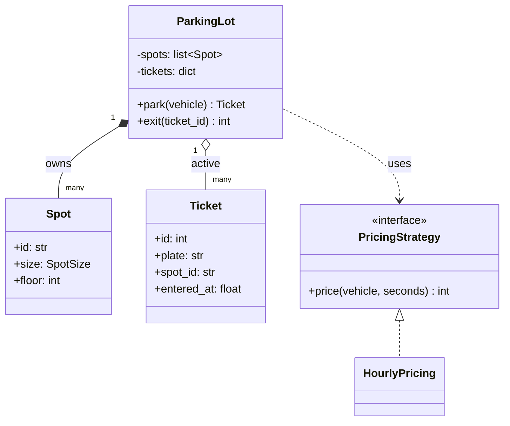
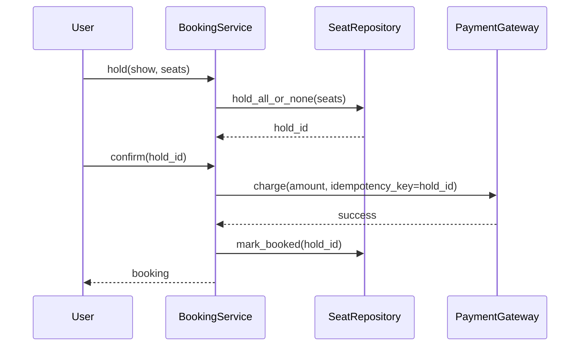

# LLD Interview Guide (SDE2)

Everything for the low-level design and machine-coding rounds in one page: how the round works → OOP, UML, SOLID and design patterns in depth → 25 problems with designs and runnable solutions.

Related: [syllabus](../test/INTERVIEW_SYLLABUS.md) · [concurrency guide](concurrency-interview-guide.md) · [HLD guide](hld-interview-guide.md)

**Code conventions:** Python 3.10+, standard library only. Every code block runs as-is (copy into a `.py` file) and ends with assertions. Money is in integer minor units (paise/cents) — never floats. Clocks are injected so tests don't sleep.

## Index

**Part A — The round**
- [1. How the round is graded](#1-how-the-round-is-graded)
- [2. The 6-step approach](#2-the-6-step-approach)

**Part B — Concepts**
- [3. OOP in depth](#3-oop-in-depth)
- [4. Class relationships and UML](#4-class-relationships-and-uml)
- [5. SOLID with code](#5-solid-with-code)
- [6. Other design principles](#6-other-design-principles)
- [7. Design patterns](#7-design-patterns)
- [8. Modeling techniques that come up in every problem](#8-modeling-techniques-that-come-up-in-every-problem)
- [9. Machine-coding: layout, errors, tests](#9-machine-coding-layout-errors-tests)

**Part C — Problems**
- [10. Tier 1 problems](#10-tier-1-problems)
- [11. Tier 2 problems](#11-tier-2-problems)
- [12. Tier 3 problems](#12-tier-3-problems)
- [13. Follow-up questions in every LLD round](#13-follow-up-questions-in-every-lld-round)

---

# Part A — The round

## 1. How the round is graded

Two formats:
- **LLD discussion (45–60 min — Amazon, Microsoft, Uber, Google L5+ sometimes):** requirements, class diagram, key methods, some code, extensibility questions.
- **Machine coding (90–120 min — Flipkart, Swiggy, PhonePe, Razorpay, Atlassian, Uber India):** working, runnable code; then a review where they add a feature or ask "what if".

| Area | What good looks like |
|---|---|
| Requirements | You ask questions and write down what's in and out of scope |
| Modeling | Right entities; each class has one clear job; no god class |
| Correctness | Invariants hold; invalid input and invalid state transitions are rejected; failed operations change nothing |
| Extensibility | A new type (vehicle, payment, discount) = a new class, not edits to `if/elif` chains |
| Patterns | Used where they solve a real problem; you can name the problem |
| Code quality | Clear names, small methods, custom exceptions, type hints, no global mutable state |
| Concurrency awareness | You can say what breaks with two concurrent users and how to fix it |
| Working code | It runs; you demo it |

**Biggest SDE2 mistakes:** coding before clarifying; one giant `Manager` class; patterns forced where they don't help; inheritance for everything; code that doesn't run at the end; ignoring edge cases (full lot, duplicate request, invalid state).

## 2. The 6-step approach

1. **Clarify (5 min):** actors, core use cases, rules, limits. Write "Out of scope: payments, auth, persistence, UI."
2. **Entities and ownership (5 min):** nouns → classes. Decide **who owns each piece of mutable state** (one owner per invariant).
3. **Public API (5 min):** methods on the main service — your contract. Inputs, outputs, errors.
4. **Variation points → patterns:** what changes independently? (pricing, assignment, discount, notification channel, state) → Strategy / State / Observer / Factory.
5. **Code:** models → service happy path → validation → edge cases. Keep it runnable at every step.
6. **Demo + discuss:** one success, one rejection, one edge case. Then: concurrency, persistence, scale, tests.

**Invariant-first habit:** before coding, write 1–3 rules that must always hold. Example (parking): "a spot holds at most one vehicle; a vehicle has at most one active ticket." Then every method:
- **validates everything first**, and only then mutates (so a failure leaves state unchanged);
- updates all related state **together** in the one owning class.

---

# Part B — Concepts

## 3. OOP in depth

### 3.1 Classes, objects, attributes, methods

- **Class:** a blueprint (data + behavior). **Object/instance:** one concrete thing made from it.
- **Instance attributes** (`self.x`) are per object. **Class attributes** are shared by all instances — never use a mutable class attribute as per-object state.
- **Instance methods** get `self`; **class methods** get `cls` (alternative constructors); **static methods** get neither (helpers that belong to the class's namespace).
- **Identity vs equality:** `a is b` (same object) vs `a == b` (equal values, `__eq__`).

```python
class Account:
    bank_name = "DemoBank"                 # class attribute: shared
    _next_id = 1

    def __init__(self, owner: str, balance: int = 0):
        self.id = Account._next_id         # instance attributes
        Account._next_id += 1
        self.owner = owner
        self._balance = balance

    @classmethod
    def with_bonus(cls, owner: str) -> "Account":   # alternative constructor
        return cls(owner, balance=500)

    @staticmethod
    def is_valid_amount(amount: int) -> bool:        # helper, no self/cls
        return isinstance(amount, int) and amount > 0

a, b = Account("asha"), Account.with_bonus("ravi")
assert (a.id, b.id) == (1, 2) and b._balance == 500
assert Account.is_valid_amount(10) and not Account.is_valid_amount(-1)
assert a.bank_name == b.bank_name == "DemoBank"
```

**Mutable class attribute bug (classic interview question):**
```python
class Bad:
    items = []                 # shared by ALL instances
    def add(self, x): self.items.append(x)

class Good:
    def __init__(self): self.items = []   # one list per instance
    def add(self, x): self.items.append(x)

b1, b2 = Bad(), Bad(); b1.add(1)
assert b2.items == [1]                   # surprise: leaked across objects
g1, g2 = Good(), Good(); g1.add(1)
assert g2.items == []
```
Same family: `def f(x, acc=[])` — default arguments are evaluated once, so the list is shared across calls. Use `acc=None` and inside: `if acc is None: acc = []`.

### 3.2 Encapsulation

- The object **owns its state** and exposes operations that keep it valid. Outsiders can't put it into an invalid state.
- Python has no `private`; conventions: `_name` (internal), `__name` (name-mangled, rarely needed).
- **Properties** expose read access (or validated writes) without exposing the field.
- Don't return internal mutable collections — return copies or read-only views.

```python
class BankAccount:
    def __init__(self, balance: int = 0):
        if balance < 0:
            raise ValueError("negative opening balance")
        self._balance = balance
        self._history: list[tuple[str, int]] = []

    @property
    def balance(self) -> int:              # read-only from outside
        return self._balance

    @property
    def history(self) -> tuple:            # a copy, not the internal list
        return tuple(self._history)

    def withdraw(self, amount: int) -> None:
        if amount <= 0:
            raise ValueError("amount must be positive")
        if amount > self._balance:
            raise ValueError("insufficient funds")   # validate before mutating
        self._balance -= amount
        self._history.append(("withdraw", amount))

acct = BankAccount(100)
acct.withdraw(30)
assert acct.balance == 70 and acct.history == (("withdraw", 30),)
try:
    acct.balance = 10**9
    assert False
except AttributeError:
    pass                                    # no setter → can't bypass rules
```

### 3.3 Abstraction: abstract classes and protocols

- Callers depend on **what** something does, not **how**.
- `abc.ABC` + `@abstractmethod`: a base class that can't be instantiated until subclasses implement the methods. Good when you also share code.
- `typing.Protocol`: structural typing ("anything with a `pay(amount)` method") — no inheritance needed. Good for loose coupling.
- In Python, a plain **callable** is often the simplest abstraction for a one-method strategy.

```python
from abc import ABC, abstractmethod
from typing import Protocol

class PaymentMethod(ABC):
    @abstractmethod
    def pay(self, amount: int) -> str: ...

    def pay_with_receipt(self, amount: int) -> str:     # shared behavior in the base
        return f"receipt:{self.pay(amount)}"

class Upi(PaymentMethod):
    def pay(self, amount): return f"upi:{amount}"

try:
    PaymentMethod()
    assert False
except TypeError:
    pass                                            # abstract → can't instantiate

class Notifier(Protocol):
    def send(self, user: str, msg: str) -> None: ...

class SmsNotifier:                                   # no inheritance from Notifier
    def __init__(self): self.sent = []
    def send(self, user, msg): self.sent.append((user, msg))

def notify_all(n: Notifier, users):                 # depends on the shape only
    for u in users:
        n.send(u, "hi")

sms = SmsNotifier()
notify_all(sms, ["a", "b"])
assert Upi().pay_with_receipt(5) == "receipt:upi:5" and len(sms.sent) == 2
```

**Abstract class vs interface (Java/C++ angle):** an abstract class can hold state and shared code; a class can extend only one (Java). An interface defines a contract; a class can implement many. Python's ABC plays both roles; Protocol is the closest to a pure interface.

### 3.4 Inheritance

- "**is-a**" with **substitutability**: a subclass must work anywhere the parent works (Liskov).
- `super()` calls the parent's implementation (follows the **MRO** — method resolution order).
- Multiple inheritance exists in Python (mixins), but keep it to small, independent mixins.
- **When not to inherit:** to reuse a few fields or helpers, to model roles that change at runtime (a user who becomes an admin), or variants that combine (weekend + truck pricing → subclass explosion). Use composition instead.

```python
class Vehicle:
    wheels = 4
    def __init__(self, plate: str):
        self.plate = plate
    def describe(self) -> str:
        return f"{type(self).__name__}({self.plate}, {self.wheels} wheels)"

class Bike(Vehicle):
    wheels = 2

class Truck(Vehicle):
    wheels = 6
    def __init__(self, plate: str, load_tons: int):
        super().__init__(plate)            # reuse parent initialization
        self.load_tons = load_tons
    def describe(self):
        return super().describe() + f" load={self.load_tons}t"

assert Bike("B1").describe() == "Bike(B1, 2 wheels)"
assert Truck("T1", 10).describe() == "Truck(T1, 6 wheels) load=10t"
assert [c.__name__ for c in Truck.__mro__] == ["Truck", "Vehicle", "object"]
```

### 3.5 Polymorphism

- **Subtype polymorphism:** one call site, many implementations (`shape.area()`).
- **Duck typing:** Python cares that the method exists, not the type.
- **Operator overloading** via dunder methods (`__add__`, `__lt__`, `__eq__`).
- Replaces `if type == ...` chains → new behavior = new class.

```python
import math

class Shape:
    def area(self) -> float:
        raise NotImplementedError

class Circle(Shape):
    def __init__(self, r): self.r = r
    def area(self): return math.pi * self.r ** 2

class Rect(Shape):
    def __init__(self, w, h): self.w, self.h = w, h
    def area(self): return self.w * self.h

shapes = [Circle(1), Rect(2, 3)]
assert round(sum(s.area() for s in shapes), 2) == 9.14      # no if/else on type
```

### 3.6 Composition, aggregation, delegation

- **Composition (has-a, owns):** the part lives and dies with the whole (an `Order` owns its `OrderLine`s).
- **Aggregation (has-a, shares):** the part exists independently (a `Team` has `Player`s who exist without it).
- **Delegation:** an object forwards work to a component (`Car.start()` → `self.engine.start()`).
- **Composition over inheritance:** assemble behavior from small parts you can swap at runtime.

```python
class PetrolEngine:
    def start(self): return "vroom"

class ElectricEngine:
    def start(self): return "hum"

class Car:
    def __init__(self, engine):            # composed, swappable
        self.engine = engine
    def start(self):
        return self.engine.start()         # delegation

car = Car(PetrolEngine())
assert car.start() == "vroom"
car.engine = ElectricEngine()              # change behavior without a subclass
assert car.start() == "hum"
```

### 3.7 Dataclasses, value objects, entities, enums

- **Entity:** has an identity that persists while attributes change (User #42 changes email, still the same user). Equality by ID.
- **Value object:** defined only by its values, immutable (Money(500, "INR"), Location(lat, lng), DateRange). Equality by value. Use `@dataclass(frozen=True)`.
- **Enums** for fixed sets (statuses, types) — no magic strings.
- `field(default_factory=list)` for mutable defaults. `order=True` gives comparisons. `slots=True` saves memory.

```python
from dataclasses import dataclass, field
from enum import Enum

@dataclass(frozen=True)
class Money:
    amount: int                  # minor units
    currency: str = "INR"

    def __add__(self, other: "Money") -> "Money":
        if self.currency != other.currency:
            raise ValueError("currency mismatch")
        return Money(self.amount + other.amount, self.currency)

class OrderStatus(Enum):
    PLACED = "placed"
    SHIPPED = "shipped"

@dataclass
class Order:                     # entity: mutable, identified by id
    id: int
    status: OrderStatus = OrderStatus.PLACED
    lines: list[Money] = field(default_factory=list)

    def __eq__(self, other):
        return isinstance(other, Order) and other.id == self.id
    __hash__ = object.__hash__

assert Money(100) + Money(50) == Money(150)          # value equality
assert len({Money(1), Money(1)}) == 1                # frozen → hashable
o1, o2 = Order(1), Order(1, OrderStatus.SHIPPED)
assert o1 == o2                                      # same identity
try:
    Money(1).amount = 5
    assert False
except Exception:
    pass                                             # immutable
```

### 3.8 Useful dunder methods

| Method | Purpose |
|---|---|
| `__repr__` / `__str__` | Debug / user-facing text |
| `__eq__` + `__hash__` | Equality and use as dict keys / in sets (must agree: equal objects → equal hashes) |
| `__lt__` (+ `functools.total_ordering`) | Sorting, heaps |
| `__len__`, `__iter__`, `__contains__`, `__getitem__` | Make a collection behave like one |
| `__enter__` / `__exit__` | Context managers (`with`) for resources/locks |
| `__call__` | Object usable as a function (strategy objects) |

```python
import heapq
from functools import total_ordering

@total_ordering
class Task:
    def __init__(self, priority: int, name: str):
        self.priority, self.name = priority, name
    def __eq__(self, other): return self.priority == other.priority
    def __lt__(self, other): return self.priority < other.priority
    def __repr__(self): return f"Task({self.priority}, {self.name!r})"

class Playlist:
    def __init__(self, songs): self._songs = list(songs)
    def __len__(self): return len(self._songs)
    def __iter__(self): return iter(self._songs)
    def __contains__(self, s): return s in self._songs

heap = [Task(3, "c"), Task(1, "a"), Task(2, "b")]
heapq.heapify(heap)
assert heapq.heappop(heap).name == "a" and Task(1, "x") <= Task(2, "y")
p = Playlist(["x", "y"])
assert len(p) == 2 and "y" in p and list(p) == ["x", "y"]
```

### 3.9 Exceptions as part of the design

- Define a small hierarchy: `class DomainError(Exception)`, then `NotFound`, `InvalidState`, `InsufficientFunds`…
- Raise specific errors; don't return `None`/`False` for failures (callers forget to check).
- Validate at the service boundary; inside, trust your invariants.
- Never swallow exceptions silently; convert to domain errors at boundaries (e.g., a provider's HTTP error → `PaymentFailed`).

```python
class DomainError(Exception): ...
class NotFound(DomainError): ...
class InvalidState(DomainError): ...

def find(store: dict, key):
    try:
        return store[key]
    except KeyError:
        raise NotFound(f"{key} not found") from None

try:
    find({}, "x")
except DomainError as e:            # callers can catch the whole family
    assert isinstance(e, NotFound)
```

## 4. Class relationships and UML

### 4.1 Relationships (strongest → weakest coupling)

| Relationship | Meaning | Example | UML arrow |
|---|---|---|---|
| **Inheritance (generalization)** | is-a | `Car` is a `Vehicle` | solid line, hollow triangle `<\|--` |
| **Realization** | implements an interface | `Upi` implements `PaymentMethod` | dashed line, hollow triangle `<\|..` |
| **Composition** | owns; part dies with the whole | `Order` ◆— `OrderLine` | filled diamond `*--` |
| **Aggregation** | has; part lives independently | `Team` ◇— `Player` | hollow diamond `o--` |
| **Association** | knows about / uses long-term | `Driver` — `Car` | plain line `--` |
| **Dependency** | uses temporarily (parameter, local) | `ReportService` uses `Formatter` | dashed arrow `..>` |

**Multiplicity:** `1`, `0..1`, `*`, `1..*` on each end (one `Order` has `1..*` lines).

### 4.2 Class diagram example (parking lot)



### 4.3 Sequence diagram example (booking)



In interviews, a quick text version is fine: `ParkingLot 1──* Spot`, `ParkingLot ──> PricingStrategy`.

## 5. SOLID with code

### 5.1 S — Single Responsibility Principle

**A class should have one reason to change.** "Reason to change" = one stakeholder/concern (business rules, formatting, persistence, notification).

```python
# BAD: business rules, formatting and persistence in one class.
class InvoiceBad:
    def __init__(self, items): self.items = items
    def total(self): return sum(p * q for p, q in self.items)
    def to_html(self): return f"<b>{self.total()}</b>"        # presentation
    def save(self, db): db.append(self.total())                 # persistence

# GOOD: each class changes for one reason.
class Invoice:
    def __init__(self, items): self.items = items
    def total(self) -> int: return sum(p * q for p, q in self.items)

class InvoiceHtmlRenderer:
    def render(self, invoice: Invoice) -> str: return f"<b>{invoice.total()}</b>"

class InvoiceRepository:
    def __init__(self): self.rows = []
    def save(self, invoice: Invoice) -> None: self.rows.append(invoice.total())

inv = Invoice([(100, 2), (50, 1)])
repo = InvoiceRepository(); repo.save(inv)
assert InvoiceHtmlRenderer().render(inv) == "<b>250</b>" and repo.rows == [250]
```

### 5.2 O — Open/Closed Principle

**Open for extension, closed for modification:** add behavior by adding code, not by editing tested code.

```python
from abc import ABC, abstractmethod

# BAD: every new customer type edits this function.
def discount_bad(kind: str, amount: int) -> int:
    if kind == "regular": return 0
    elif kind == "premium": return amount // 10
    elif kind == "vip": return amount // 5
    raise ValueError(kind)

# GOOD: new types are new classes; the checkout code never changes.
class DiscountPolicy(ABC):
    @abstractmethod
    def discount(self, amount: int) -> int: ...

class Regular(DiscountPolicy):
    def discount(self, amount): return 0

class Premium(DiscountPolicy):
    def discount(self, amount): return amount // 10

class Vip(DiscountPolicy):              # added later without touching checkout()
    def discount(self, amount): return amount // 5

def checkout(amount: int, policy: DiscountPolicy) -> int:
    return amount - policy.discount(amount)

assert checkout(1000, Premium()) == 900 and checkout(1000, Vip()) == 800
```

### 5.3 L — Liskov Substitution Principle

**Subtypes must be usable wherever the base type is expected without breaking correctness.** Subclasses must not strengthen preconditions, weaken postconditions, or throw unexpected errors.

```python
# BAD: Square breaks Rectangle's contract (setting width changes height).
class Rectangle:
    def __init__(self, w, h): self.w, self.h = w, h
    def set_width(self, w): self.w = w
    def area(self): return self.w * self.h

class SquareBad(Rectangle):
    def __init__(self, s): super().__init__(s, s)
    def set_width(self, w): self.w = self.h = w

def stretch(r: Rectangle):
    r.set_width(10)
    return r.area()            # caller expects 10 * original height

assert stretch(Rectangle(2, 3)) == 30
assert stretch(SquareBad(3)) == 100          # violates the expectation (30)

# GOOD: don't model Square as a mutable Rectangle; share a smaller abstraction.
class Shape:
    def area(self) -> int: raise NotImplementedError

class Rect(Shape):
    def __init__(self, w, h): self.w, self.h = w, h
    def area(self): return self.w * self.h

class Square(Shape):
    def __init__(self, s): self.s = s
    def area(self): return self.s * self.s

assert [s.area() for s in (Rect(2, 3), Square(3))] == [6, 9]
```

Other classic LSP smells: `Penguin(Bird)` with `fly()` raising; a `ReadOnlyList(list)` whose `append` raises. Fix by splitting the abstraction (`Bird` vs `FlyingBird`).

### 5.4 I — Interface Segregation Principle

**Clients shouldn't depend on methods they don't use.** Prefer several small interfaces over one fat one.

```python
from abc import ABC, abstractmethod

# BAD: a basic printer is forced to implement scan/fax.
class MachineBad(ABC):
    @abstractmethod
    def print(self, doc): ...
    @abstractmethod
    def scan(self, doc): ...
    @abstractmethod
    def fax(self, doc): ...

# GOOD: small role interfaces, combine as needed.
class Printer(ABC):
    @abstractmethod
    def print(self, doc): ...

class Scanner(ABC):
    @abstractmethod
    def scan(self, doc): ...

class BasicPrinter(Printer):
    def print(self, doc): return f"printed {doc}"

class OfficeMachine(Printer, Scanner):
    def print(self, doc): return f"printed {doc}"
    def scan(self, doc): return f"scanned {doc}"

assert BasicPrinter().print("a") == "printed a"
assert OfficeMachine().scan("b") == "scanned b"
```

### 5.5 D — Dependency Inversion Principle

**High-level modules depend on abstractions, not concrete low-level modules.** Inject dependencies (constructor injection) → swappable and testable.

```python
from typing import Protocol

class EmailSender(Protocol):
    def send(self, to: str, body: str) -> None: ...

# BAD: OrderService creates a concrete SMTP client inside → can't test without SMTP.
# class OrderService:
#     def __init__(self): self.mailer = SmtpMailer("smtp.prod")

# GOOD: depend on the abstraction, receive it from outside.
class OrderService:
    def __init__(self, mailer: EmailSender):
        self._mailer = mailer
    def place(self, user_email: str, order_id: int) -> None:
        self._mailer.send(user_email, f"order {order_id} placed")

class FakeMailer:
    def __init__(self): self.outbox = []
    def send(self, to, body): self.outbox.append((to, body))

fake = FakeMailer()
OrderService(fake).place("a@x.com", 7)
assert fake.outbox == [("a@x.com", "order 7 placed")]
```

**DIP vs DI vs IoC:** DIP is the principle (depend on abstractions). Dependency injection is a technique (pass dependencies in). Inversion of control is the broader idea (a framework/container wires things and calls your code).

## 6. Other design principles

| Principle | Meaning | In practice |
|---|---|---|
| **DRY** | Each piece of knowledge has one source | One validation function, not five copies. But don't merge code that only *looks* similar (it may change for different reasons). |
| **KISS** | Simplest design that works | A dict + lock beats a custom concurrent structure in a 90-min round. |
| **YAGNI** | Don't build what isn't required yet | No plugin system "for later". Leave a seam (interface) instead. |
| **Composition over inheritance** | Combine small parts | Strategy objects instead of subclass trees. |
| **High cohesion, low coupling** | Related things together; few dependencies between modules | A `Cart` owns cart logic; it doesn't reach into payment internals. |
| **Law of Demeter** | Talk only to immediate friends | `order.total()`, not `order.cart.items[0].product.price.amount`. |
| **Tell, don't ask** | Tell an object to do something instead of pulling its data and deciding outside | `account.withdraw(50)` rather than `if account.balance >= 50: account.balance -= 50`. |
| **Fail fast** | Detect invalid input/state early with clear errors | Validate in constructors and at service entry. |
| **Separation of concerns** | Different concerns in different layers | Parsing input ≠ business logic ≠ storage. |
| **Program to an interface** | Depend on contracts | Accept `PaymentMethod`, not `RazorpayClient`. |

## 7. Design patterns

For each: **intent → when it shows up in LLD → code**. All blocks run.

### 7.1 Creational

**Singleton** — exactly one instance (logger registry, config). Prefer creating one object at startup and injecting it; know the thread-safe version for interviews.

```python
from threading import Lock

class Config:
    _instance = None
    _lock = Lock()

    def __new__(cls):
        if cls._instance is None:                 # fast path without locking
            with cls._lock:
                if cls._instance is None:         # double-checked locking
                    cls._instance = super().__new__(cls)
                    cls._instance.settings = {}
        return cls._instance

Config().settings["env"] = "prod"
assert Config() is Config() and Config().settings["env"] == "prod"
```
Pythonic alternative: a module-level instance (`config = Config()` in `config.py`) — modules are imported once.

**Factory method / simple factory** — create the right subtype from input; callers don't know concrete classes.

```python
from abc import ABC, abstractmethod

class Notification(ABC):
    @abstractmethod
    def send(self, msg: str) -> str: ...

class Email(Notification):
    def send(self, msg): return f"email:{msg}"

class Sms(Notification):
    def send(self, msg): return f"sms:{msg}"

class NotificationFactory:
    _registry: dict[str, type[Notification]] = {"email": Email, "sms": Sms}

    @classmethod
    def register(cls, kind: str, klass: type[Notification]) -> None:
        cls._registry[kind] = klass                 # extend without editing create()

    @classmethod
    def create(cls, kind: str) -> Notification:
        try:
            return cls._registry[kind]()
        except KeyError:
            raise ValueError(f"unknown channel {kind}") from None

class Push(Notification):
    def send(self, msg): return f"push:{msg}"

NotificationFactory.register("push", Push)
assert NotificationFactory.create("push").send("hi") == "push:hi"
```

**Abstract factory** — create *families* of related objects that must match (UI theme: dark button + dark checkbox; cloud provider: AWS storage + AWS queue).

```python
class DarkButton:
    def render(self): return "dark-button"
class DarkCheckbox:
    def render(self): return "dark-checkbox"
class LightButton:
    def render(self): return "light-button"
class LightCheckbox:
    def render(self): return "light-checkbox"

class DarkTheme:
    def button(self): return DarkButton()
    def checkbox(self): return DarkCheckbox()

class LightTheme:
    def button(self): return LightButton()
    def checkbox(self): return LightCheckbox()

def build_form(theme):                    # never mixes families
    return [theme.button().render(), theme.checkbox().render()]

assert build_form(DarkTheme()) == ["dark-button", "dark-checkbox"]
```

**Builder** — construct complex objects step by step with many optional parts; validate at `build()`.

```python
from dataclasses import dataclass

@dataclass(frozen=True)
class HttpRequest:
    method: str
    url: str
    headers: tuple
    body: str | None
    timeout: float

class RequestBuilder:
    def __init__(self, url: str):
        self._url, self._method, self._headers = url, "GET", []
        self._body, self._timeout = None, 5.0

    def method(self, m: str): self._method = m; return self
    def header(self, k: str, v: str): self._headers.append((k, v)); return self
    def body(self, b: str): self._body = b; return self
    def timeout(self, t: float): self._timeout = t; return self

    def build(self) -> HttpRequest:
        if self._method == "GET" and self._body is not None:
            raise ValueError("GET cannot have a body")
        return HttpRequest(self._method, self._url, tuple(self._headers), self._body, self._timeout)

req = RequestBuilder("/orders").method("POST").header("Idempotency-Key", "k1").body("{}").build()
assert req.method == "POST" and req.headers == (("Idempotency-Key", "k1"),)
```

**Prototype** — create new objects by copying an existing configured one (`copy.deepcopy`), e.g., cloning a document template or a game unit.

```python
import copy

class Template:
    def __init__(self, sections): self.sections = sections
    def clone(self): return copy.deepcopy(self)

base = Template(["header", "footer"])
doc = base.clone(); doc.sections.append("body")
assert base.sections == ["header", "footer"]           # original untouched
```

### 7.2 Structural

**Adapter** — make an incompatible interface fit the one your code expects (wrapping third-party SDKs).

```python
class LegacySmsApi:                          # third-party, can't change
    def send_text(self, phone_number, text_body): return f"legacy:{phone_number}:{text_body}"

class SmsSender:                             # what our code expects
    def send(self, to: str, msg: str) -> str: raise NotImplementedError

class LegacySmsAdapter(SmsSender):
    def __init__(self, api: LegacySmsApi): self._api = api
    def send(self, to, msg): return self._api.send_text(phone_number=to, text_body=msg)

assert LegacySmsAdapter(LegacySmsApi()).send("99", "hi") == "legacy:99:hi"
```

**Decorator** — add responsibilities by wrapping an object with the same interface; stack wrappers (pizza toppings, logging/retry/caching around a service).

```python
class DataSource:
    def __init__(self): self.calls = 0
    def read(self, key): self.calls += 1; return f"value:{key}"

class CachingSource:                         # same interface, wraps another source
    def __init__(self, inner): self.inner, self.cache = inner, {}
    def read(self, key):
        if key not in self.cache:
            self.cache[key] = self.inner.read(key)
        return self.cache[key]

class LoggingSource:
    def __init__(self, inner): self.inner, self.log = inner, []
    def read(self, key):
        self.log.append(key)
        return self.inner.read(key)

raw = DataSource()
src = LoggingSource(CachingSource(raw))      # stack: logging → caching → raw
src.read("a"); src.read("a")
assert raw.calls == 1 and src.log == ["a", "a"]
```

**Facade** — one simple entry point over a complex subsystem.

```python
class Inventory:
    def reserve(self, sku): return f"reserved {sku}"
class Payments:
    def charge(self, amt): return f"charged {amt}"
class Shipping:
    def schedule(self, sku): return f"shipping {sku}"

class CheckoutFacade:
    def __init__(self):
        self.inv, self.pay, self.ship = Inventory(), Payments(), Shipping()
    def buy(self, sku, amount):              # callers don't orchestrate 3 subsystems
        return [self.inv.reserve(sku), self.pay.charge(amount), self.ship.schedule(sku)]

assert CheckoutFacade().buy("tee", 500)[1] == "charged 500"
```

**Proxy** — a stand-in that controls access: lazy loading, access control, caching, remote calls.

```python
class Image:
    def __init__(self, path):
        self.path = path
        self.loaded = True                   # imagine expensive disk read
    def show(self): return f"showing {self.path}"

class LazyImage:                             # virtual proxy: load on first use
    def __init__(self, path): self.path, self._real = path, None
    def show(self):
        if self._real is None:
            self._real = Image(self.path)
        return self._real.show()

class ProtectedImage:                        # protection proxy
    def __init__(self, img, user_role): self.img, self.role = img, user_role
    def show(self):
        if self.role != "admin":
            raise PermissionError("admins only")
        return self.img.show()

lazy = LazyImage("a.png")
assert lazy._real is None and lazy.show() == "showing a.png"
try:
    ProtectedImage(lazy, "guest").show(); assert False
except PermissionError:
    pass
```

**Composite** — treat a tree of objects uniformly (file/folder, menu/submenu, org chart).

```python
class File:
    def __init__(self, name, size): self.name, self._size = name, size
    def size(self): return self._size

class Folder:
    def __init__(self, name): self.name, self.children = name, []
    def add(self, node): self.children.append(node); return self
    def size(self): return sum(c.size() for c in self.children)   # same method as File

root = Folder("root").add(File("a", 10)).add(Folder("sub").add(File("b", 5)))
assert root.size() == 15
```

**Bridge** — split an abstraction from its implementation so both vary independently (shapes × renderers, notifications × channels) instead of a class per combination.

```python
class Renderer:
    def circle(self, r): raise NotImplementedError
class SvgRenderer(Renderer):
    def circle(self, r): return f"<circle r={r}>"
class CanvasRenderer(Renderer):
    def circle(self, r): return f"ctx.arc({r})"

class Circle:                                # abstraction holds an implementation
    def __init__(self, r, renderer: Renderer): self.r, self.renderer = r, renderer
    def draw(self): return self.renderer.circle(self.r)

assert Circle(2, SvgRenderer()).draw() == "<circle r=2>"
assert Circle(2, CanvasRenderer()).draw() == "ctx.arc(2)"
```

**Flyweight** — share immutable intrinsic state among many objects to save memory (glyphs in an editor, tree types in a game, seat types in a stadium).

```python
from functools import lru_cache

class SeatType:                              # shared, immutable
    def __init__(self, name, price): self.name, self.price = name, price

@lru_cache(maxsize=None)
def seat_type(name: str, price: int) -> SeatType:
    return SeatType(name, price)

seats = [(row, col, seat_type("GOLD", 300)) for row in range(100) for col in range(100)]
assert len({id(t) for _, _, t in seats}) == 1   # 10,000 seats share one SeatType
```

### 7.3 Behavioral

**Strategy** — interchangeable algorithms behind one interface (pricing, discount, assignment, split type, rate-limit algorithm). In Python a callable often suffices.

```python
from typing import Callable

PricingStrategy = Callable[[int], int]           # hours -> amount

def hourly(rate): return lambda hours: hours * rate
def flat(amount): return lambda hours: amount
def capped(inner, cap): return lambda hours: min(cap, inner(hours))   # strategies compose

class ParkingFee:
    def __init__(self, strategy: PricingStrategy): self.strategy = strategy
    def fee(self, hours): return self.strategy(hours)

assert ParkingFee(hourly(40)).fee(3) == 120
assert ParkingFee(capped(hourly(40), 100)).fee(3) == 100
```

**Observer** — publishers notify subscribers about events without knowing them (notifications, UI updates, stock alerts).

```python
from collections import defaultdict

class EventBus:
    def __init__(self): self._subs = defaultdict(list)
    def subscribe(self, event: str, handler) -> None: self._subs[event].append(handler)
    def unsubscribe(self, event: str, handler) -> None: self._subs[event].remove(handler)
    def publish(self, event: str, payload) -> None:
        for handler in list(self._subs[event]):   # copy: handlers may unsubscribe
            handler(payload)

bus, got = EventBus(), []
email = lambda p: got.append(("email", p))
bus.subscribe("order_shipped", email)
bus.subscribe("order_shipped", lambda p: got.append(("sms", p)))
bus.publish("order_shipped", 42)
bus.unsubscribe("order_shipped", email)
bus.publish("order_shipped", 43)
assert got == [("email", 42), ("sms", 42), ("sms", 43)]
```

**State** — behavior depends on the current state; each state is an object that handles actions and decides the next state (vending machine, ATM, order lifecycle, traffic light). Replaces big `if state == ...` blocks in every method.

```python
class InvalidAction(Exception): ...

class DocState:
    def submit(self, doc): raise InvalidAction(f"{type(self).__name__}: submit")
    def approve(self, doc): raise InvalidAction(f"{type(self).__name__}: approve")
    def reject(self, doc): raise InvalidAction(f"{type(self).__name__}: reject")

class Draft(DocState):
    def submit(self, doc): doc.state = InReview()

class InReview(DocState):
    def approve(self, doc): doc.state = Published()
    def reject(self, doc): doc.state = Draft()

class Published(DocState):
    pass

class Document:
    def __init__(self): self.state = Draft()
    def submit(self): self.state.submit(self)
    def approve(self): self.state.approve(self)
    def reject(self): self.state.reject(self)

d = Document(); d.submit(); d.reject(); d.submit(); d.approve()
assert isinstance(d.state, Published)
try:
    d.submit(); assert False
except InvalidAction:
    pass
```
Lighter alternative for simple lifecycles: an enum + a transition table (`ALLOWED[current] = {next states}`) — used in several problems below. Use full State classes when each state has different *behavior*, not just different allowed transitions.

**Command** — wrap an action as an object (with `execute`/`undo`): undo/redo, macro recording, job queues.

```python
class Editor:
    def __init__(self): self.text = ""

class InsertCommand:
    def __init__(self, editor, s): self.editor, self.s = editor, s
    def execute(self): self.editor.text += self.s
    def undo(self): self.editor.text = self.editor.text[: -len(self.s)]

class History:
    def __init__(self): self.done, self.undone = [], []
    def run(self, cmd): cmd.execute(); self.done.append(cmd); self.undone.clear()
    def undo(self):
        cmd = self.done.pop(); cmd.undo(); self.undone.append(cmd)
    def redo(self):
        cmd = self.undone.pop(); cmd.execute(); self.done.append(cmd)

ed, h = Editor(), History()
h.run(InsertCommand(ed, "Hello")); h.run(InsertCommand(ed, " World"))
h.undo(); assert ed.text == "Hello"
h.redo(); assert ed.text == "Hello World"
```

**Chain of Responsibility** — pass a request along handlers until one handles it (log levels, approval workflows, middleware, ATM note dispensing).

```python
class Handler:
    def __init__(self, nxt=None): self.nxt = nxt
    def handle(self, request):
        return self.nxt.handle(request) if self.nxt else "rejected"

class AuthCheck(Handler):
    def handle(self, req):
        return "401" if not req.get("user") else super().handle(req)

class RateCheck(Handler):
    def handle(self, req):
        return "429" if req.get("count", 0) > 100 else super().handle(req)

class Endpoint(Handler):
    def handle(self, req): return "200"

pipeline = AuthCheck(RateCheck(Endpoint()))
assert pipeline.handle({}) == "401"
assert pipeline.handle({"user": "u", "count": 500}) == "429"
assert pipeline.handle({"user": "u"}) == "200"
```

**Template method** — fixed algorithm skeleton in a base class; subclasses fill in steps.

```python
from abc import ABC, abstractmethod

class Report(ABC):
    def generate(self) -> str:                 # the fixed skeleton
        return "\n".join([self.header(), *self.rows(), self.footer()])
    def header(self): return "REPORT"
    def footer(self): return "END"
    @abstractmethod
    def rows(self) -> list[str]: ...

class SalesReport(Report):
    def rows(self): return ["tee,2", "mug,1"]

assert SalesReport().generate() == "REPORT\ntee,2\nmug,1\nEND"
```

**Iterator** — traverse a collection without exposing its internals (paginated results, tree traversal).

```python
class Paginated:
    def __init__(self, fetch_page): self.fetch_page = fetch_page
    def __iter__(self):
        page = 0
        while items := self.fetch_page(page):
            yield from items
            page += 1

data = list(range(7))
pages = Paginated(lambda p: data[p * 3:(p + 1) * 3])
assert list(pages) == data
```

**Mediator** — objects communicate through a central mediator instead of referencing each other (chat room, air traffic control, UI form widgets).

```python
class ChatRoom:
    def __init__(self): self.users = {}
    def join(self, user): self.users[user.name] = user; user.room = self
    def send(self, sender, to, msg): self.users[to].inbox.append((sender, msg))

class User:
    def __init__(self, name): self.name, self.inbox, self.room = name, [], None
    def send(self, to, msg): self.room.send(self.name, to, msg)   # no direct reference to `to`

room, a, b = ChatRoom(), User("a"), User("b")
room.join(a); room.join(b); a.send("b", "hi")
assert b.inbox == [("a", "hi")]
```

**Memento** — capture and restore an object's state without exposing internals (undo snapshots, game save).

```python
class TextBox:
    def __init__(self): self._text = ""
    def type(self, s): self._text += s
    def save(self): return ("memento", self._text)          # opaque snapshot
    def restore(self, m): self._text = m[1]
    @property
    def text(self): return self._text

box = TextBox(); box.type("hello"); snap = box.save(); box.type(" world")
box.restore(snap)
assert box.text == "hello"
```

**Visitor** — add operations over a fixed set of element types without changing them (exporting a document tree to HTML/Markdown, computing taxes over different item types).

```python
class Book:
    def __init__(self, price): self.price = price
    def accept(self, v): return v.visit_book(self)

class Food:
    def __init__(self, price): self.price = price
    def accept(self, v): return v.visit_food(self)

class TaxVisitor:                       # new operation = new visitor, items unchanged
    def visit_book(self, b): return b.price * 5 // 100
    def visit_food(self, f): return 0

items = [Book(1000), Food(500)]
assert sum(i.accept(TaxVisitor()) for i in items) == 50
```

### 7.4 Other patterns that appear in LLD answers

- **Repository:** a collection-like interface over storage (`OrderRepository.get/save/find_by_user`). Services don't know if it's a dict or a DB.
- **Specification / filter objects:** composable predicates for search (`ByAuthor("x") & Available()`).
- **Null object:** a do-nothing implementation instead of `None` checks (`NoDiscount`, `NullLogger`).
- **Object pool:** reuse expensive objects (DB connections) — see the concurrency guide.
- **Producer–consumer, thread pool, read-write lock:** concurrency patterns — see the [concurrency guide](concurrency-interview-guide.md).

```python
class Spec:
    def __init__(self, pred): self.pred = pred
    def __call__(self, x): return self.pred(x)
    def __and__(self, other): return Spec(lambda x: self(x) and other(x))
    def __or__(self, other): return Spec(lambda x: self(x) or other(x))
    def __invert__(self): return Spec(lambda x: not self(x))

books = [{"author": "a", "available": True}, {"author": "a", "available": False}, {"author": "b", "available": True}]
by_a = Spec(lambda b: b["author"] == "a")
available = Spec(lambda b: b["available"])
assert [b for b in books if (by_a & available)(b)] == [books[0]]
assert len([b for b in books if (~by_a | ~available)(b)]) == 2
```

### 7.5 Pattern quick-pick table

| If the problem says… | Reach for |
|---|---|
| "different pricing / discount / assignment / split rules" | Strategy |
| "notify users / update display when X changes" | Observer |
| "machine/lifecycle with states; actions valid only in some states" | State (or enum + transition table) |
| "create objects by type string / config" | Factory (+ registry) |
| "many optional parameters" | Builder |
| "undo/redo, queue actions" | Command (+ Memento) |
| "request passes through levels/handlers" | Chain of Responsibility |
| "tree of items treated uniformly" | Composite |
| "wrap a third-party API" | Adapter |
| "add features on top without subclassing" | Decorator |
| "simplify a complex subsystem" | Facade |
| "only one instance" | Singleton (or inject one instance) |

## 8. Modeling techniques that come up in every problem

### 8.1 State machines with a transition table

```python
from enum import Enum, auto

class Status(Enum):
    CREATED = auto(); PAID = auto(); SHIPPED = auto(); DELIVERED = auto(); CANCELLED = auto()

ALLOWED = {
    Status.CREATED: {Status.PAID, Status.CANCELLED},
    Status.PAID: {Status.SHIPPED, Status.CANCELLED},
    Status.SHIPPED: {Status.DELIVERED},
    Status.DELIVERED: set(),
    Status.CANCELLED: set(),
}

def transition(current: Status, new: Status) -> Status:
    if new not in ALLOWED[current]:
        raise ValueError(f"{current.name} -> {new.name} not allowed")
    return new

s = transition(Status.CREATED, Status.PAID)
try:
    transition(s, Status.DELIVERED); assert False
except ValueError:
    pass
```

### 8.2 Interval overlap (bookings, meetings, rentals)

Two half-open intervals `[a1, a2)` and `[b1, b2)` overlap **iff `a1 < b2 and b1 < a2`**. Back-to-back (`a2 == b1`) doesn't overlap. Use half-open intervals everywhere to avoid off-by-one bugs.

### 8.3 Allocation with fast lookup

- Smallest free spot of size ≥ k → a min-heap (or sorted list) per size.
- Nearest available driver → geo cell index; for interviews, a scan with `min(..., key=distance)` is fine; mention the index.
- Free items per type → `dict[type, set[id]]` for O(1) pick/release.

### 8.4 Validate → compute → commit

```
def operation(...):
    1. validate all inputs and preconditions (raise on failure)
    2. compute the result (pure, may raise)
    3. commit all state changes together (no raising after this point)
```
This makes every failure leave state unchanged — the most common correctness bug in machine-coding rounds.

### 8.5 IDs, time, and money

- IDs: `itertools.count(1)` per service, or `uuid4()`.
- Time: inject `clock=time.monotonic` (durations) or `datetime` provider (calendar dates); tests pass a fake.
- Money: integers in minor units; when splitting, distribute the remainder explicitly so parts sum to the total.

```python
def split_evenly(total: int, n: int) -> list[int]:
    base, extra = divmod(total, n)
    return [base + 1 if i < extra else base for i in range(n)]

assert split_evenly(1000, 3) == [334, 333, 333] and sum(split_evenly(1000, 3)) == 1000
```

### 8.6 Thread-safety in LLD answers

- Name the race ("two gates pick the same free spot").
- Simplest fix: one lock in the owning service around check + act.
- Better throughput: per-entity locks (per show, per account) — acquire multiple in a fixed order.
- Multi-server: in-process locks don't work → DB conditional updates / unique constraints.
- Details and patterns: [concurrency guide](concurrency-interview-guide.md).

## 9. Machine-coding: layout, errors, tests

### 9.1 Project layout (90-minute round)

```
app/
  models/          # dataclasses + enums (Order, Item, OrderStatus)
  strategies/      # interchangeable policies (pricing, assignment)
  repositories/    # in-memory stores behind small interfaces
  services/        # business logic; enforces invariants
  exceptions.py    # DomainError, NotFound, InvalidState, ...
  main.py          # demo driver / command parser
tests/
  test_services.py
```

- In-memory repositories behind an interface → "swap for a DB" is one class.
- Parse commands in `main.py`; keep business logic free of I/O and parsing.
- If the problem gives a command format (`ADD_USER u1 ...`), write a tiny dispatcher: `{"ADD_USER": service.add_user, ...}`.

### 9.2 Repository example

```python
from abc import ABC, abstractmethod
from dataclasses import dataclass

@dataclass
class User:
    id: str
    name: str

class UserRepository(ABC):
    @abstractmethod
    def get(self, user_id: str) -> User: ...
    @abstractmethod
    def save(self, user: User) -> None: ...

class InMemoryUserRepository(UserRepository):
    def __init__(self): self._rows: dict[str, User] = {}
    def get(self, user_id):
        if user_id not in self._rows:
            raise KeyError(user_id)
        return self._rows[user_id]
    def save(self, user): self._rows[user.id] = user

repo = InMemoryUserRepository(); repo.save(User("u1", "Asha"))
assert repo.get("u1").name == "Asha"
```

### 9.3 Testing in the round

```python
import unittest

class Wallet:
    def __init__(self): self.balance = 0
    def add(self, amt):
        if amt <= 0: raise ValueError("positive only")
        self.balance += amt

class WalletTest(unittest.TestCase):
    def test_add(self):
        w = Wallet(); w.add(10)
        self.assertEqual(w.balance, 10)

    def test_rejects_non_positive_and_keeps_state(self):
        w = Wallet()
        with self.assertRaises(ValueError):
            w.add(0)
        self.assertEqual(w.balance, 0)

result = unittest.TextTestRunner(verbosity=0).run(unittest.defaultTestLoader.loadTestsFromTestCase(WalletTest))
assert result.wasSuccessful()
```

What to test: each strategy alone; invalid transitions; boundaries (exact hour, empty cart, full lot); **failed operations leave state unchanged**; idempotent repeats.

---

# Part C — Problems

Each problem: **clarify → entities → invariants → patterns → code → follow-ups.** Code is a complete in-memory solution you could write in a round; practice re-writing it from the design notes, not memorizing it.

## 10. Tier 1 problems

### 10.1 Parking lot

**Clarify:** floors and spot sizes? vehicle types? pricing rule (per hour, per type)? multiple gates at once? payment? display board?
Assume: spots SMALL/MEDIUM/LARGE on several floors; bike→small, car→medium, truck→large; a vehicle may use a bigger spot if its size is full; hourly price per vehicle type (started hours, min 1); multiple gates (thread-safe).

**Entities**
- `Spot(id, floor, size)` — immutable metadata.
- `Ticket(id, plate, vehicle_type, spot_id, entered_at)` — immutable record.
- `ParkingLot` — **owns** free spots, active tickets, plate → ticket index.
- Pricing strategy — callable `(vehicle_type, seconds) → amount`.

**Invariants**
- A spot is either free (in a free heap) or referenced by exactly one active ticket.
- One active ticket per plate.

**Design decisions**
- Free spots kept in a **min-heap per size** keyed by `(floor, id)` → O(log n) allocation of the lowest-floor spot, no scanning.
- Try the vehicle's own size first, then larger sizes.
- Exit computes the fee **before** releasing anything (a pricing error leaves state intact).
- One lock around park/exit — two gates can't take the same spot.

```python
import heapq
from dataclasses import dataclass
from enum import IntEnum
from itertools import count
from math import ceil
from threading import Lock
from time import monotonic

class Size(IntEnum):
    SMALL = 1
    MEDIUM = 2
    LARGE = 3

VEHICLE_SIZE = {"bike": Size.SMALL, "car": Size.MEDIUM, "truck": Size.LARGE}

@dataclass(frozen=True)
class Spot:
    id: str
    floor: int
    size: Size

@dataclass(frozen=True)
class Ticket:
    id: int
    plate: str
    vehicle_type: str
    spot_id: str
    entered_at: float

class ParkingError(Exception): ...

def hourly_pricing(rate_per_hour: dict[str, int]):
    def price(vehicle_type: str, seconds: float) -> int:
        hours = max(1, ceil(seconds / 3600))
        return hours * rate_per_hour[vehicle_type]
    return price

class ParkingLot:
    def __init__(self, spots: list[Spot], pricing, clock=monotonic):
        self._spots = {s.id: s for s in spots}
        if len(self._spots) != len(spots):
            raise ValueError("duplicate spot id")
        self._free: dict[Size, list] = {size: [] for size in Size}
        for s in spots:
            heapq.heappush(self._free[s.size], (s.floor, s.id))
        self._tickets: dict[int, Ticket] = {}
        self._ticket_by_plate: dict[str, int] = {}
        self._ids = count(1)
        self._pricing, self._clock = pricing, clock
        self._lock = Lock()

    def park(self, plate: str, vehicle_type: str) -> Ticket:
        if vehicle_type not in VEHICLE_SIZE:
            raise ParkingError(f"unknown vehicle type {vehicle_type}")
        if not plate.strip():
            raise ParkingError("plate required")
        need = VEHICLE_SIZE[vehicle_type]
        with self._lock:
            if plate in self._ticket_by_plate:
                raise ParkingError("vehicle already parked")
            for size in Size:                          # smallest fitting size first
                if size >= need and self._free[size]:
                    _, spot_id = heapq.heappop(self._free[size])
                    break
            else:
                raise ParkingError("no spot available")
            ticket = Ticket(next(self._ids), plate, vehicle_type, spot_id, self._clock())
            self._tickets[ticket.id] = ticket
            self._ticket_by_plate[plate] = ticket.id
            return ticket

    def exit(self, ticket_id: int) -> int:
        with self._lock:
            ticket = self._tickets.get(ticket_id)
            if ticket is None:
                raise ParkingError("invalid or already used ticket")
            fee = self._pricing(ticket.vehicle_type, self._clock() - ticket.entered_at)
            del self._tickets[ticket_id]                # commit only after fee succeeded
            del self._ticket_by_plate[ticket.plate]
            spot = self._spots[ticket.spot_id]
            heapq.heappush(self._free[spot.size], (spot.floor, spot.id))
            return fee

    def free_spots(self, vehicle_type: str) -> int:
        need = VEHICLE_SIZE[vehicle_type]
        with self._lock:
            return sum(len(self._free[s]) for s in Size if s >= need)

now = [0.0]
lot = ParkingLot(
    [Spot("S1", 0, Size.SMALL), Spot("M1", 0, Size.MEDIUM), Spot("M2", 1, Size.MEDIUM), Spot("L1", 0, Size.LARGE)],
    hourly_pricing({"bike": 20, "car": 40, "truck": 100}),
    clock=lambda: now[0],
)
bike = lot.park("KA01", "bike")
assert bike.spot_id == "S1"
assert lot.park("KA02", "bike").spot_id == "M1"          # small full → medium
assert lot.park("KA03", "car").spot_id == "M2"
assert lot.park("KA04", "truck").spot_id == "L1"
try:
    lot.park("KA05", "car"); assert False
except ParkingError:
    pass
try:
    lot.park("KA01", "bike"); assert False               # already inside
except ParkingError:
    pass
now[0] = 3601
assert lot.exit(bike.id) == 40                           # 2 started hours × 20
assert lot.free_spots("bike") == 1
try:
    lot.exit(bike.id); assert False                      # ticket reused
except ParkingError:
    pass
```

**Complexity:** park/exit O(log S); free count O(sizes).

**Follow-ups**
- *Display board per floor?* Observer: the lot publishes `spot_taken/spot_freed(floor, size)`; boards keep counters.
- *Reserved/EV spots?* Add a spot attribute + an allocation strategy that filters; `park()` asks the strategy instead of the heap directly.
- *Payment before exit?* `exit()` returns the fee and moves the ticket to `PAYMENT_PENDING`; a `pay(ticket_id)` call releases the spot. Keep fee calculation separate from payment.
- *Lost ticket?* Look up by plate; charge a max daily fee.
- *Multiple lots / many servers?* Spot state moves to a DB; allocation = `UPDATE spots SET occupied = true WHERE id = (SELECT id ... FOR UPDATE SKIP LOCKED LIMIT 1)`.

---

### 10.2 LRU cache and LFU cache (with TTL)

**Clarify:** capacity; `get` returns value or miss; `put` inserts/updates and evicts when full; O(1) required; thread-safe?

**LRU design:** hashmap `key → node` + **doubly linked list** ordered by recency (head = most recent). Sentinel head/tail nodes remove edge cases. `get`: move node to front. `put`: update or insert at front; if over capacity remove `tail.prev`.

Interviewers usually want the linked list written by hand (not `OrderedDict`):

```python
class _Node:
    __slots__ = ("key", "val", "prev", "next")
    def __init__(self, key=None, val=None):
        self.key, self.val, self.prev, self.next = key, val, None, None

class LRUCache:
    def __init__(self, capacity: int):
        if capacity < 0:
            raise ValueError("capacity must be >= 0")
        self._cap = capacity
        self._map: dict = {}
        self._head, self._tail = _Node(), _Node()          # sentinels
        self._head.next, self._tail.prev = self._tail, self._head

    def _unlink(self, node: _Node) -> None:
        node.prev.next, node.next.prev = node.next, node.prev

    def _push_front(self, node: _Node) -> None:
        node.prev, node.next = self._head, self._head.next
        self._head.next.prev = node
        self._head.next = node

    def get(self, key):
        node = self._map.get(key)
        if node is None:
            return None
        self._unlink(node)
        self._push_front(node)
        return node.val

    def put(self, key, val) -> None:
        if self._cap == 0:
            return
        node = self._map.get(key)
        if node:
            node.val = val
            self._unlink(node)
            self._push_front(node)
            return
        if len(self._map) == self._cap:
            lru = self._tail.prev
            self._unlink(lru)
            del self._map[lru.key]
        node = _Node(key, val)
        self._map[key] = node
        self._push_front(node)

    def keys_most_recent_first(self) -> list:
        out, node = [], self._head.next
        while node is not self._tail:
            out.append(node.key)
            node = node.next
        return out

c = LRUCache(2)
c.put(1, "a"); c.put(2, "b")
assert c.get(1) == "a"                 # 1 becomes most recent
c.put(3, "c")                          # evicts 2
assert c.get(2) is None and c.keys_most_recent_first() == [3, 1]
c.put(1, "A")                          # update moves to front
assert c.get(1) == "A" and c.keys_most_recent_first() == [1, 3]
```

**LFU design (O(1)):**
- `vals: key → (value, freq, expires_at)`
- `freqs: freq → OrderedDict of keys` (LRU order within the same frequency for tie-breaks)
- `min_freq` — the lowest frequency present; eviction pops the oldest key from `freqs[min_freq]`.
- On access: move the key from `freqs[f]` to `freqs[f+1]`; if `freqs[f]` becomes empty and `f == min_freq`, then `min_freq = f + 1`. A new key has freq 1 → `min_freq = 1`.
- **TTL:** store `expires_at`; check lazily on `get`. Active expiry (a min-heap of expiry times or random sampling like Redis) is an extension.

```python
from collections import OrderedDict, defaultdict
from time import monotonic

class LFUCache:
    def __init__(self, capacity: int, clock=monotonic):
        if capacity < 0:
            raise ValueError("capacity must be >= 0")
        self._cap, self._clock = capacity, clock
        self._vals = {}                          # key -> (value, freq, expires_at | None)
        self._freqs = defaultdict(OrderedDict)   # freq -> keys, least recent first
        self._min_freq = 0

    def get(self, key):
        item = self._vals.get(key)
        if item is None:
            return None
        if item[2] is not None and item[2] <= self._clock():
            self._remove(key)                    # lazy expiry
            return None
        self._bump(key)
        return self._vals[key][0]

    def put(self, key, value, ttl: float | None = None) -> None:
        if self._cap == 0:
            return
        expires = None if ttl is None else self._clock() + ttl
        if key in self._vals:
            _, freq, _ = self._vals[key]
            self._vals[key] = (value, freq, expires)
            self._bump(key)
            return
        if len(self._vals) >= self._cap:
            self._evict()
        self._vals[key] = (value, 1, expires)
        self._freqs[1][key] = None
        self._min_freq = 1

    def _bump(self, key):
        value, freq, expires = self._vals[key]
        del self._freqs[freq][key]
        if not self._freqs[freq]:
            del self._freqs[freq]
            if self._min_freq == freq:
                self._min_freq = freq + 1
        self._vals[key] = (value, freq + 1, expires)
        self._freqs[freq + 1][key] = None

    def _remove(self, key):
        _, freq, _ = self._vals.pop(key)
        del self._freqs[freq][key]
        if not self._freqs[freq]:
            del self._freqs[freq]

    def _evict(self):
        if self._min_freq not in self._freqs:    # stale after an expiry removal
            self._min_freq = min(self._freqs)
        key, _ = self._freqs[self._min_freq].popitem(last=False)
        if not self._freqs[self._min_freq]:
            del self._freqs[self._min_freq]
        del self._vals[key]

now = [0.0]
cache = LFUCache(2, clock=lambda: now[0])
cache.put("a", 1); cache.put("b", 2)
assert cache.get("a") == 1           # a: freq 2, b: freq 1
cache.put("c", 3)                    # evicts b (lowest freq)
assert cache.get("b") is None and cache.get("c") == 3
cache.put("d", 4, ttl=5)             # a: 2, c: 2 -> tie, evict least recent at freq 2 = a
assert cache.get("a") is None
now[0] = 6
assert cache.get("d") is None        # expired
assert cache.get("c") == 3
```

**Follow-ups**
- *Thread-safe?* One lock around every public method — even `get` mutates recency, so a read-write lock doesn't help. Higher throughput: a **segmented cache** (N independent caches by `hash(key) % N`, each with its own lock). See the [concurrency guide](concurrency-interview-guide.md#43-thread-safe-lru-cache).
- *LRU vs LFU?* LRU adapts quickly to changing access patterns; LFU protects consistently popular items but old popular items can stick around → age/decay frequencies.
- *Write-back to a DB?* Mark entries dirty; on eviction flush dirty values (decorate the cache with a `on_evict` callback).
- *Distributed?* Consistent hashing across nodes (HLD).

---

### 10.3 Movie ticket booking (BookMyShow)

**Clarify:** cities → theaters → screens → shows; seat types with prices; select seats → **hold** (10 min) → pay → confirm; hold expiry; cancellation with refund; concurrent users on the same seats.

**Entities**
- `Seat(id, seat_type)` (screen layout) · `Show(id, movie, starts_at, seats)` — seat status is **per show**, not per screen.
- `SeatState(status, hold_id, expires_at, booking_id)` · `Hold(id, user, show, seats, amount, expires_at)` · `Booking(id, hold_id, user, show, seats, amount, status)`.
- `PricingStrategy` (by seat type; could add weekend/dynamic).
- `PaymentGateway` (interface; fake in tests).
- `BookingService` — owns seat states, holds, bookings; **lock per show**.

**Invariants**
- A seat in a show is held by at most one live hold or booked by at most one booking.
- A hold is all-or-nothing across its seats.
- Confirming the same hold twice returns the same booking (idempotent) and charges once.

```python
from dataclasses import dataclass
from enum import Enum, auto
from itertools import count
from threading import Lock
from time import monotonic

class SeatStatus(Enum):
    AVAILABLE = auto()
    HELD = auto()
    BOOKED = auto()

class BookingError(Exception): ...
class SeatUnavailable(BookingError): ...
class HoldExpired(BookingError): ...
class PaymentFailed(BookingError): ...

@dataclass(frozen=True)
class Seat:
    id: str
    seat_type: str

@dataclass(frozen=True)
class Show:
    id: str
    movie: str
    starts_at: str
    seats: tuple[Seat, ...]

@dataclass
class SeatState:
    status: SeatStatus = SeatStatus.AVAILABLE
    hold_id: int | None = None
    expires_at: float = 0.0
    booking_id: int | None = None

@dataclass(frozen=True)
class Hold:
    id: int
    user: str
    show_id: str
    seat_ids: tuple[str, ...]
    amount: int
    expires_at: float

@dataclass
class Booking:
    id: int
    hold_id: int
    user: str
    show_id: str
    seat_ids: tuple[str, ...]
    amount: int
    status: str = "CONFIRMED"

class FakeGateway:
    def __init__(self): self.charged, self.refunded, self.fail = {}, [], False
    def charge(self, amount: int, idempotency_key: str) -> bool:
        if self.fail:
            return False
        self.charged.setdefault(idempotency_key, amount)      # idempotent on the key
        return True
    def refund(self, amount: int, key: str) -> None:
        self.refunded.append((key, amount))

class BookingService:
    HOLD_SECONDS = 600

    def __init__(self, prices: dict[str, int], gateway, clock=monotonic):
        self._prices, self._gateway, self._clock = prices, gateway, clock
        self._shows: dict[str, Show] = {}
        self._seats: dict[str, dict[str, SeatState]] = {}
        self._locks: dict[str, Lock] = {}
        self._holds: dict[int, Hold] = {}
        self._bookings: dict[int, Booking] = {}
        self._booking_by_hold: dict[int, int] = {}
        self._ids = count(1)

    def add_show(self, show: Show) -> None:
        self._shows[show.id] = show
        self._seats[show.id] = {s.id: SeatState() for s in show.seats}
        self._locks[show.id] = Lock()

    def _free(self, st: SeatState, now: float) -> bool:
        return st.status is SeatStatus.AVAILABLE or (st.status is SeatStatus.HELD and st.expires_at <= now)

    def available(self, show_id: str) -> list[str]:
        with self._locks[show_id]:
            now = self._clock()
            return sorted(sid for sid, st in self._seats[show_id].items() if self._free(st, now))

    def hold(self, user: str, show_id: str, seat_ids: list[str]) -> Hold:
        if show_id not in self._shows:
            raise BookingError("unknown show")
        if not seat_ids or len(set(seat_ids)) != len(seat_ids):
            raise BookingError("seat list empty or has duplicates")
        seats = self._seats[show_id]
        if any(s not in seats for s in seat_ids):
            raise BookingError("unknown seat")
        types = {s.id: s.seat_type for s in self._shows[show_id].seats}
        with self._locks[show_id]:
            now = self._clock()
            taken = [s for s in seat_ids if not self._free(seats[s], now)]
            if taken:
                raise SeatUnavailable(taken)                  # nothing changed
            hold = Hold(next(self._ids), user, show_id, tuple(seat_ids),
                        sum(self._prices[types[s]] for s in seat_ids), now + self.HOLD_SECONDS)
            for s in seat_ids:
                seats[s] = SeatState(SeatStatus.HELD, hold.id, hold.expires_at)
            self._holds[hold.id] = hold
            return hold

    def confirm(self, hold_id: int) -> Booking:
        hold = self._holds.get(hold_id)
        if hold is None:
            raise BookingError("unknown hold")
        with self._locks[hold.show_id]:
            if hold_id in self._booking_by_hold:              # idempotent retry
                return self._bookings[self._booking_by_hold[hold_id]]
            now, seats = self._clock(), self._seats[hold.show_id]
            if any(seats[s].hold_id != hold_id or seats[s].status is not SeatStatus.HELD
                   or seats[s].expires_at <= now for s in hold.seat_ids):
                raise HoldExpired(hold_id)
            if not self._gateway.charge(hold.amount, idempotency_key=f"hold-{hold_id}"):
                raise PaymentFailed(hold_id)                  # hold kept; user may retry
            booking = Booking(next(self._ids), hold_id, hold.user, hold.show_id, hold.seat_ids, hold.amount)
            for s in hold.seat_ids:
                seats[s] = SeatState(SeatStatus.BOOKED, booking_id=booking.id)
            self._bookings[booking.id] = booking
            self._booking_by_hold[hold_id] = booking.id
            return booking

    def cancel(self, booking_id: int) -> None:
        booking = self._bookings[booking_id]
        with self._locks[booking.show_id]:
            if booking.status != "CONFIRMED":
                raise BookingError("already cancelled")
            for s in booking.seat_ids:
                self._seats[booking.show_id][s] = SeatState()
            booking.status = "CANCELLED"
            self._gateway.refund(booking.amount, f"booking-{booking_id}")

now = [0.0]
gw = FakeGateway()
svc = BookingService({"GOLD": 30000, "SILVER": 20000}, gw, clock=lambda: now[0])
svc.add_show(Show("s1", "Dune", "2025-05-01T18:00",
                  (Seat("A1", "GOLD"), Seat("A2", "GOLD"), Seat("B1", "SILVER"))))
h1 = svc.hold("u1", "s1", ["A1", "A2"])
assert h1.amount == 60000 and svc.available("s1") == ["B1"]
try:
    svc.hold("u2", "s1", ["A2", "B1"]); assert False
except SeatUnavailable as e:
    assert e.args[0] == ["A2"]
assert svc.available("s1") == ["B1"]                      # failed hold changed nothing
now[0] = 601                                              # u1's hold expires
h2 = svc.hold("u2", "s1", ["A2", "B1"])
try:
    svc.confirm(h1.id); assert False
except HoldExpired:
    pass
b = svc.confirm(h2.id)
assert svc.confirm(h2.id) is b and gw.charged == {f"hold-{h2.id}": 50000}   # idempotent
assert svc.available("s1") == ["A1"]
svc.cancel(b.id)
assert svc.available("s1") == ["A1", "A2", "B1"] and gw.refunded == [(f"booking-{b.id}", 50000)]
```

**Follow-ups**
- *Two users click the same seat at the same instant?* The check-and-hold runs under the show's lock; in a DB it's one conditional `UPDATE ... WHERE status = 'AVAILABLE' OR hold expired` and checking the row count.
- *Payment completes after the hold expired?* `confirm` refuses → refund the charge (compensation).
- *Real-time seat map?* Observer → WebSocket push of seat status changes.
- *Different prices for weekends/premium shows?* Pricing strategy takes `(show, seat)`.
- *Why not lock seats when the user opens the seat map?* Browsing users would block real buyers; lock only on explicit selection with a short TTL.

---

### 10.4 Splitwise (expense sharing)

**Clarify:** users; expenses paid by one user, split among participants: EQUAL, EXACT, PERCENT; show balances; settle up; simplify debts.

**Entities**
- `SplitStrategy` → `EqualSplit`, `ExactSplit`, `PercentSplit` — each validates input and returns `{user: share}` summing exactly to the amount.
- `Expense(id, paid_by, amount, shares, description)` — append-only log.
- `ExpenseManager` — owns users, expenses and **pairwise net debts** `owes[debtor][creditor]`.

**Invariants**
- Shares sum exactly to the expense amount (integer paise; remainder distributed).
- Between two users only one direction of debt is stored (netted).
- Sum of everyone's net balance is 0.

```python
import heapq
from abc import ABC, abstractmethod
from collections import defaultdict
from dataclasses import dataclass
from itertools import count

class SplitError(Exception): ...

def _spread(total: int, weights: list[int]) -> list[int]:
    """Split total proportionally to weights; leftover paise go to the first users."""
    wsum = sum(weights)
    parts = [total * w // wsum for w in weights]
    for i in range(total - sum(parts)):
        parts[i] += 1
    return parts

class SplitStrategy(ABC):
    @abstractmethod
    def shares(self, amount: int, users: list[str], values: dict | None) -> dict[str, int]: ...

class EqualSplit(SplitStrategy):
    def shares(self, amount, users, values=None):
        return dict(zip(users, _spread(amount, [1] * len(users))))

class ExactSplit(SplitStrategy):
    def shares(self, amount, users, values):
        if set(values) != set(users) or sum(values.values()) != amount:
            raise SplitError("exact amounts must cover all users and sum to the total")
        if any(v < 0 for v in values.values()):
            raise SplitError("negative share")
        return dict(values)

class PercentSplit(SplitStrategy):
    def shares(self, amount, users, values):
        if set(values) != set(users) or sum(values.values()) != 100:
            raise SplitError("percentages must cover all users and sum to 100")
        return dict(zip(users, _spread(amount, [values[u] for u in users])))

@dataclass(frozen=True)
class Expense:
    id: int
    paid_by: str
    amount: int
    shares: dict
    description: str

class ExpenseManager:
    def __init__(self):
        self._users: set[str] = set()
        self._expenses: list[Expense] = []
        self._owes = defaultdict(lambda: defaultdict(int))     # debtor -> creditor -> amount
        self._ids = count(1)

    def add_user(self, user: str) -> None:
        self._users.add(user)

    def add_expense(self, paid_by: str, amount: int, users: list[str],
                    strategy: SplitStrategy, values: dict | None = None, description: str = "") -> Expense:
        if amount <= 0:
            raise SplitError("amount must be positive")
        unknown = ({paid_by} | set(users)) - self._users
        if unknown:
            raise SplitError(f"unknown users {sorted(unknown)}")
        if len(set(users)) != len(users) or not users:
            raise SplitError("participants must be unique and non-empty")
        shares = strategy.shares(amount, users, values)        # validates; may raise
        expense = Expense(next(self._ids), paid_by, amount, shares, description)
        for user, share in shares.items():
            if user != paid_by and share:
                self._add_debt(user, paid_by, share)
        self._expenses.append(expense)
        return expense

    def settle(self, debtor: str, creditor: str, amount: int) -> None:
        if amount <= 0 or amount > self._owes[debtor][creditor]:
            raise SplitError("invalid settlement amount")
        self._add_debt(creditor, debtor, amount)               # payment reverses debt

    def _add_debt(self, debtor: str, creditor: str, amount: int) -> None:
        reverse = self._owes[creditor][debtor]
        if reverse >= amount:
            self._owes[creditor][debtor] = reverse - amount
        else:
            self._owes[creditor][debtor] = 0
            self._owes[debtor][creditor] += amount - reverse
        for a, b in ((debtor, creditor), (creditor, debtor)):
            if self._owes[a][b] == 0:
                del self._owes[a][b]

    def balances(self) -> dict[tuple[str, str], int]:
        return {(d, c): amt for d, row in self._owes.items() for c, amt in row.items()}

    def net(self, user: str) -> int:
        """Positive: others owe this user. Negative: this user owes."""
        owed = sum(row.get(user, 0) for row in self._owes.values())
        owes = sum(self._owes[user].values()) if user in self._owes else 0
        return owed - owes

    def simplify(self) -> list[tuple[str, str, int]]:
        """Greedy: biggest debtor pays biggest creditor. At most n-1 payments."""
        nets = {u: self.net(u) for u in self._users}
        creditors = [(-v, u) for u, v in nets.items() if v > 0]
        debtors = [(v, u) for u, v in nets.items() if v < 0]
        heapq.heapify(creditors); heapq.heapify(debtors)
        plan = []
        while creditors and debtors:
            c_amt, c = heapq.heappop(creditors)
            d_amt, d = heapq.heappop(debtors)
            pay = min(-c_amt, -d_amt)
            plan.append((d, c, pay))
            if -c_amt > pay:
                heapq.heappush(creditors, (c_amt + pay, c))
            if -d_amt > pay:
                heapq.heappush(debtors, (d_amt + pay, d))
        return plan

m = ExpenseManager()
for u in "ABCD":
    m.add_user(u)
m.add_expense("A", 300, ["A", "B", "C"], EqualSplit(), description="dinner")
m.add_expense("B", 150, ["A", "B", "C"], EqualSplit(), description="cab")
assert m.balances() == {("B", "A"): 50, ("C", "A"): 100, ("C", "B"): 50}
assert (m.net("A"), m.net("B"), m.net("C")) == (150, 0, -150)
assert m.simplify() == [("C", "A", 150)]
m.add_expense("D", 1001, ["D", "A"], PercentSplit(), {"D": 50, "A": 50})
assert m.balances()[("A", "D")] == 500                 # D's share got the extra paisa (501)
try:
    m.add_expense("A", 100, ["A", "B"], ExactSplit(), {"A": 30, "B": 30}); assert False
except SplitError:
    pass
m.settle("C", "A", 100)
assert ("C", "A") not in m.balances()
assert sum(m.net(u) for u in "ABCD") == 0
```

**Follow-ups**
- *New split type (shares/ratios)?* New strategy (`ShareSplit` using `_spread` with weights) — `add_expense` unchanged.
- *Groups?* `Group(id, members)`; expenses tagged with a group; balances computed per group or globally.
- *Edit/delete an expense?* Apply the reverse shares (negate), then the new one; keep the original in the log (audit).
- *Is greedy simplification optimal?* It gives ≤ n−1 transactions; the true minimum is NP-hard (subset-sum), greedy is the accepted answer.

---

### 10.5 Elevator system

**Clarify:** N elevators, F floors; hall calls (up/down buttons on a floor) and car calls (buttons inside); goal: low wait time; capacity/emergency out of scope initially.

**Entities**
- `Elevator(id, floor, direction, stops)` — moves itself with **LOOK**: keep going in the current direction while there are stops ahead, then reverse.
- `Controller` — receives hall calls, **dispatches** to an elevator via a strategy, advances time with `step()`.
- `DispatchStrategy` — scores elevators for a hall call.

**Key decision:** separate **dispatch** (which elevator) from **movement** (in what order an elevator serves its stops). They change for different reasons. `step()` advances one floor per tick → deterministic, testable without threads.

```python
from enum import Enum

class Direction(Enum):
    UP = 1
    DOWN = -1
    IDLE = 0

class Elevator:
    def __init__(self, eid: int, floor: int = 0):
        self.id, self.floor, self.direction = eid, floor, Direction.IDLE
        self.stops: set[int] = set()
        self.served: list[int] = []                 # log of floors where doors opened

    def add_stop(self, floor: int) -> None:
        if floor == self.floor and self.direction is Direction.IDLE:
            self.served.append(floor)               # already here: open doors
        else:
            self.stops.add(floor)

    def step(self) -> None:
        if not self.stops:
            self.direction = Direction.IDLE
            return
        if self.direction is Direction.IDLE:        # head toward the nearest stop
            nearest = min(self.stops, key=lambda f: (abs(f - self.floor), f))
            self.direction = Direction.UP if nearest > self.floor else Direction.DOWN
        ahead = [f for f in self.stops if (f - self.floor) * self.direction.value > 0]
        if not ahead:                               # LOOK: reverse when nothing ahead
            self.direction = Direction.DOWN if self.direction is Direction.UP else Direction.UP
        self.floor += self.direction.value
        if self.floor in self.stops:
            self.stops.remove(self.floor)
            self.served.append(self.floor)
            if not self.stops:
                self.direction = Direction.IDLE

def nearest_suitable(elevators: list[Elevator], floor: int, direction: Direction) -> Elevator:
    def cost(e: Elevator) -> tuple:
        distance = abs(e.floor - floor)
        if e.direction is Direction.IDLE:
            return (distance, e.id)
        moving_toward = (floor - e.floor) * e.direction.value >= 0
        if moving_toward and e.direction is direction:
            return (distance, e.id)                 # can pick up on the way
        return (distance + 2 * 100, e.id)           # must finish its run first: penalize
    return min(elevators, key=cost)

class Controller:
    def __init__(self, n: int, floors: int, strategy=nearest_suitable):
        self.floors = floors
        self.elevators = [Elevator(i) for i in range(n)]
        self.strategy = strategy

    def _check(self, floor):
        if not 0 <= floor < self.floors:
            raise ValueError("invalid floor")

    def hall_call(self, floor: int, direction: Direction) -> int:
        self._check(floor)
        e = self.strategy(self.elevators, floor, direction)
        e.add_stop(floor)
        return e.id

    def car_call(self, elevator_id: int, floor: int) -> None:
        self._check(floor)
        self.elevators[elevator_id].add_stop(floor)

    def step(self, ticks: int = 1) -> None:
        for _ in range(ticks):
            for e in self.elevators:
                e.step()

ctl = Controller(n=2, floors=20)
ctl.elevators[1].floor = 10
assert ctl.hall_call(8, Direction.DOWN) == 1          # elevator 1 is closer
assert ctl.hall_call(2, Direction.UP) == 0
ctl.step(2)
assert ctl.elevators[0].served == [2] and ctl.elevators[1].served == [8]
ctl.car_call(0, 7); ctl.car_call(0, 0)               # inside elevator 0 at floor 2
ctl.step(20)
assert ctl.elevators[0].served == [2, 0, 7]          # nearest first (0 is 2 away, 7 is 5 away)

e = Elevator(9, floor=5)
for f in (7, 2, 9):
    e.add_stop(f)
for _ in range(15):
    e.step()
assert e.served == [7, 9, 2]                          # LOOK: finish going up, then come down
```

**Follow-ups**
- *Capacity/weight?* Elevator tracks load; dispatch skips full elevators.
- *Peak hours?* Swap strategies: zoning (elevators 0–1 serve floors 0–10), or send idle elevators to the lobby in the morning.
- *Emergency / maintenance?* State per elevator (`MAINTENANCE` excluded from dispatch; `EMERGENCY` clears stops and goes to ground) — State pattern if behavior diverges a lot.
- *Real system threads?* One thread per elevator calling `step()` on a timer + a lock around `stops`; or an event loop. Keep the logic testable as above.

---

### 10.6 Rate limiter

**Clarify:** limit per user/API key/IP? which algorithm, or pluggable? single process or many servers? what to return when limited?

**Entities**
- `RateLimitStrategy` (interface) → `TokenBucket`, `SlidingWindowLog`, `FixedWindowCounter`
- `RateLimiter` — keeps one strategy instance per client key, created by a factory (per-plan limits)
- Clock injected

**Algorithms** (tradeoffs in the [HLD guide](hld-interview-guide.md#186-rate-limiting))
- Token bucket: refill `elapsed × rate` tokens (capped), take one per request. Allows bursts up to capacity.
- Sliding window log: deque of timestamps; drop those older than the window; allow if fewer than the limit.
- Fixed window: counter per window index `int(now // window)`; simplest; allows 2× bursts at edges.

```python
from abc import ABC, abstractmethod
from collections import deque
from threading import Lock
from time import monotonic

class RateLimitStrategy(ABC):
    @abstractmethod
    def allow(self, now: float) -> bool: ...

class TokenBucket(RateLimitStrategy):
    def __init__(self, capacity: int, refill_per_sec: float):
        if capacity <= 0 or refill_per_sec <= 0:
            raise ValueError("capacity and rate must be positive")
        self._cap, self._rate = capacity, refill_per_sec
        self._tokens, self._last = float(capacity), None

    def allow(self, now):
        if self._last is not None:
            self._tokens = min(self._cap, self._tokens + (now - self._last) * self._rate)
        self._last = now
        if self._tokens >= 1:
            self._tokens -= 1
            return True
        return False

class SlidingWindowLog(RateLimitStrategy):
    def __init__(self, limit: int, window_sec: float):
        self._limit, self._window = limit, window_sec
        self._hits = deque()

    def allow(self, now):
        while self._hits and self._hits[0] <= now - self._window:
            self._hits.popleft()
        if len(self._hits) < self._limit:
            self._hits.append(now)
            return True
        return False

class FixedWindowCounter(RateLimitStrategy):
    def __init__(self, limit: int, window_sec: float):
        self._limit, self._window = limit, window_sec
        self._window_id, self._count = None, 0

    def allow(self, now):
        window_id = int(now // self._window)
        if window_id != self._window_id:
            self._window_id, self._count = window_id, 0
        if self._count < self._limit:
            self._count += 1
            return True
        return False

class RateLimiter:
    """One strategy instance per client; the factory decides the rule (e.g. per plan)."""

    def __init__(self, strategy_factory, clock=monotonic):
        self._factory, self._clock = strategy_factory, clock
        self._limiters: dict[str, RateLimitStrategy] = {}
        self._lock = Lock()   # one lock: simple and correct; see follow-ups for scaling

    def allow(self, client_id: str) -> bool:
        with self._lock:
            limiter = self._limiters.get(client_id)
            if limiter is None:
                limiter = self._limiters[client_id] = self._factory(client_id)
            return limiter.allow(self._clock())

now = [0.0]
plans = {"free": lambda: TokenBucket(2, 1), "pro": lambda: SlidingWindowLog(3, 10)}
user_plan = {"alice": "free", "bob": "pro"}
rl = RateLimiter(lambda cid: plans[user_plan[cid]](), clock=lambda: now[0])

assert [rl.allow("alice") for _ in range(3)] == [True, True, False]   # burst of 2
now[0] = 1.0
assert rl.allow("alice") and not rl.allow("alice")                   # 1 token refilled
assert [rl.allow("bob") for _ in range(4)] == [True, True, True, False]
now[0] = 11.0
assert rl.allow("bob")                                               # old hits slid out

fw = FixedWindowCounter(2, 60)
assert [fw.allow(t) for t in (0, 1, 2, 60)] == [True, True, False, True]
```

**Follow-ups**
- *One lock for all clients is a bottleneck?* Lock per client (strategy holds its own lock) or lock striping (N locks, `hash(client) % N`). The dict creation needs its own small lock or `setdefault`.
- *Memory grows with clients?* Evict idle clients (LRU of limiters, or a TTL sweep).
- *Many servers?* Move state to Redis with a Lua script (HLD guide 22.2).
- *Add a new algorithm?* New `RateLimitStrategy` subclass; nothing else changes.

---

### 10.7 Food ordering (Zomato / Swiggy)

**Clarify:** users browse restaurants and menus, add to cart (one restaurant per cart), place order, restaurant accepts, rider assigned, status updates, cancellation rules. Out of scope: payments, search ranking, real maps.

**Entities**
- `MenuItem(id, name, price)` · `Restaurant(id, location, menu, available_items, is_open)`
- `Cart` per user — `restaurant_id` + `{item_id: qty}`
- `Order(id, user, restaurant, items, total, status, rider)` · `OrderStatus` enum with allowed transitions
- `Rider(id, location, busy)` · `RiderAssignmentStrategy` (nearest available)
- `FoodDeliveryService` — orchestrates; publishes status events to listeners (Observer)

**Invariants**
- A cart holds items from exactly one restaurant.
- Order status only moves along allowed transitions.
- A rider has at most one active order.

```python
from dataclasses import dataclass, field
from enum import Enum, auto
from itertools import count
from math import dist

class OrderStatus(Enum):
    PLACED = auto()
    ACCEPTED = auto()
    PREPARING = auto()
    PICKED_UP = auto()
    DELIVERED = auto()
    CANCELLED = auto()

S = OrderStatus
ALLOWED = {
    S.PLACED: {S.ACCEPTED, S.CANCELLED},
    S.ACCEPTED: {S.PREPARING, S.CANCELLED},
    S.PREPARING: {S.PICKED_UP},
    S.PICKED_UP: {S.DELIVERED},
    S.DELIVERED: set(),
    S.CANCELLED: set(),
}

class OrderError(Exception): ...

@dataclass(frozen=True)
class MenuItem:
    id: str
    name: str
    price: int

@dataclass
class Restaurant:
    id: str
    location: tuple[float, float]
    menu: dict[str, MenuItem]
    available: set[str] = field(default_factory=set)
    is_open: bool = True

@dataclass
class Rider:
    id: str
    location: tuple[float, float]
    order_id: int | None = None

@dataclass
class Cart:
    restaurant_id: str
    items: dict[str, int] = field(default_factory=dict)

@dataclass
class Order:
    id: int
    user_id: str
    restaurant_id: str
    items: dict[str, int]
    total: int
    status: OrderStatus = S.PLACED
    rider_id: str | None = None

def nearest_available(riders, location):
    free = [r for r in riders if r.order_id is None]
    return min(free, key=lambda r: dist(r.location, location), default=None)

class FoodDeliveryService:
    def __init__(self, assign_rider=nearest_available):
        self._restaurants: dict[str, Restaurant] = {}
        self._riders: dict[str, Rider] = {}
        self._orders: dict[int, Order] = {}
        self._carts: dict[str, Cart] = {}
        self._assign = assign_rider
        self._ids = count(1)
        self._listeners = []

    def add_restaurant(self, r: Restaurant): self._restaurants[r.id] = r
    def add_rider(self, r: Rider): self._riders[r.id] = r
    def subscribe(self, listener): self._listeners.append(listener)

    def add_to_cart(self, user_id: str, restaurant_id: str, item_id: str, qty: int = 1):
        rest = self._restaurants.get(restaurant_id)
        if rest is None or not rest.is_open:
            raise OrderError("restaurant unavailable")
        if item_id not in rest.menu or item_id not in rest.available:
            raise OrderError("item unavailable")
        if qty <= 0:
            raise OrderError("qty must be positive")
        cart = self._carts.get(user_id)
        if cart and cart.restaurant_id != restaurant_id:
            raise OrderError("cart has items from another restaurant")
        cart = self._carts.setdefault(user_id, Cart(restaurant_id))
        cart.items[item_id] = cart.items.get(item_id, 0) + qty

    def place_order(self, user_id: str) -> Order:
        cart = self._carts.get(user_id)
        if not cart or not cart.items:
            raise OrderError("cart is empty")
        rest = self._restaurants[cart.restaurant_id]
        if not rest.is_open or any(i not in rest.available for i in cart.items):
            raise OrderError("some items are no longer available")   # cart kept for the user to fix
        total = sum(rest.menu[i].price * q for i, q in cart.items.items())
        order = Order(next(self._ids), user_id, rest.id, dict(cart.items), total)
        self._orders[order.id] = order
        del self._carts[user_id]
        self._publish(order, None)
        return order

    def update_status(self, order_id: int, new: OrderStatus) -> None:
        order = self._orders[order_id]
        if new not in ALLOWED[order.status]:
            raise OrderError(f"{order.status.name} -> {new.name} not allowed")
        if new is S.ACCEPTED:                          # assign before changing state
            rider = self._assign(self._riders.values(),
                                 self._restaurants[order.restaurant_id].location)
            if rider is None:
                raise OrderError("no rider available")
            rider.order_id, order.rider_id = order.id, rider.id
        if new in (S.DELIVERED, S.CANCELLED) and order.rider_id:
            self._riders[order.rider_id].order_id = None
        old, order.status = order.status, new
        self._publish(order, old)

    def _publish(self, order, old):
        for listener in self._listeners:
            listener(order, old)

svc = FoodDeliveryService()
svc.add_restaurant(Restaurant("r1", (0, 0), {"m1": MenuItem("m1", "Dosa", 12000),
                                             "m2": MenuItem("m2", "Idli", 6000)}, {"m1", "m2"}))
svc.add_restaurant(Restaurant("r2", (5, 5), {"p": MenuItem("p", "Pizza", 30000)}, {"p"}))
svc.add_rider(Rider("near", (1, 1))); svc.add_rider(Rider("far", (9, 9)))
log = []
svc.subscribe(lambda o, old: log.append(o.status.name))

svc.add_to_cart("u1", "r1", "m1", 2); svc.add_to_cart("u1", "r1", "m2")
try:
    svc.add_to_cart("u1", "r2", "p"); assert False
except OrderError:
    pass
order = svc.place_order("u1")
assert order.total == 30000
svc.update_status(order.id, S.ACCEPTED)
assert order.rider_id == "near"
try:
    svc.update_status(order.id, S.DELIVERED); assert False      # must go through PREPARING, PICKED_UP
except OrderError:
    pass
for s in (S.PREPARING, S.PICKED_UP, S.DELIVERED):
    svc.update_status(order.id, s)
assert log == ["PLACED", "ACCEPTED", "PREPARING", "PICKED_UP", "DELIVERED"]
```

**Follow-ups**
- *Cancellation fee after PREPARING?* A `CancellationPolicy` strategy by status; `PREPARING` not in the cancel-allowed set today.
- *Batch two orders to one rider?* Change the rider model to a capacity + list of orders; the assignment strategy considers route overlap.
- *Coupons?* See [cart + coupons](#116-shopping-cart--coupons) — discount strategies applied in `place_order`.
- *Concurrency?* Two orders accepted at once could pick the same rider → assignment under a lock, or a conditional update on the rider row.

---

### 10.8 Vending machine

**Clarify:** products in slots with price and stock; accepts coins of fixed denominations; returns change with the coins it has; cancel refunds; out-of-stock and cannot-make-change cases; admin restock.

**Design:** **State pattern** — `Idle` and `HasMoney` (the "dispensing" step is atomic inside `select`). Each state object decides what `insert`, `select`, `cancel` mean.

**Key decisions**
- On `select`: validate product, stock, enough money, **and that change can be made** → only then deduct stock, coins, and return. Failure leaves everything unchanged.
- Change-making with **limited** coins: greedy can fail (change 6 with coins {5×1, 2×3, 1×0}: greedy takes 5 then fails; 2+2+2 works). Use a small bounded-coin DP that minimizes coin count.
- Inserted coins join the machine's coin pool before computing change (they can be returned as change).

```python
from abc import ABC
from collections import Counter
from dataclasses import dataclass

class VendingError(Exception): ...

@dataclass
class Slot:
    product: str
    price: int
    stock: int

def make_change(amount: int, coins: Counter) -> Counter | None:
    """Fewest coins summing to amount using limited coin counts; None if impossible."""
    best: dict[int, Counter] = {0: Counter()}
    for coin, n in sorted(coins.items()):
        for _ in range(n):                           # each physical coin used at most once
            nxt = dict(best)
            for total, combo in best.items():
                t = total + coin
                if t <= amount:
                    cand = combo + Counter({coin: 1})
                    if t not in nxt or sum(cand.values()) < sum(nxt[t].values()):
                        nxt[t] = cand
            best = nxt
    return best.get(amount)

class State(ABC):
    def insert(self, vm, coin): raise VendingError("invalid action")
    def select(self, vm, code): raise VendingError("insert money first")
    def cancel(self, vm): raise VendingError("nothing to cancel")

class Idle(State):
    def insert(self, vm, coin):
        vm._accept(coin)
        vm.state = HasMoney()

class HasMoney(State):
    def insert(self, vm, coin):
        vm._accept(coin)

    def select(self, vm, code):
        slot = vm.slots.get(code)
        if slot is None:
            raise VendingError("unknown product")
        if slot.stock == 0:
            raise VendingError("out of stock")
        paid = sum(c * n for c, n in vm.inserted.items())
        if paid < slot.price:
            raise VendingError(f"insert {slot.price - paid} more")
        pool = vm.coins + vm.inserted
        change = make_change(paid - slot.price, pool)
        if change is None:
            raise VendingError("cannot make change; cancel or use exact amount")
        slot.stock -= 1                               # commit only after every check passed
        vm.coins = pool - change
        vm.inserted = Counter()
        vm.state = Idle()
        return slot.product, change

    def cancel(self, vm):
        refund, vm.inserted = vm.inserted, Counter()
        vm.state = Idle()
        return refund

class VendingMachine:
    ACCEPTED = {1, 2, 5, 10, 20}

    def __init__(self, slots: dict[str, Slot], coins: dict[int, int]):
        self.slots, self.coins = slots, Counter(coins)
        self.inserted, self.state = Counter(), Idle()

    def _accept(self, coin):
        if coin not in self.ACCEPTED:
            raise VendingError("coin rejected")
        self.inserted[coin] += 1

    def insert(self, coin: int): self.state.insert(self, coin)
    def select(self, code: str): return self.state.select(self, code)
    def cancel(self): return self.state.cancel(self)

    def restock(self, code: str, qty: int):
        if not isinstance(self.state, Idle):
            raise VendingError("transaction in progress")
        self.slots[code].stock += qty

vm = VendingMachine({"A1": Slot("chips", 14, 2), "B1": Slot("soda", 25, 0)}, {5: 1, 2: 3})
try:
    vm.select("A1"); assert False                    # no money yet
except VendingError:
    pass
vm.insert(10); vm.insert(10)
product, change = vm.select("A1")
assert product == "chips" and change == Counter({2: 3})   # greedy (5 + ?) would fail
assert vm.slots["A1"].stock == 1 and vm.coins == Counter({10: 2, 5: 1})
vm.insert(20); vm.insert(5)
try:
    vm.select("B1"); assert False                    # out of stock, money kept
except VendingError:
    pass
assert vm.cancel() == Counter({20: 1, 5: 1}) and isinstance(vm.state, Idle)
vm.insert(20)
try:
    vm.select("A1"); assert False                    # change 6 impossible now (only 10s and 5s)
except VendingError as e:
    assert "change" in str(e)
assert vm.slots["A1"].stock == 1                      # unchanged
```

**Follow-ups**
- *Card/UPI payment?* `PaymentMethod` strategy; the cash path keeps change logic, card path skips it.
- *Maintenance mode?* A `Maintenance` state that only accepts `restock`/`collect_cash`.
- *Multiple items in one transaction?* Keep a running balance; `select` repeatedly; change at the end.

---

### 10.9 Logging framework

**Clarify:** levels (DEBUG < INFO < WARN < ERROR); multiple destinations (console, file, remote); formats (text, JSON); per-module loggers (`app.db`) inheriting settings; must not slow down requests.

**Entities**
- `LogRecord(logger, level, message, ts)`.
- `Formatter` (Strategy): `TextFormatter`, `JsonFormatter`.
- `Handler` (sink) with its own level + formatter; `MemoryHandler` here (stands in for console/file); `AsyncHandler` wraps another handler with a queue + background thread.
- `Logger(name, level, handlers, parent, propagate)` — hierarchy by dotted names; a record goes to this logger's handlers and **propagates** to ancestors (Chain of Responsibility).
- `LogManager.get_logger(name)` — one logger per name (registry/singleton per name).

```python
import json
import queue
import threading
from abc import ABC, abstractmethod
from dataclasses import dataclass
from enum import IntEnum
from time import time

class Level(IntEnum):
    DEBUG = 10
    INFO = 20
    WARN = 30
    ERROR = 40

@dataclass(frozen=True)
class LogRecord:
    logger: str
    level: Level
    message: str
    ts: float

class Formatter(ABC):
    @abstractmethod
    def format(self, r: LogRecord) -> str: ...

class TextFormatter(Formatter):
    def format(self, r): return f"{r.level.name} {r.logger}: {r.message}"

class JsonFormatter(Formatter):
    def format(self, r): return json.dumps({"level": r.level.name, "logger": r.logger, "msg": r.message})

class Handler(ABC):
    def __init__(self, level: Level = Level.DEBUG, formatter: Formatter | None = None):
        self.level, self.formatter = level, formatter or TextFormatter()
        self._lock = threading.Lock()               # lines from threads don't interleave

    def handle(self, r: LogRecord) -> None:
        if r.level >= self.level:
            line = self.formatter.format(r)
            with self._lock:
                self.emit(line)

    @abstractmethod
    def emit(self, line: str) -> None: ...

class MemoryHandler(Handler):
    def __init__(self, *a, **kw):
        super().__init__(*a, **kw)
        self.lines: list[str] = []
    def emit(self, line): self.lines.append(line)

class AsyncHandler(Handler):
    """Producer-consumer: callers enqueue; one background thread writes to the inner handler."""
    _STOP = object()

    def __init__(self, inner: Handler, capacity: int = 10_000):
        super().__init__(inner.level, inner.formatter)
        self._inner, self._q, self.dropped = inner, queue.Queue(capacity), 0
        self._thread = threading.Thread(target=self._run, daemon=True)
        self._thread.start()

    def handle(self, r):
        try:
            self._q.put_nowait(r)                   # never block the request path
        except queue.Full:
            self.dropped += 1

    def emit(self, line): raise NotImplementedError

    def _run(self):
        while (r := self._q.get()) is not self._STOP:
            self._inner.handle(r)

    def close(self):
        self._q.put(self._STOP)
        self._thread.join()

class Logger:
    def __init__(self, name: str, parent: "Logger | None" = None, level: Level | None = None):
        self.name, self.parent, self.level = name, parent, level
        self.handlers: list[Handler] = []
        self.propagate = True

    def effective_level(self) -> Level:
        logger = self
        while logger.level is None:
            logger = logger.parent
        return logger.level

    def log(self, level: Level, message: str) -> None:
        if level < self.effective_level():
            return
        record = LogRecord(self.name, level, message, time())
        logger = self
        while logger:
            for h in logger.handlers:
                h.handle(record)
            if not logger.propagate:
                break
            logger = logger.parent

    def debug(self, m): self.log(Level.DEBUG, m)
    def info(self, m): self.log(Level.INFO, m)
    def warn(self, m): self.log(Level.WARN, m)
    def error(self, m): self.log(Level.ERROR, m)

class LogManager:
    def __init__(self):
        self.root = Logger("root", level=Level.INFO)
        self._loggers = {"root": self.root}
        self._lock = threading.Lock()

    def get_logger(self, name: str) -> Logger:
        with self._lock:
            if name in self._loggers:
                return self._loggers[name]
            parent, parts = self.root, name.split(".")
            for i in range(1, len(parts) + 1):
                key = ".".join(parts[:i])
                if key not in self._loggers:
                    self._loggers[key] = Logger(key, parent)
                parent = self._loggers[key]
            return parent

mgr = LogManager()
everything = MemoryHandler(Level.DEBUG)
errors_json = MemoryHandler(Level.ERROR, JsonFormatter())
mgr.root.handlers += [everything, errors_json]
db = mgr.get_logger("app.db")
db.level = Level.DEBUG
http = mgr.get_logger("app.http")                    # inherits INFO from root
assert mgr.get_logger("app.db") is db and db.parent is mgr.get_logger("app")
db.debug("query took 3ms")
http.debug("dropped")                                 # below effective level
http.error("500 on /orders")
assert everything.lines == ["DEBUG app.db: query took 3ms", "ERROR app.http: 500 on /orders"]
assert json.loads(errors_json.lines[0])["logger"] == "app.http"

sink = MemoryHandler()
async_h = AsyncHandler(sink)
worker = mgr.get_logger("worker"); worker.handlers.append(async_h); worker.propagate = False
for i in range(100):
    worker.info(f"job {i}")
async_h.close()
assert len(sink.lines) == 100 and async_h.dropped == 0
```

**Follow-ups**
- *Log file rotation?* A `RotatingFileHandler` decorator: when size > N, rename and reopen.
- *Queue full policy?* Drop DEBUG/INFO, block or write synchronously for ERROR.
- *Structured context (request_id)?* Thread-local/contextvars context merged into every record.
- *Configuration from file?* A builder/factory reads config and creates handlers/formatters by name.

---

### 10.10 Notification / pub-sub system

**Clarify:** topics; publishers; subscribers; push (callbacks) or pull (consumers read at their own pace)? replay? Ordering? This version is Kafka-like **pull with offsets**, the more common machine-coding ask ("design a message queue").

**Entities**
- `Message(offset, payload, timestamp)`
- `Topic(name, messages)` — append-only log
- `Broker` — creates topics, publishes, tracks **per-subscriber offsets per topic**
- Subscriber is just an ID here; push mode would add a callback per subscriber (Observer)

**Invariants:** messages in a topic are ordered by offset; each subscriber reads each message once unless it resets its offset (replay).

```python
from dataclasses import dataclass
from threading import Lock

@dataclass(frozen=True)
class Message:
    offset: int
    payload: object

class Broker:
    def __init__(self, retention: int | None = None):
        self._topics: dict[str, list[Message]] = {}
        self._base: dict[str, int] = {}             # offset of the first retained message
        self._offsets: dict[tuple[str, str], int] = {}
        self._retention = retention
        self._lock = Lock()

    def create_topic(self, topic: str) -> None:
        with self._lock:
            if topic in self._topics:
                raise ValueError("topic exists")
            self._topics[topic], self._base[topic] = [], 0

    def subscribe(self, subscriber: str, topic: str, from_beginning: bool = False) -> None:
        with self._lock:
            log = self._log(topic)
            start = self._base[topic] if from_beginning else self._base[topic] + len(log)
            self._offsets[(subscriber, topic)] = start

    def publish(self, topic: str, payload) -> int:
        with self._lock:
            log = self._log(topic)
            offset = self._base[topic] + len(log)
            log.append(Message(offset, payload))
            if self._retention is not None and len(log) > self._retention:
                drop = len(log) - self._retention
                del log[:drop]
                self._base[topic] += drop
            return offset

    def poll(self, subscriber: str, topic: str, max_messages: int = 10) -> list[Message]:
        with self._lock:
            key = (subscriber, topic)
            if key not in self._offsets:
                raise KeyError("not subscribed")
            log, base = self._log(topic), self._base[topic]
            start = max(self._offsets[key], base)     # skip messages lost to retention
            batch = log[start - base: start - base + max_messages]
            self._offsets[key] = start + len(batch)   # auto-commit after read
            return batch

    def seek(self, subscriber: str, topic: str, offset: int) -> None:
        with self._lock:
            if (subscriber, topic) not in self._offsets:
                raise KeyError("not subscribed")
            self._offsets[(subscriber, topic)] = offset

    def _log(self, topic):
        if topic not in self._topics:
            raise KeyError(f"unknown topic {topic}")
        return self._topics[topic]

b = Broker(retention=3)
b.create_topic("orders")
b.subscribe("billing", "orders")
b.publish("orders", "o1"); b.publish("orders", "o2")
b.subscribe("late", "orders")                       # only sees new messages
b.subscribe("audit", "orders", from_beginning=True)
b.publish("orders", "o3")
assert [m.payload for m in b.poll("billing", "orders")] == ["o1", "o2", "o3"]
assert [m.payload for m in b.poll("late", "orders")] == ["o3"]
assert b.poll("billing", "orders") == []
b.seek("billing", "orders", 1)                      # replay
assert [m.payload for m in b.poll("billing", "orders", 1)] == ["o2"]
b.publish("orders", "o4")                           # retention drops o1
assert [m.payload for m in b.poll("audit", "orders")] == ["o2", "o3", "o4"]
```

**Follow-ups**
- *Push delivery?* Subscribers register callbacks; a dispatcher thread per subscriber calls them (a slow subscriber must not block others → per-subscriber queue).
- *At-least-once?* Don't auto-commit: `poll` returns messages, the consumer calls `commit(offset)` after processing. A crash before commit → redelivery.
- *Consumer groups?* Partition the topic; each partition assigned to one consumer in the group.
- *Blocking poll (wait for new messages)?* Condition variable: `poll` waits on `cond` until the log grows; `publish` calls `notify_all`. See [concurrency guide](concurrency-interview-guide.md).
- *Notification-service flavor (email/SMS/push)?* Channels as strategies (`EmailSender`, `SmsSender`) behind a `NotificationSender` interface; user preferences decide channels; retry with backoff; templates.

---

## 11. Tier 2 problems

### 11.1 Tic-tac-toe and Snake & Ladder (game modeling)

**Game modeling pattern:** `Game` owns board, players, turn order, status; `Player` is data; moves are validated before changing anything; win check is separate; randomness (dice) is injected so tests are deterministic.

**Tic-tac-toe (N×N, O(1) win check):** keep counters per row, column and both diagonals (+1 for X, −1 for O); a counter reaching ±N means a win.

```python
class TicTacToe:
    def __init__(self, n: int = 3, players=("X", "O")):
        self.n, self.players = n, players
        self.board = [[None] * n for _ in range(n)]
        self._rows, self._cols = [0] * n, [0] * n
        self._diag = self._anti = 0
        self.turn, self.moves, self.winner = 0, 0, None

    def play(self, r: int, c: int) -> str | None:
        """Returns the winner, 'DRAW', or None if the game continues."""
        if self.winner:
            raise ValueError("game over")
        if not (0 <= r < self.n and 0 <= c < self.n) or self.board[r][c]:
            raise ValueError("invalid move")
        player = self.players[self.turn]
        self.board[r][c] = player
        d = 1 if self.turn == 0 else -1
        self._rows[r] += d; self._cols[c] += d
        if r == c: self._diag += d
        if r + c == self.n - 1: self._anti += d
        self.moves += 1
        if self.n in (abs(self._rows[r]), abs(self._cols[c]), abs(self._diag), abs(self._anti)):
            self.winner = player
        elif self.moves == self.n * self.n:
            self.winner = "DRAW"
        self.turn ^= 1
        return self.winner

g = TicTacToe()
for move in [(0, 0), (1, 0), (1, 1), (2, 0)]:
    assert g.play(*move) is None
assert g.play(2, 2) == "X"

g = TicTacToe()
for r, c in [(0, 0), (0, 1), (0, 2), (1, 1), (1, 0), (1, 2), (2, 1), (2, 0)]:
    assert g.play(r, c) is None
assert g.play(2, 2) == "DRAW"
```

**Snake & Ladder:** board 1..100; snakes `head → tail`, ladders `bottom → top`; players take turns in order; roll moves forward; a roll that passes 100 means no move; landing on a snake/ladder jumps; first to exactly 100 wins.

```python
import random
from collections import deque

class SnakeLadderGame:
    def __init__(self, players: list[str], snakes: dict[int, int], ladders: dict[int, int],
                 size: int = 100, dice=None):
        if len(set(players)) != len(players) or len(players) < 2:
            raise ValueError("need 2+ unique players")
        for head, tail in snakes.items():
            if not (1 < tail < head < size):
                raise ValueError(f"bad snake {head}->{tail}")
        for bottom, top in ladders.items():
            if not (1 < bottom < top < size):
                raise ValueError(f"bad ladder {bottom}->{top}")
        if set(snakes) & set(ladders):
            raise ValueError("a cell can't start both a snake and a ladder")
        self.size = size
        self.jumps = {**snakes, **ladders}
        self.positions = {p: 0 for p in players}
        self.turns = deque(players)
        self.dice = dice or (lambda: random.randint(1, 6))
        self.winner: str | None = None

    def play_turn(self) -> tuple[str, int, int]:
        if self.winner:
            raise RuntimeError("game over")
        player = self.turns[0]
        roll = self.dice()
        target = self.positions[player] + roll
        if target <= self.size:                     # overshoot = stay
            self.positions[player] = self.jumps.get(target, target)
        if self.positions[player] == self.size:
            self.winner = player
        else:
            self.turns.rotate(-1)
        return player, roll, self.positions[player]

rolls = iter([1, 6, 3, 4, 2])
g = SnakeLadderGame(["ann", "bob"], snakes={9: 2}, ladders={4: 96}, dice=lambda: next(rolls))
assert g.play_turn() == ("ann", 1, 1)
assert g.play_turn() == ("bob", 6, 6)
assert g.play_turn() == ("ann", 3, 96)               # ladder 4 → 96
assert g.play_turn() == ("bob", 4, 10)
assert g.play_turn() == ("ann", 2, 98)
rolls2 = iter([5, 1, 2])
g.dice = lambda: next(rolls2)
assert g.play_turn() == ("bob", 5, 15)
assert g.play_turn() == ("ann", 1, 99)
g.play_turn()                                         # bob 15 → 17
g.dice = lambda: 1
assert g.play_turn() == ("ann", 1, 100) and g.winner == "ann"
```

**Follow-ups:** multiple dice / "6 gives another turn" (rule strategy) · undo (Command) · AI player for tic-tac-toe (strategy `choose_move`, minimax) · chess: `Piece` subclasses generate candidate moves; `Board.is_legal(move)` also checks the king isn't left in check — candidate move ≠ legal move.

---

### 11.2 Library management

**Clarify:** catalog of books with multiple physical copies; members borrow (limit per member), return, reserve when none available; fines for late returns; search by title/author.

**Entities**
- `Book(isbn, title, author)` — catalog information. `BookCopy(id, isbn, status, held_for, hold_until)` — the physical item (**key modeling point: book ≠ copy**).
- `Member(id, name, max_loans, fines)` · `Loan(id, copy_id, member_id, due, returned_on)`.
- Reservation queue per ISBN (FIFO). `FinePolicy` strategy. Observer callback to notify members.

**Invariants:** a copy is AVAILABLE, ON_HOLD (for one member), or BORROWED (one open loan); a member's open loans ≤ max; members with unpaid fines can't borrow.

```python
from collections import defaultdict, deque
from dataclasses import dataclass
from datetime import date, timedelta
from enum import Enum, auto
from itertools import count

class CopyStatus(Enum):
    AVAILABLE = auto()
    ON_HOLD = auto()
    BORROWED = auto()

class LibraryError(Exception): ...

@dataclass(frozen=True)
class Book:
    isbn: str
    title: str
    author: str

@dataclass
class BookCopy:
    id: int
    isbn: str
    status: CopyStatus = CopyStatus.AVAILABLE
    held_for: str | None = None
    hold_until: date | None = None

@dataclass
class Member:
    id: str
    name: str
    max_loans: int = 3
    fines: int = 0

@dataclass
class Loan:
    id: int
    copy_id: int
    member_id: str
    due: date
    returned_on: date | None = None

def per_day_fine(rate: int = 10, cap: int = 500):
    return lambda days_late: min(cap, max(0, days_late) * rate)

class Library:
    LOAN_DAYS, HOLD_DAYS = 14, 3

    def __init__(self, fine_policy=per_day_fine(), notify=lambda member_id, msg: None):
        self.books: dict[str, Book] = {}
        self.copies: dict[int, BookCopy] = {}
        self.members: dict[str, Member] = {}
        self.loans: dict[int, Loan] = {}
        self._open_loan_by_copy: dict[int, int] = {}
        self._reservations: dict[str, deque] = defaultdict(deque)
        self._fine, self._notify = fine_policy, notify
        self._copy_ids, self._loan_ids = count(1), count(1)

    def add_book(self, book: Book, copies: int = 1) -> list[int]:
        self.books[book.isbn] = book
        ids = []
        for _ in range(copies):
            c = BookCopy(next(self._copy_ids), book.isbn)
            self.copies[c.id] = c
            ids.append(c.id)
        return ids

    def add_member(self, m: Member) -> None:
        self.members[m.id] = m

    def search(self, title: str = "", author: str = "") -> list[Book]:
        t, a = title.lower(), author.lower()
        return [b for b in self.books.values() if t in b.title.lower() and a in b.author.lower()]

    def _usable_by(self, c: BookCopy, member_id: str, today: date) -> bool:
        if c.status is CopyStatus.AVAILABLE:
            return True
        if c.status is CopyStatus.ON_HOLD:
            return c.held_for == member_id or c.hold_until < today   # expired holds are free
        return False

    def checkout(self, member_id: str, isbn: str, today: date) -> Loan:
        m = self.members.get(member_id)
        if m is None or isbn not in self.books:
            raise LibraryError("unknown member or book")
        if m.fines:
            raise LibraryError("pay fines first")
        open_loans = sum(1 for l in self.loans.values() if l.member_id == member_id and not l.returned_on)
        if open_loans >= m.max_loans:
            raise LibraryError("loan limit reached")
        candidates = [c for c in self.copies.values() if c.isbn == isbn and self._usable_by(c, member_id, today)]
        if not candidates:
            raise LibraryError("no copy available; reserve instead")
        copy = min(candidates, key=lambda c: (c.held_for != member_id, c.id))   # own hold first
        if member_id in self._reservations[isbn]:
            self._reservations[isbn].remove(member_id)
        copy.status, copy.held_for, copy.hold_until = CopyStatus.BORROWED, None, None
        loan = Loan(next(self._loan_ids), copy.id, member_id, today + timedelta(days=self.LOAN_DAYS))
        self.loans[loan.id] = loan
        self._open_loan_by_copy[copy.id] = loan.id
        return loan

    def return_copy(self, copy_id: int, today: date) -> int:
        loan_id = self._open_loan_by_copy.pop(copy_id, None)
        if loan_id is None:
            raise LibraryError("copy is not on loan")
        loan = self.loans[loan_id]
        loan.returned_on = today
        fine = self._fine((today - loan.due).days)
        self.members[loan.member_id].fines += fine
        copy = self.copies[copy_id]
        queue_ = self._reservations[copy.isbn]
        if queue_:
            nxt = queue_.popleft()
            copy.status, copy.held_for = CopyStatus.ON_HOLD, nxt
            copy.hold_until = today + timedelta(days=self.HOLD_DAYS)
            self._notify(nxt, f"'{self.books[copy.isbn].title}' is ready for pickup")
        else:
            copy.status = CopyStatus.AVAILABLE
        return fine

    def reserve(self, member_id: str, isbn: str, today: date) -> int:
        if any(self._usable_by(c, member_id, today) for c in self.copies.values() if c.isbn == isbn):
            raise LibraryError("a copy is available; check it out")
        q = self._reservations[isbn]
        if member_id in q:
            raise LibraryError("already reserved")
        q.append(member_id)
        return len(q)

    def pay_fine(self, member_id: str, amount: int) -> None:
        m = self.members[member_id]
        if not 0 < amount <= m.fines:
            raise LibraryError("invalid amount")
        m.fines -= amount

msgs = []
lib = Library(notify=lambda mid, msg: msgs.append((mid, msg)))
lib.add_book(Book("111", "Clean Code", "Robert Martin"), copies=1)
lib.add_member(Member("m1", "Asha")); lib.add_member(Member("m2", "Ravi"))
d0 = date(2025, 1, 1)
loan = lib.checkout("m1", "111", d0)
assert lib.search(author="martin")[0].isbn == "111"
try:
    lib.checkout("m2", "111", d0); assert False
except LibraryError:
    pass
assert lib.reserve("m2", "111", d0) == 1
fine = lib.return_copy(loan.copy_id, d0 + timedelta(days=17))     # 3 days late
assert fine == 30 and lib.members["m1"].fines == 30
assert msgs == [("m2", "'Clean Code' is ready for pickup")]
try:
    lib.checkout("m1", "111", d0 + timedelta(days=17)); assert False   # fines + held for m2
except LibraryError:
    pass
loan2 = lib.checkout("m2", "111", d0 + timedelta(days=18))
assert lib.copies[loan2.copy_id].status is CopyStatus.BORROWED
lib.pay_fine("m1", 30)
assert lib.members["m1"].fines == 0
```

**Follow-ups:** renewals (extend `due` if nobody reserved) · e-books (copy without physical status, concurrent loan licenses) · search at scale (inverted index) · two librarians checking out the last copy (lock around checkout or a conditional DB update).

---

### 11.3 Meeting room scheduler / calendar

**Clarify:** rooms with capacity; book `[start, end)` for N attendees; pick a room automatically; cancel; list a room's bookings.

**Key idea:** keep each room's bookings **sorted by start**. A new interval `[s, e)` is free iff the booking just before it ends ≤ s and the booking just after starts ≥ e → `bisect`, O(log n) check.

**Room choice strategy:** smallest room with enough capacity that's free (saves big rooms).

```python
import bisect
from dataclasses import dataclass
from itertools import count

@dataclass(frozen=True)
class Booking:
    id: int
    room_id: str
    start: int
    end: int
    attendees: int

class Room:
    def __init__(self, room_id: str, capacity: int):
        self.id, self.capacity = room_id, capacity
        self._starts: list[int] = []
        self._bookings: list[Booking] = []      # sorted by start, non-overlapping

    def is_free(self, start: int, end: int) -> bool:
        i = bisect.bisect_left(self._starts, start)
        if i > 0 and self._bookings[i - 1].end > start:
            return False
        if i < len(self._bookings) and self._bookings[i].start < end:
            return False
        return True

    def add(self, booking: Booking) -> None:
        i = bisect.bisect_left(self._starts, booking.start)
        self._starts.insert(i, booking.start)
        self._bookings.insert(i, booking)

    def remove(self, booking: Booking) -> None:
        i = self._bookings.index(booking)
        del self._starts[i], self._bookings[i]

    def bookings(self) -> list[Booking]:
        return list(self._bookings)

class Scheduler:
    def __init__(self, rooms):
        self._rooms = sorted(rooms, key=lambda r: (r.capacity, r.id))
        self._by_id: dict[int, Booking] = {}
        self._ids = count(1)

    def book(self, start: int, end: int, attendees: int) -> Booking:
        if start >= end or attendees <= 0:
            raise ValueError("invalid request")
        for room in self._rooms:                       # smallest fitting room first
            if room.capacity >= attendees and room.is_free(start, end):
                booking = Booking(next(self._ids), room.id, start, end, attendees)
                room.add(booking)
                self._by_id[booking.id] = booking
                return booking
        raise LookupError("no room available")

    def cancel(self, booking_id: int) -> None:
        booking = self._by_id.pop(booking_id)
        next(r for r in self._rooms if r.id == booking.room_id).remove(booking)

s = Scheduler([Room("big", 10), Room("small", 4)])
b1 = s.book(9, 10, 3)
assert b1.room_id == "small"
assert s.book(9, 10, 3).room_id == "big"          # small is busy -> big
try:
    s.book(9, 11, 2); assert False
except LookupError:
    pass
assert s.book(10, 11, 4).room_id == "small"       # [9,10) and [10,11) don't overlap
s.cancel(b1.id)
assert s.book(9, 10, 2).room_id == "small"
```

**Follow-ups**
- *Recurring meetings?* Expand occurrences in a window and book all-or-nothing.
- *Find the earliest free slot of length L for a set of people?* Merge everyone's busy intervals (sort + merge), then scan gaps.
- *Many rooms?* Index rooms by capacity; an interval tree per room for overlap queries.

---

### 11.4 In-memory file system (Atlassian, Uber)

**Design:** **Composite** — `Directory` and `File` share a `Node` base; a directory holds children by name. Paths are parsed into parts and walked from the root.

**Operations:** `mkdir(path)` (create parents like `mkdir -p`), `write(path, content, append=False)`, `read(path)`, `ls(path)` (sorted names; for a file, just its name), `rm(path)`, `size(path)` (recursive for directories).

```python
class Node:
    def __init__(self, name: str):
        self.name = name

class File(Node):
    def __init__(self, name: str):
        super().__init__(name)
        self.content = ""

    def size(self) -> int:
        return len(self.content)

class Directory(Node):
    def __init__(self, name: str):
        super().__init__(name)
        self.children: dict[str, Node] = {}

    def size(self) -> int:
        return sum(child.size() for child in self.children.values())

class FileSystem:
    def __init__(self):
        self.root = Directory("")

    @staticmethod
    def _parts(path: str) -> list[str]:
        if not path.startswith("/"):
            raise ValueError("path must be absolute")
        return [p for p in path.split("/") if p]

    def _walk(self, parts, create_dirs=False) -> Directory:
        node = self.root
        for part in parts:
            child = node.children.get(part)
            if child is None:
                if not create_dirs:
                    raise FileNotFoundError("/" + "/".join(parts))
                child = node.children[part] = Directory(part)
            if not isinstance(child, Directory):
                raise NotADirectoryError(part)
            node = child
        return node

    def mkdir(self, path: str) -> None:
        self._walk(self._parts(path), create_dirs=True)

    def write(self, path: str, content: str, append: bool = False) -> None:
        *dirs, name = self._parts(path)
        parent = self._walk(dirs, create_dirs=True)
        node = parent.children.get(name)
        if isinstance(node, Directory):
            raise IsADirectoryError(path)
        if node is None:
            node = parent.children[name] = File(name)
        node.content = node.content + content if append else content

    def read(self, path: str) -> str:
        node = self._get(path)
        if not isinstance(node, File):
            raise IsADirectoryError(path)
        return node.content

    def ls(self, path: str) -> list[str]:
        node = self._get(path)
        return [node.name] if isinstance(node, File) else sorted(node.children)

    def rm(self, path: str) -> None:
        *dirs, name = self._parts(path)
        parent = self._walk(dirs)
        if name not in parent.children:
            raise FileNotFoundError(path)
        del parent.children[name]

    def size(self, path: str) -> int:
        return self._get(path).size()

    def _get(self, path: str) -> Node:
        parts = self._parts(path)
        if not parts:
            return self.root
        *dirs, name = parts
        parent = self._walk(dirs)
        if name not in parent.children:
            raise FileNotFoundError(path)
        return parent.children[name]

fs = FileSystem()
fs.mkdir("/a/b")
fs.write("/a/b/notes.txt", "hello")
fs.write("/a/b/notes.txt", " world", append=True)
fs.write("/a/c.txt", "xyz")
assert fs.read("/a/b/notes.txt") == "hello world"
assert fs.ls("/a") == ["b", "c.txt"] and fs.ls("/a/c.txt") == ["c.txt"]
assert fs.size("/a") == 14
fs.rm("/a/b")
assert fs.ls("/a") == ["c.txt"]
try:
    fs.read("/a/b/notes.txt"); assert False
except FileNotFoundError:
    pass
```

**Follow-ups:** `mv` (detach from one parent, attach to another; reject moving a dir into itself) · permissions (owner + mode on `Node`, checked in `_walk`) · search by name/extension (DFS with a filter strategy) · thread safety (one lock for the tree, or a read-write lock since reads dominate).

---

### 11.5 Key-value store with transactions

**Classic machine-coding ask:** `set`, `get`, `delete`, `begin`, `commit`, `rollback`, with **nested** transactions.

**Key idea:** an **undo log** per transaction level. On the first write to a key inside a level, record its old value (or "missing"). Rollback restores those values. Commit merges the level's undo log into its parent (keeping the parent's older value if it already has one), so a later rollback of the parent still restores correctly.

```python
_MISSING = object()

class TransactionalKV:
    def __init__(self):
        self._data: dict = {}
        self._undo: list[dict] = []          # one undo log per open transaction

    def get(self, key):
        return self._data.get(key)

    def set(self, key, value) -> None:
        self._remember(key)
        self._data[key] = value

    def delete(self, key) -> None:
        if key in self._data:
            self._remember(key)
            del self._data[key]

    def begin(self) -> None:
        self._undo.append({})

    def rollback(self) -> None:
        if not self._undo:
            raise RuntimeError("no transaction")
        for key, old in self._undo.pop().items():
            if old is _MISSING:
                self._data.pop(key, None)
            else:
                self._data[key] = old

    def commit(self) -> None:
        if not self._undo:
            raise RuntimeError("no transaction")
        top = self._undo.pop()
        if self._undo:                       # nested: parent must still be able to undo
            parent = self._undo[-1]
            for key, old in top.items():
                parent.setdefault(key, old)

    def _remember(self, key):
        if self._undo and key not in self._undo[-1]:
            self._undo[-1][key] = self._data.get(key, _MISSING)

kv = TransactionalKV()
kv.set("a", 1)
kv.begin()
kv.set("a", 2); kv.set("b", 3)
kv.begin()
kv.delete("a")
kv.rollback()                       # undo inner only
assert kv.get("a") == 2 and kv.get("b") == 3
kv.begin()
kv.set("a", 5)
kv.commit()                         # merged into outer
kv.rollback()                       # undo outer, including merged change
assert kv.get("a") == 1 and kv.get("b") is None
```

**Follow-ups**
- *`count(value)` in O(1)?* Maintain `value → count` alongside `_data`; update it in `set`/`delete` and rollback.
- *Concurrent clients with isolation?* Each client gets its own transaction buffer (writes kept private until commit) + optimistic concurrency check at commit (key versions). That's MVCC-lite.
- *Undo log vs copy-on-begin?* Copying the whole dict per `begin` is O(n); the undo log is O(keys touched).

---

### 11.6 Shopping cart + coupons

**Entities:** `Product(sku, price, category)` · `Inventory(sku → qty)` · `Cart(user, lines)` · `Coupon` (Strategy) · `CheckoutService`.

**Coupon types (each a strategy with `is_applicable(cart)` + `discount(cart)`):** percent off with a max cap · flat off above a minimum cart value · buy X get Y free on a SKU · category-specific percent.

**Rules:** one coupon per order (or stackable rules — clarify); discount never exceeds the subtotal; checkout reserves stock **all-or-nothing**.

```python
from abc import ABC, abstractmethod
from dataclasses import dataclass, field

@dataclass(frozen=True)
class Product:
    sku: str
    price: int
    category: str

@dataclass
class Cart:
    lines: dict[str, int] = field(default_factory=dict)       # sku -> qty

class Coupon(ABC):
    @abstractmethod
    def discount(self, cart: Cart, catalog: dict[str, Product]) -> int:
        """0 if not applicable."""

def subtotal(cart, catalog):
    return sum(catalog[s].price * q for s, q in cart.lines.items())

class PercentOff(Coupon):
    def __init__(self, pct: int, cap: int):
        self.pct, self.cap = pct, cap
    def discount(self, cart, catalog):
        return min(self.cap, subtotal(cart, catalog) * self.pct // 100)

class FlatOffAbove(Coupon):
    def __init__(self, off: int, minimum: int):
        self.off, self.minimum = off, minimum
    def discount(self, cart, catalog):
        return self.off if subtotal(cart, catalog) >= self.minimum else 0

class BuyXGetY(Coupon):
    def __init__(self, sku: str, x: int, y: int):
        self.sku, self.x, self.y = sku, x, y
    def discount(self, cart, catalog):
        qty = cart.lines.get(self.sku, 0)
        free = (qty // (self.x + self.y)) * self.y
        return free * catalog[self.sku].price if self.sku in catalog else 0

class CategoryPercent(Coupon):
    def __init__(self, category: str, pct: int):
        self.category, self.pct = category, pct
    def discount(self, cart, catalog):
        eligible = sum(catalog[s].price * q for s, q in cart.lines.items()
                       if catalog[s].category == self.category)
        return eligible * self.pct // 100

class OutOfStock(Exception): ...

class CheckoutService:
    def __init__(self, catalog: dict[str, Product], stock: dict[str, int], coupons: dict[str, Coupon]):
        self.catalog, self.stock, self.coupons = catalog, stock, coupons

    def checkout(self, cart: Cart, code: str | None = None) -> int:
        short = [s for s, q in cart.lines.items() if self.stock.get(s, 0) < q]
        if short:
            raise OutOfStock(short)                     # validate everything first
        total = subtotal(cart, self.catalog)
        if code is not None:
            coupon = self.coupons.get(code)
            if coupon is None:
                raise ValueError("invalid coupon")
            total -= min(total, coupon.discount(cart, self.catalog))
        for s, q in cart.lines.items():                 # then mutate
            self.stock[s] -= q
        return total

catalog = {"tee": Product("tee", 50000, "apparel"), "mug": Product("mug", 20000, "home")}
svc = CheckoutService(catalog, {"tee": 5, "mug": 1}, {
    "SAVE10": PercentOff(10, cap=5000),
    "FLAT100": FlatOffAbove(10000, minimum=100000),
    "TEE2+1": BuyXGetY("tee", 2, 1),
    "HOME20": CategoryPercent("home", 20),
})
cart = Cart({"tee": 3, "mug": 1})                       # subtotal 170000
assert svc.checkout(Cart(dict(cart.lines)), "SAVE10") == 165000   # 10% capped at 5000
assert svc.checkout(Cart({"tee": 1}), "FLAT100") == 50000         # below minimum -> no discount
try:
    svc.checkout(cart, "TEE2+1"); assert False                    # mug already sold out
except OutOfStock:
    pass
assert svc.checkout(Cart({"tee": 1}), "HOME20") == 50000          # no home items
```

**Follow-ups:** coupon usage limits per user (a redemption table + check) · expiry dates (a `valid_until` check in a base class or decorator) · "best coupon automatically" (evaluate all, pick max) · stock races (a lock around check+decrement, or `UPDATE ... WHERE qty >= n` in a DB).

---

### 11.7 ATM

**Design:** **State pattern** for the session (`Idle → CardInserted → Authenticated`) and **Chain of Responsibility** (or a simple greedy plan) for the cash dispenser.

**Key decisions**
- Plan the notes **before** debiting the account; then debit; then dispense (commit the plan). If the plan fails, nothing changes.
- With denominations where each is a multiple of the next smaller one (2000, 500, 100), greedy with limited note counts finds a solution whenever one exists. For arbitrary denominations use DP.
- 3 wrong PINs → retain the card.

```python
from abc import ABC

class ATMError(Exception): ...

class Bank:
    def __init__(self):
        self._accounts = {}           # card -> [pin, balance]

    def open(self, card, pin, balance):
        self._accounts[card] = [pin, balance]

    def verify(self, card, pin) -> bool:
        return card in self._accounts and self._accounts[card][0] == pin

    def debit(self, card, amount):
        acct = self._accounts[card]
        if acct[1] < amount:
            raise ATMError("insufficient balance")
        acct[1] -= amount

    def balance(self, card):
        return self._accounts[card][1]

class CashDispenser:
    def __init__(self, notes: dict[int, int]):      # denomination -> count
        self.notes = dict(notes)

    def plan(self, amount: int) -> dict[int, int]:
        plan, left = {}, amount
        for d in sorted(self.notes, reverse=True):
            use = min(left // d, self.notes[d])
            if use:
                plan[d], left = use, left - use * d
        if left:
            raise ATMError("cannot dispense this amount")
        return plan

    def commit(self, plan):
        for d, n in plan.items():
            self.notes[d] -= n

class State(ABC):
    def insert_card(self, atm, card): raise ATMError("invalid action")
    def enter_pin(self, atm, pin): raise ATMError("invalid action")
    def withdraw(self, atm, amount): raise ATMError("invalid action")
    def eject(self, atm): raise ATMError("invalid action")

class Idle(State):
    def insert_card(self, atm, card):
        atm.card, atm.attempts, atm.state = card, 0, CardInserted()

class CardInserted(State):
    def enter_pin(self, atm, pin):
        if atm.bank.verify(atm.card, pin):
            atm.state = Authenticated()
            return
        atm.attempts += 1
        if atm.attempts >= 3:
            atm.retained.append(atm.card)
            atm.card, atm.state = None, Idle()
            raise ATMError("card retained")
        raise ATMError("wrong pin")

    def eject(self, atm):
        atm.card, atm.state = None, Idle()

class Authenticated(State):
    def withdraw(self, atm, amount):
        if amount <= 0:
            raise ATMError("invalid amount")
        plan = atm.dispenser.plan(amount)        # 1. can we dispense?
        atm.bank.debit(atm.card, amount)         # 2. debit (may fail; nothing changed yet)
        atm.dispenser.commit(plan)               # 3. dispense
        return plan

    def eject(self, atm):
        atm.card, atm.state = None, Idle()

class ATM:
    def __init__(self, bank, dispenser):
        self.bank, self.dispenser = bank, dispenser
        self.state, self.card, self.attempts, self.retained = Idle(), None, 0, []

    def insert_card(self, card): self.state.insert_card(self, card)
    def enter_pin(self, pin): self.state.enter_pin(self, pin)
    def withdraw(self, amount): return self.state.withdraw(self, amount)
    def eject(self): self.state.eject(self)

bank = Bank(); bank.open("c1", "1234", 10000)
atm = ATM(bank, CashDispenser({2000: 2, 500: 4, 100: 10}))
atm.insert_card("c1")
try:
    atm.withdraw(500); assert False        # not authenticated yet
except ATMError:
    pass
atm.enter_pin("1234")
assert atm.withdraw(4700) == {2000: 2, 500: 1, 100: 2}
try:
    atm.withdraw(130); assert False         # not a multiple of 100
except ATMError:
    pass
assert bank.balance("c1") == 5300
atm.eject()
atm.insert_card("c1")
for _ in range(2):
    try:
        atm.enter_pin("0000")
    except ATMError:
        pass
try:
    atm.enter_pin("0000"); assert False
except ATMError as e:
    assert str(e) == "card retained" and isinstance(atm.state, Idle)
```

**Follow-ups:** debit succeeded but the dispenser jammed → reverse the debit (compensation) and log for reconciliation · deposits · mini statement · concurrent use of the same account from two ATMs → the bank's debit must be atomic (DB conditional update).

---

### 11.8 Hotel booking

**Clarify:** rooms of types (single/double/suite) with nightly rates; search availability for a date range; book (system picks a room); check-in/check-out; cancel; weekend surcharge.

**Entities**
- `Room(number, type, rate)` · `Reservation(id, guest, room, check_in, check_out, status, amount)`.
- `ReservationStatus`: `RESERVED → CHECKED_IN → CHECKED_OUT`, `RESERVED → CANCELLED` (transition table).
- `PricingStrategy` — per night; weekend surcharge.
- `Hotel` — owns rooms and reservations.

**Key idea:** a stay is a half-open date range `[check_in, check_out)`; two stays conflict iff `a.in < b.out and b.in < a.out`. Only RESERVED/CHECKED_IN reservations block a room.

```python
from dataclasses import dataclass
from datetime import date, timedelta
from enum import Enum, auto
from itertools import count

class RoomType(Enum):
    SINGLE = auto()
    DOUBLE = auto()
    SUITE = auto()

class ResStatus(Enum):
    RESERVED = auto()
    CHECKED_IN = auto()
    CHECKED_OUT = auto()
    CANCELLED = auto()

ALLOWED = {
    ResStatus.RESERVED: {ResStatus.CHECKED_IN, ResStatus.CANCELLED},
    ResStatus.CHECKED_IN: {ResStatus.CHECKED_OUT},
    ResStatus.CHECKED_OUT: set(),
    ResStatus.CANCELLED: set(),
}
BLOCKING = {ResStatus.RESERVED, ResStatus.CHECKED_IN}

class HotelError(Exception): ...

@dataclass(frozen=True)
class Room:
    number: int
    type: RoomType
    rate: int

@dataclass
class Reservation:
    id: int
    guest: str
    room: int
    check_in: date
    check_out: date
    amount: int
    status: ResStatus = ResStatus.RESERVED

def weekend_surcharge(pct: int = 20):
    def price(room: Room, check_in: date, check_out: date) -> int:
        total, d = 0, check_in
        while d < check_out:
            weekend = d.weekday() in (4, 5)              # Friday and Saturday nights
            total += room.rate * (100 + pct) // 100 if weekend else room.rate
            d += timedelta(days=1)
        return total
    return price

class Hotel:
    def __init__(self, rooms: list[Room], pricing=weekend_surcharge()):
        self.rooms = {r.number: r for r in rooms}
        self.reservations: dict[int, Reservation] = {}
        self._pricing, self._ids = pricing, count(1)

    def _is_free(self, room_no: int, check_in: date, check_out: date) -> bool:
        return not any(r.room == room_no and r.status in BLOCKING
                       and r.check_in < check_out and check_in < r.check_out
                       for r in self.reservations.values())

    def search(self, room_type: RoomType, check_in: date, check_out: date) -> list[Room]:
        if check_in >= check_out:
            raise HotelError("check-out must be after check-in")
        return [r for r in sorted(self.rooms.values(), key=lambda r: r.number)
                if r.type is room_type and self._is_free(r.number, check_in, check_out)]

    def book(self, guest: str, room_type: RoomType, check_in: date, check_out: date) -> Reservation:
        free = self.search(room_type, check_in, check_out)
        if not free:
            raise HotelError("no room available")
        room = free[0]
        res = Reservation(next(self._ids), guest, room.number, check_in, check_out,
                          self._pricing(room, check_in, check_out))
        self.reservations[res.id] = res
        return res

    def _move(self, res_id: int, new: ResStatus) -> Reservation:
        res = self.reservations[res_id]
        if new not in ALLOWED[res.status]:
            raise HotelError(f"{res.status.name} -> {new.name} not allowed")
        res.status = new
        return res

    def check_in(self, res_id: int, today: date) -> None:
        res = self.reservations[res_id]
        if not res.check_in <= today < res.check_out:
            raise HotelError("not within the stay dates")
        self._move(res_id, ResStatus.CHECKED_IN)

    def check_out(self, res_id: int) -> None: self._move(res_id, ResStatus.CHECKED_OUT)
    def cancel(self, res_id: int) -> None: self._move(res_id, ResStatus.CANCELLED)

h = Hotel([Room(101, RoomType.DOUBLE, 1000), Room(102, RoomType.DOUBLE, 1000), Room(201, RoomType.SUITE, 5000)])
r1 = h.book("asha", RoomType.DOUBLE, date(2024, 5, 2), date(2024, 5, 5))   # Thu, Fri, Sat nights
assert r1.room == 101 and r1.amount == 1000 + 1200 + 1200
r2 = h.book("ravi", RoomType.DOUBLE, date(2024, 5, 4), date(2024, 5, 6))
assert r2.room == 102
try:
    h.book("x", RoomType.DOUBLE, date(2024, 5, 4), date(2024, 5, 5)); assert False
except HotelError:
    pass
assert [r.number for r in h.search(RoomType.DOUBLE, date(2024, 5, 5), date(2024, 5, 6))] == [101]  # back-to-back ok
h.cancel(r2.id)
assert [r.number for r in h.search(RoomType.DOUBLE, date(2024, 5, 4), date(2024, 5, 5))] == [102]
h.check_in(r1.id, date(2024, 5, 2)); h.check_out(r1.id)
try:
    h.cancel(r1.id); assert False
except HotelError:
    pass
```

**Follow-ups:** faster availability (per-room sorted interval list + bisect, as in the meeting scheduler; or an interval tree) · overbooking policy · room upgrades (strategy chooses a higher type if none free) · concurrency (lock around search+book, or DB exclusion constraint on date ranges).

---

### 11.9 Task scheduler / job scheduler

**Clarify:** schedule a task to run after a delay or at a fixed interval; cancel; retry failed tasks a limited number of times; order by run time; ties by insertion order.

**Design**
- Min-heap of `(run_at, seq, task_id)`; `seq` breaks ties deterministically.
- `Task(id, fn, interval, retries_left, retry_delay)`.
- **Cancel is lazy:** remove from the task map; skip heap entries whose task is gone.
- This version is driven by a **simulated clock** (`run_until(t)`) → fully deterministic. The real-thread version (condition variable + worker thread) is in the [concurrency guide](concurrency-interview-guide.md#47-delayed-task-scheduler).

```python
import heapq
from dataclasses import dataclass
from itertools import count
from typing import Callable

@dataclass
class Task:
    id: int
    fn: Callable[[], None]
    interval: float | None
    retries_left: int
    retry_delay: float

class Scheduler:
    def __init__(self):
        self.now = 0.0
        self._heap: list[tuple[float, int, int]] = []
        self._tasks: dict[int, Task] = {}
        self._ids, self._seq = count(1), count()
        self.failures: list[tuple[int, str]] = []

    def schedule(self, fn, delay: float = 0, interval: float | None = None,
                 retries: int = 0, retry_delay: float = 1.0) -> int:
        if delay < 0 or (interval is not None and interval <= 0):
            raise ValueError("invalid timing")
        task = Task(next(self._ids), fn, interval, retries, retry_delay)
        self._tasks[task.id] = task
        self._push(self.now + delay, task.id)
        return task.id

    def cancel(self, task_id: int) -> bool:
        return self._tasks.pop(task_id, None) is not None

    def _push(self, run_at: float, task_id: int) -> None:
        heapq.heappush(self._heap, (run_at, next(self._seq), task_id))

    def run_until(self, t: float) -> None:
        while self._heap and self._heap[0][0] <= t:
            run_at, _, task_id = heapq.heappop(self._heap)
            task = self._tasks.get(task_id)
            if task is None:
                continue                                    # cancelled
            self.now = run_at
            try:
                task.fn()
            except Exception as exc:
                if task.retries_left > 0:
                    task.retries_left -= 1
                    self._push(run_at + task.retry_delay, task_id)
                    continue
                self.failures.append((task_id, str(exc)))
            if task.interval is not None and task_id in self._tasks:
                self._push(run_at + task.interval, task_id)
            elif task.interval is None:
                self._tasks.pop(task_id, None)
        self.now = t

log = []
s = Scheduler()
s.schedule(lambda: log.append(("b", s.now)), delay=5)
s.schedule(lambda: log.append(("a", s.now)), delay=2)
c = s.schedule(lambda: log.append(("c", s.now)), delay=3)
tick = s.schedule(lambda: log.append(("tick", s.now)), delay=0, interval=4)
s.cancel(c)
attempts = []
def flaky():
    attempts.append(s.now)
    if len(attempts) < 3:
        raise RuntimeError("boom")
s.schedule(flaky, delay=1, retries=2, retry_delay=0.5)
s.schedule(lambda: 1 / 0, delay=6)
s.run_until(9)
assert log == [("tick", 0), ("a", 2), ("tick", 4), ("b", 5), ("tick", 8)]
assert attempts == [1, 1.5, 2.0]                    # 2 retries, then success
assert len(s.failures) == 1 and "division" in s.failures[0][1]
s.cancel(tick)
s.run_until(20)
assert log[-1] == ("tick", 8)
```

**Follow-ups:** cron expressions (compute next run with a parser) · priorities (add priority to the heap key) · persistence and multiple nodes (DB table + `SELECT ... FOR UPDATE SKIP LOCKED`, see HLD job scheduler) · long tasks shouldn't block others (hand off to a worker pool).

---

### 11.10 Ride sharing (Uber-style LLD)

**Clarify:** riders request rides with pickup/drop and vehicle type; system picks the nearest available driver of that type within a radius; driver may decline (try the next); trip lifecycle; fare = base + per-km × surge; ratings.

**Entities**
- `Driver(id, vehicle_type, location, status, ratings)` · `Trip(id, rider, driver, pickup, drop, status, fare, declined_by)`.
- `TripStatus`: `ASSIGNED → STARTED → COMPLETED`, `ASSIGNED → CANCELLED`.
- Strategies: `MatchingStrategy` (nearest available), `PricingStrategy` (base + distance × surge), `SurgeStrategy` (demand/supply).

```python
from dataclasses import dataclass, field
from enum import Enum, auto
from itertools import count
from math import dist

class DriverStatus(Enum):
    AVAILABLE = auto()
    ON_TRIP = auto()
    OFFLINE = auto()

class TripStatus(Enum):
    ASSIGNED = auto()
    STARTED = auto()
    COMPLETED = auto()
    CANCELLED = auto()

ALLOWED = {
    TripStatus.ASSIGNED: {TripStatus.STARTED, TripStatus.CANCELLED},
    TripStatus.STARTED: {TripStatus.COMPLETED},
    TripStatus.COMPLETED: set(),
    TripStatus.CANCELLED: set(),
}

class RideError(Exception): ...

@dataclass
class Driver:
    id: str
    vehicle_type: str
    location: tuple[float, float]
    status: DriverStatus = DriverStatus.AVAILABLE
    ratings: list[int] = field(default_factory=list)

    @property
    def rating(self) -> float:
        return sum(self.ratings) / len(self.ratings) if self.ratings else 5.0

@dataclass
class Trip:
    id: int
    rider: str
    driver_id: str
    pickup: tuple[float, float]
    drop: tuple[float, float]
    vehicle_type: str
    status: TripStatus = TripStatus.ASSIGNED
    fare: int | None = None
    declined_by: set[str] = field(default_factory=set)

def nearest_available(drivers, pickup, vehicle_type, exclude, radius):
    options = [d for d in drivers if d.status is DriverStatus.AVAILABLE and d.vehicle_type == vehicle_type
               and d.id not in exclude and dist(d.location, pickup) <= radius]
    return min(options, key=lambda d: (dist(d.location, pickup), -d.rating, d.id), default=None)

def distance_pricing(base: dict[str, int], per_km: dict[str, int]):
    def fare(vehicle_type: str, km: float, surge: float) -> int:
        return round((base[vehicle_type] + per_km[vehicle_type] * km) * surge)
    return fare

class RideService:
    def __init__(self, pricing, match=nearest_available, radius_km: float = 5.0, surge=lambda svc: 1.0):
        self.drivers: dict[str, Driver] = {}
        self.trips: dict[int, Trip] = {}
        self._pricing, self._match, self._radius, self._surge = pricing, match, radius_km, surge
        self._ids = count(1)

    def add_driver(self, d: Driver) -> None: self.drivers[d.id] = d

    def update_location(self, driver_id: str, loc) -> None: self.drivers[driver_id].location = loc

    def request_ride(self, rider: str, pickup, drop, vehicle_type: str) -> Trip:
        driver = self._match(self.drivers.values(), pickup, vehicle_type, set(), self._radius)
        if driver is None:
            raise RideError("no driver nearby")
        trip = Trip(next(self._ids), rider, driver.id, pickup, drop, vehicle_type)
        driver.status = DriverStatus.ON_TRIP                # reserve the driver
        self.trips[trip.id] = trip
        return trip

    def decline(self, trip_id: int) -> Trip:
        trip = self.trips[trip_id]
        if trip.status is not TripStatus.ASSIGNED:
            raise RideError("can only decline an assigned trip")
        old = self.drivers[trip.driver_id]
        old.status = DriverStatus.AVAILABLE
        trip.declined_by.add(old.id)
        nxt = self._match(self.drivers.values(), trip.pickup, trip.vehicle_type, trip.declined_by, self._radius)
        if nxt is None:
            trip.status = TripStatus.CANCELLED
            raise RideError("no other driver available")
        nxt.status, trip.driver_id = DriverStatus.ON_TRIP, nxt.id
        return trip

    def _move(self, trip: Trip, new: TripStatus) -> None:
        if new not in ALLOWED[trip.status]:
            raise RideError(f"{trip.status.name} -> {new.name} not allowed")
        trip.status = new

    def start(self, trip_id: int) -> None: self._move(self.trips[trip_id], TripStatus.STARTED)

    def complete(self, trip_id: int) -> int:
        trip = self.trips[trip_id]
        fare = self._pricing(trip.vehicle_type, dist(trip.pickup, trip.drop), self._surge(self))
        self._move(trip, TripStatus.COMPLETED)
        trip.fare = fare
        driver = self.drivers[trip.driver_id]
        driver.status, driver.location = DriverStatus.AVAILABLE, trip.drop
        return fare

    def cancel(self, trip_id: int) -> None:
        trip = self.trips[trip_id]
        self._move(trip, TripStatus.CANCELLED)
        self.drivers[trip.driver_id].status = DriverStatus.AVAILABLE

    def rate_driver(self, trip_id: int, stars: int) -> None:
        trip = self.trips[trip_id]
        if trip.status is not TripStatus.COMPLETED or not 1 <= stars <= 5:
            raise RideError("invalid rating")
        self.drivers[trip.driver_id].ratings.append(stars)

def demand_surge(svc: RideService) -> float:
    busy = sum(d.status is DriverStatus.ON_TRIP for d in svc.drivers.values())
    return 1.5 if busy / max(1, len(svc.drivers)) >= 0.8 else 1.0

svc = RideService(distance_pricing({"mini": 50, "sedan": 80}, {"mini": 10, "sedan": 15}), surge=demand_surge)
svc.add_driver(Driver("d1", "mini", (0, 1)))
svc.add_driver(Driver("d2", "mini", (0, 3)))
svc.add_driver(Driver("d3", "sedan", (0, 0.5)))
trip = svc.request_ride("r1", (0, 0), (0, 4), "mini")
assert trip.driver_id == "d1"                        # nearest mini, not the nearer sedan
svc.decline(trip.id)
assert trip.driver_id == "d2" and svc.drivers["d1"].status is DriverStatus.AVAILABLE
svc.start(trip.id)
assert svc.complete(trip.id) == 90                   # 50 + 10 × 4 km, no surge (1 of 3 busy at completion)
svc.rate_driver(trip.id, 4)
assert svc.drivers["d2"].rating == 4.0 and svc.drivers["d2"].location == (0, 4)
try:
    svc.request_ride("r2", (100, 100), (0, 0), "mini"); assert False
except RideError:
    pass
```

**Follow-ups:** driver offers with timeouts (offer state + expiry) · pooled rides · real geo index instead of scanning · concurrency: two requests grabbing the same driver → atomic status flip (lock or conditional update).

---

## 12. Tier 3 problems

### 12.1 Customer issue resolution system (PhonePe, Atlassian)

**Clarify:** customers raise issues against a transaction (type: payment, mutual fund, gold, insurance); agents have expertise in some types; assign an issue to a free agent with matching expertise, otherwise waitlist it on such an agent; agents resolve issues and automatically pick the next from their waitlist; search issues by email/type; view agents' work history.

**Entities:** `Issue(id, txn_id, type, subject, email, status, agent_id, resolution)` · `Agent(id, name, expertise, current, waitlist, history)` · `AssignmentStrategy` (free-first, then shortest waitlist).

**Invariants:** an agent works on at most one issue; every OPEN issue is either assigned or waiting in exactly one agent's waitlist (or unassignable).

```python
from collections import deque
from dataclasses import dataclass, field
from enum import Enum, auto
from itertools import count

class IssueType(Enum):
    PAYMENT = auto()
    MUTUAL_FUND = auto()
    GOLD = auto()
    INSURANCE = auto()

class IssueStatus(Enum):
    OPEN = auto()
    WAITING = auto()
    IN_PROGRESS = auto()
    RESOLVED = auto()

@dataclass
class Issue:
    id: str
    txn_id: str
    type: IssueType
    subject: str
    email: str
    status: IssueStatus = IssueStatus.OPEN
    agent_id: str | None = None
    resolution: str | None = None

@dataclass
class Agent:
    id: str
    name: str
    expertise: set[IssueType]
    current: str | None = None
    waitlist: deque = field(default_factory=deque)
    history: list[str] = field(default_factory=list)

def free_then_shortest_queue(agents, issue_type):
    capable = [a for a in agents if issue_type in a.expertise]
    if not capable:
        return None
    free = [a for a in capable if a.current is None]
    pool = free or capable
    return min(pool, key=lambda a: (a.current is not None, len(a.waitlist), a.id))

class IssueService:
    def __init__(self, strategy=free_then_shortest_queue):
        self.issues: dict[str, Issue] = {}
        self.agents: dict[str, Agent] = {}
        self._strategy = strategy
        self._issue_ids, self._agent_ids = count(1), count(1)

    def create_issue(self, txn_id, type_, subject, email) -> str:
        issue = Issue(f"I{next(self._issue_ids)}", txn_id, type_, subject, email)
        self.issues[issue.id] = issue
        return issue.id

    def add_agent(self, name, expertise) -> str:
        agent = Agent(f"A{next(self._agent_ids)}", name, set(expertise))
        self.agents[agent.id] = agent
        return agent.id

    def assign_issue(self, issue_id: str) -> str:
        issue = self.issues[issue_id]
        if issue.status is not IssueStatus.OPEN:
            raise ValueError("issue already assigned or closed")
        agent = self._strategy(self.agents.values(), issue.type)
        if agent is None:
            raise LookupError("no agent with this expertise")
        issue.agent_id = agent.id
        if agent.current is None:
            agent.current, issue.status = issue.id, IssueStatus.IN_PROGRESS
        else:
            agent.waitlist.append(issue.id)
            issue.status = IssueStatus.WAITING
        return agent.id

    def resolve_issue(self, issue_id: str, resolution: str) -> None:
        issue = self.issues[issue_id]
        if issue.status is not IssueStatus.IN_PROGRESS:
            raise ValueError("only in-progress issues can be resolved")
        agent = self.agents[issue.agent_id]
        issue.status, issue.resolution = IssueStatus.RESOLVED, resolution
        agent.history.append(issue.id)
        agent.current = None
        if agent.waitlist:                                  # auto-pick next
            nxt = self.issues[agent.waitlist.popleft()]
            agent.current, nxt.status = nxt.id, IssueStatus.IN_PROGRESS

    def get_issues(self, email: str | None = None, type_: IssueType | None = None) -> list[str]:
        return [i.id for i in self.issues.values()
                if (email is None or i.email == email) and (type_ is None or i.type is type_)]

    def work_history(self) -> dict[str, list[str]]:
        return {a.id: list(a.history) for a in self.agents.values()}

svc = IssueService()
i1 = svc.create_issue("T1", IssueType.PAYMENT, "failed", "a@x.com")
i2 = svc.create_issue("T2", IssueType.PAYMENT, "refund", "b@x.com")
i3 = svc.create_issue("T3", IssueType.GOLD, "price", "a@x.com")
a1 = svc.add_agent("Ann", [IssueType.PAYMENT, IssueType.GOLD])
a2 = svc.add_agent("Bob", [IssueType.GOLD])
assert svc.assign_issue(i1) == a1
assert svc.assign_issue(i3) == a2                       # Ann busy; Bob free and capable
assert svc.assign_issue(i2) == a1 and svc.issues[i2].status is IssueStatus.WAITING
svc.resolve_issue(i1, "retried")
assert svc.agents[a1].current == i2                     # auto-picked from waitlist
assert svc.get_issues(email="a@x.com") == [i1, i3]
assert svc.work_history() == {a1: [i1], a2: []}
```

**Follow-ups:** SLA-based priority (waitlist as a heap by deadline) · agent shifts/capacity > 1 · reassign on agent leave · notify customers on status change (Observer).

---

### 12.2 Wallet / payment service (Paytm, PhonePe)

**Clarify:** users with wallets; top-up; transfer between users; statement (filter, sort); offers (e.g., cashback on a user's first transfer of the day, 5% capped at ₹50); no overdraft; concurrent transfers.

**Entities:** `Wallet(user, balance, lock)` · `Transaction(id, type, from, to, amount, ts)` (append-only ledger) · `Offer` strategy.

**Invariants:** balance ≥ 0; a transfer debits and credits together or not at all; total money changes only by top-ups and cashback; every movement is a transaction.

```python
from dataclasses import dataclass
from datetime import datetime
from enum import Enum, auto
from itertools import count
from threading import Lock, Thread

class TxnType(Enum):
    TOPUP = auto()
    TRANSFER = auto()
    CASHBACK = auto()

class WalletError(Exception): ...

@dataclass(frozen=True)
class Transaction:
    id: int
    type: TxnType
    from_user: str | None
    to_user: str
    amount: int
    ts: datetime

class Wallet:
    def __init__(self, user: str):
        self.user, self.balance, self.lock = user, 0, Lock()

def first_transfer_of_day_cashback(pct: int = 5, cap: int = 5000):
    def offer(service: "WalletService", txn: Transaction) -> int:
        same_day = [t for t in service.transactions
                    if t.type is TxnType.TRANSFER and t.from_user == txn.from_user and t.ts.date() == txn.ts.date()]
        return min(cap, txn.amount * pct // 100) if len(same_day) == 1 else 0
    return offer

class WalletService:
    def __init__(self, offers=(), clock=datetime.now):
        self.wallets: dict[str, Wallet] = {}
        self.transactions: list[Transaction] = []
        self._offers, self._clock = list(offers), clock
        self._ids, self._log_lock = count(1), Lock()

    def create(self, user: str) -> None:
        if user in self.wallets:
            raise WalletError("wallet exists")
        self.wallets[user] = Wallet(user)

    def _record(self, type_, from_user, to_user, amount) -> Transaction:
        with self._log_lock:
            txn = Transaction(next(self._ids), type_, from_user, to_user, amount, self._clock())
            self.transactions.append(txn)
            return txn

    def top_up(self, user: str, amount: int) -> None:
        if amount <= 0:
            raise WalletError("amount must be positive")
        w = self.wallets[user]
        with w.lock:
            w.balance += amount
        self._record(TxnType.TOPUP, None, user, amount)

    def transfer(self, src: str, dst: str, amount: int) -> Transaction:
        if src == dst or amount <= 0:
            raise WalletError("invalid transfer")
        a, b = self.wallets[src], self.wallets[dst]
        first, second = sorted((a, b), key=lambda w: w.user)   # fixed lock order: no deadlock
        with first.lock, second.lock:
            if a.balance < amount:
                raise WalletError("insufficient balance")
            a.balance -= amount
            b.balance += amount
            txn = self._record(TxnType.TRANSFER, src, dst, amount)
        for offer in self._offers:
            cashback = offer(self, txn)
            if cashback:
                with a.lock:
                    a.balance += cashback
                self._record(TxnType.CASHBACK, None, src, cashback)
        return txn

    def statement(self, user: str, type_: TxnType | None = None, newest_first: bool = True) -> list[Transaction]:
        rows = [t for t in self.transactions if user in (t.from_user, t.to_user) and (type_ is None or t.type is type_)]
        return sorted(rows, key=lambda t: t.id, reverse=newest_first)

clock = [datetime(2025, 1, 1, 10)]
svc = WalletService([first_transfer_of_day_cashback()], clock=lambda: clock[0])
for u in ("a", "b"):
    svc.create(u)
svc.top_up("a", 100_000)
svc.transfer("a", "b", 20_000)                       # first today → 5% cashback = 1000
svc.transfer("a", "b", 20_000)                       # second today → none
assert svc.wallets["a"].balance == 61_000 and svc.wallets["b"].balance == 40_000
try:
    svc.transfer("b", "a", 10**9); assert False
except WalletError:
    pass
assert [t.type for t in svc.statement("a")] == [TxnType.TRANSFER, TxnType.CASHBACK, TxnType.TRANSFER, TxnType.TOPUP]

svc2 = WalletService()
for u in ("x", "y"):
    svc2.create(u); svc2.top_up(u, 10_000)
def ping(src, dst):
    for _ in range(500):
        try:
            svc2.transfer(src, dst, 7)
        except WalletError:
            pass
ts = [Thread(target=ping, args=p) for p in [("x", "y"), ("y", "x")] * 2]
for t in ts: t.start()
for t in ts: t.join(10)
assert svc2.wallets["x"].balance + svc2.wallets["y"].balance == 20_000   # conserved, no deadlock
```

**Follow-ups:** idempotency keys on transfer (client retries) · persistence with a double-entry ledger (HLD payment system) · offer engine with multiple rules (Strategy list, priority, stacking rules) · limits (KYC-based daily caps).

---

### 12.3 Stack Overflow / Q&A

**Clarify:** users post questions (with tags), answers, comments; upvote/downvote questions and answers (one vote per user per post, changeable); the asker accepts one answer; reputation changes; search by tag/keyword.

**Reputation rules (example):** question upvote +5, answer upvote +10, any downvote −2, accepted answer +15 to the answerer. Changing a vote reverses the old effect first.

```python
from collections import defaultdict
from dataclasses import dataclass, field
from itertools import count

class QAError(Exception): ...

@dataclass
class Post:
    id: int
    author: str
    body: str
    score: int = 0
    comments: list[tuple[str, str]] = field(default_factory=list)

@dataclass
class Question(Post):
    title: str = ""
    tags: set[str] = field(default_factory=set)
    answer_ids: list[int] = field(default_factory=list)
    accepted: int | None = None

@dataclass
class Answer(Post):
    question_id: int = 0

REP = {("Question", 1): 5, ("Answer", 1): 10, ("Question", -1): -2, ("Answer", -1): -2}
ACCEPT_REP = 15

class QA:
    def __init__(self):
        self.reputation: dict[str, int] = defaultdict(int)
        self.posts: dict[int, Post] = {}
        self._votes: dict[tuple[str, int], int] = {}
        self._by_tag: dict[str, set[int]] = defaultdict(set)
        self._ids = count(1)

    def ask(self, user, title, body, tags) -> int:
        q = Question(next(self._ids), user, body, title=title, tags={t.lower() for t in tags})
        self.posts[q.id] = q
        for t in q.tags:
            self._by_tag[t].add(q.id)
        return q.id

    def answer(self, user, question_id, body) -> int:
        q = self.posts.get(question_id)
        if not isinstance(q, Question):
            raise QAError("unknown question")
        a = Answer(next(self._ids), user, body, question_id=question_id)
        self.posts[a.id] = a
        q.answer_ids.append(a.id)
        return a.id

    def comment(self, user, post_id, text) -> None:
        self.posts[post_id].comments.append((user, text))

    def vote(self, user, post_id, value: int) -> None:
        if value not in (1, -1, 0):
            raise QAError("vote must be +1, -1 or 0 (remove)")
        post = self.posts[post_id]
        if post.author == user:
            raise QAError("can't vote on your own post")
        kind = type(post).__name__
        old = self._votes.get((user, post_id), 0)
        if old == value:
            return
        if old:                                         # reverse previous vote
            post.score -= old
            self.reputation[post.author] -= REP[(kind, old)]
        if value:
            post.score += value
            self.reputation[post.author] += REP[(kind, value)]
            self._votes[(user, post_id)] = value
        else:
            self._votes.pop((user, post_id), None)

    def accept(self, user, answer_id) -> None:
        a = self.posts[answer_id]
        q = self.posts[a.question_id]
        if q.author != user:
            raise QAError("only the asker can accept")
        if q.accepted is not None:
            self.reputation[self.posts[q.accepted].author] -= ACCEPT_REP
        q.accepted = answer_id
        self.reputation[a.author] += ACCEPT_REP

    def search(self, tag: str | None = None, keyword: str = "") -> list[int]:
        ids = self._by_tag.get(tag.lower(), set()) if tag else {p for p in self.posts if isinstance(self.posts[p], Question)}
        kw = keyword.lower()
        return sorted(i for i in ids if kw in self.posts[i].title.lower() or kw in self.posts[i].body.lower())

qa = QA()
q = qa.ask("asha", "How does GIL work?", "Threads in CPython...", ["Python", "concurrency"])
a1 = qa.answer("ravi", q, "It's a mutex around bytecode execution")
a2 = qa.answer("meera", q, "Use multiprocessing")
qa.vote("ravi", q, 1); qa.vote("meera", a1, 1); qa.vote("asha", a2, -1)
assert qa.reputation == {"asha": 5, "ravi": 10, "meera": -2}
qa.vote("asha", a2, 1)                                   # change vote: -(-2) + 10
assert qa.reputation["meera"] == 10 and qa.posts[a2].score == 1
qa.accept("asha", a1)
assert qa.reputation["ravi"] == 25
try:
    qa.vote("ravi", a1, 1); assert False
except QAError:
    pass
assert qa.search(tag="python") == [q] and qa.search(keyword="gil") == [q] and qa.search(tag="java") == []
```

**Follow-ups:** badges (Observer on reputation events) · close/duplicate questions (state) · bounty (escrowed reputation) · search ranking (score + recency) · moderation queues.

---

### 12.4 Online auction

**Clarify:** sellers create auctions (start price, minimum increment, end time, optional reserve price); users place bids; seller can't bid; no bids after the end; **anti-sniping**: a bid in the last minute extends the end; closing picks the winner if the reserve is met.

**Invariant:** the highest bid is strictly increasing by at least the increment; bids are accepted only while OPEN and before `ends_at`.

```python
from dataclasses import dataclass, field
from itertools import count
from threading import Lock

class AuctionError(Exception): ...

@dataclass
class Bid:
    user: str
    amount: int
    at: float

@dataclass
class Auction:
    id: int
    item: str
    seller: str
    start_price: int
    increment: int
    ends_at: float
    reserve: int = 0
    bids: list[Bid] = field(default_factory=list)
    closed: bool = False
    winner: str | None = None
    lock: Lock = field(default_factory=Lock, repr=False)

    @property
    def highest(self) -> Bid | None:
        return self.bids[-1] if self.bids else None

class AuctionHouse:
    SNIPE_WINDOW = 60

    def __init__(self, clock):
        self.auctions: dict[int, Auction] = {}
        self._clock, self._ids = clock, count(1)

    def create(self, item, seller, start_price, increment, duration, reserve=0) -> int:
        if start_price <= 0 or increment <= 0 or duration <= 0:
            raise AuctionError("invalid auction parameters")
        a = Auction(next(self._ids), item, seller, start_price, increment, self._clock() + duration, reserve)
        self.auctions[a.id] = a
        return a.id

    def bid(self, auction_id: int, user: str, amount: int) -> None:
        a = self.auctions[auction_id]
        with a.lock:                                   # check-then-act on the highest bid
            now = self._clock()
            if a.closed or now >= a.ends_at:
                raise AuctionError("auction ended")
            if user == a.seller:
                raise AuctionError("seller can't bid")
            minimum = a.start_price if a.highest is None else a.highest.amount + a.increment
            if amount < minimum:
                raise AuctionError(f"bid at least {minimum}")
            a.bids.append(Bid(user, amount, now))
            if a.ends_at - now < self.SNIPE_WINDOW:
                a.ends_at = now + self.SNIPE_WINDOW        # anti-sniping extension

    def close(self, auction_id: int) -> str | None:
        a = self.auctions[auction_id]
        with a.lock:
            if self._clock() < a.ends_at:
                raise AuctionError("not over yet")
            if not a.closed:
                a.closed = True
                if a.highest and a.highest.amount >= a.reserve:
                    a.winner = a.highest.user
            return a.winner

now = [0.0]
house = AuctionHouse(clock=lambda: now[0])
aid = house.create("vintage watch", "seller", start_price=1000, increment=100, duration=600, reserve=1500)
house.bid(aid, "u1", 1000)
try:
    house.bid(aid, "u2", 1050); assert False          # below 1000 + 100
except AuctionError:
    pass
house.bid(aid, "u2", 1200)
now[0] = 570                                          # last 30 seconds
house.bid(aid, "u1", 1600)
assert house.auctions[aid].ends_at == 630             # extended
now[0] = 600
try:
    house.close(aid); assert False
except AuctionError:
    pass
now[0] = 630
assert house.close(aid) == "u1"
try:
    house.bid(aid, "u3", 5000); assert False
except AuctionError:
    pass
```

**Follow-ups:** proxy/auto-bidding (each user sets a max; the system bids the minimum needed — Strategy) · notifications when outbid (Observer) · payments and escrow on close · scheduled closing (task scheduler) · scale (bids per auction serialized per auction; shard by auction_id).

---

### 12.5 Car / bike rental

**Clarify:** branches with vehicles of types (sedan, SUV, bike) and hourly prices; book a vehicle type at a branch for `[start, end)`; system picks the cheapest free vehicle; show availability; dynamic pricing (+10% when ≥ 80% of that type at the branch is booked for the slot).

```python
from dataclasses import dataclass, field
from itertools import count

class RentalError(Exception): ...

@dataclass(frozen=True)
class Vehicle:
    id: str
    type: str
    price_per_hour: int

@dataclass
class Branch:
    name: str
    vehicles: dict[str, Vehicle] = field(default_factory=dict)

@dataclass(frozen=True)
class RentalBooking:
    id: int
    branch: str
    vehicle_id: str
    start: int
    end: int
    amount: int

def surge_when_busy(threshold: float = 0.8, pct: int = 10):
    def price(base: int, hours: int, booked_ratio: float) -> int:
        amount = base * hours
        return amount * (100 + pct) // 100 if booked_ratio >= threshold else amount
    return price

class RentalService:
    def __init__(self, pricing=surge_when_busy()):
        self.branches: dict[str, Branch] = {}
        self.bookings: dict[int, RentalBooking] = {}
        self._pricing, self._ids = pricing, count(1)

    def add_branch(self, name: str) -> None:
        self.branches[name] = Branch(name)

    def add_vehicle(self, branch: str, v: Vehicle) -> None:
        self.branches[branch].vehicles[v.id] = v

    def _busy(self, vehicle_id: str, start: int, end: int) -> bool:
        return any(b.vehicle_id == vehicle_id and b.start < end and start < b.end for b in self.bookings.values())

    def available(self, branch: str, vtype: str, start: int, end: int) -> list[Vehicle]:
        if start >= end:
            raise RentalError("invalid slot")
        vs = [v for v in self.branches[branch].vehicles.values() if v.type == vtype]
        return sorted((v for v in vs if not self._busy(v.id, start, end)), key=lambda v: (v.price_per_hour, v.id))

    def book(self, branch: str, vtype: str, start: int, end: int) -> RentalBooking:
        total = [v for v in self.branches[branch].vehicles.values() if v.type == vtype]
        free = self.available(branch, vtype, start, end)
        if not free:
            raise RentalError("no vehicle available")
        booked_ratio = (len(total) - len(free)) / len(total)
        v = free[0]                                        # cheapest-first selection strategy
        booking = RentalBooking(next(self._ids), branch, v.id, start, end,
                                self._pricing(v.price_per_hour, end - start, booked_ratio))
        self.bookings[booking.id] = booking
        return booking

    def cancel(self, booking_id: int) -> None:
        if self.bookings.pop(booking_id, None) is None:
            raise RentalError("unknown booking")

svc = RentalService()
svc.add_branch("koramangala")
for i, price in enumerate([100, 100, 100, 100, 120]):
    svc.add_vehicle("koramangala", Vehicle(f"s{i}", "sedan", price))
bookings = [svc.book("koramangala", "sedan", 10, 12) for _ in range(4)]
assert [b.amount for b in bookings] == [200, 200, 200, 200]
last = svc.book("koramangala", "sedan", 10, 12)     # 4/5 booked → surge
assert last.vehicle_id == "s4" and last.amount == 264
try:
    svc.book("koramangala", "sedan", 11, 13); assert False
except RentalError:
    pass
assert [v.id for v in svc.available("koramangala", "sedan", 12, 14)] == ["s0", "s1", "s2", "s3", "s4"]
svc.cancel(bookings[0].id)
assert svc.book("koramangala", "sedan", 11, 13).vehicle_id == "s0"
```

**Follow-ups:** pick the nearest branch if none free (strategy over branches) · late return fees · vehicle maintenance blocking (a "booking" of type MAINTENANCE) · indexes per vehicle (sorted intervals + bisect) for speed.

---

## 13. Follow-up questions in every LLD round

| Question | Short answer |
|---|---|
| "How would you add a new X type?" | Point to the interface/strategy: one new class, no edits to existing logic (OCP). |
| "What if two users do this at the same time?" | Name the check-then-act race; lock the critical section (or per-entity locks); in a DB, conditional update / unique constraint. |
| "How would you persist this?" | Repositories behind an interface; swap in-memory for a DB-backed one; transactions where invariants span rows. |
| "How do you test it?" | Inject clock and strategies; unit test each strategy; test invalid transitions and that failed operations leave state unchanged. |
| "Why not inheritance here?" | The variation is a policy, not a type with different identity; composition avoids subclass explosion (`WeekendTruckLot`…). |
| "Why this pattern?" | Name the problem it solves in *this* design and the change it makes cheap. |
| "What's the complexity?" | Give it per operation; mention the data structure that makes the hot path fast (heap for free spots, hashmap + list for LRU, bisect for intervals). |
| "How would it scale to many servers?" | In-process locks stop working; move state to a DB/Redis, use conditional updates, and idempotency for retries. |
